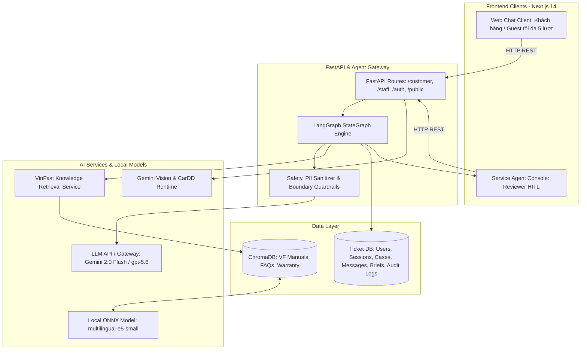

# Architecture Document — VinFast ServiceFlow AI (VFO2O-18)

## 1. System Overview

VinFast ServiceFlow AI là hệ thống AI Agent tổng đài đa kênh (Web Chat thật, cùng mô phỏng Zalo, Email, Hotline call transcript) hỗ trợ tiếp nhận, phân loại 4 nhóm Intent, làm rõ dữ kiện có ngữ cảnh, tra cứu cẩm nang kỹ thuật & chính sách VinFast, tổng hợp **Case Brief** chuẩn hóa và hỗ trợ Reviewer điều phối (routing) chính xác đến bộ phận tiếp nhận tiếp theo.

## 2. Architecture Diagrams & Chi tiết Luồng Hoạt động

Hệ thống được trực quan hóa qua 3 sơ đồ hoạt động chính thức tại thư mục [`docs/architecture/`](docs/architecture/):
1. **[Activity Tổng thể MVP Main (Khách hàng — Hệ thống AI — Staff)](docs/architecture/Activity%20diagram%20system.jpg):** Thể hiện trọn vẹn luồng từ Web Support Hub, phân tích ảnh, LangGraph state machine, gợi ý điểm dịch vụ đến bảng điều khiển Staff Console và vòng đời ticket.
2. **[Sơ đồ Hoạt động Toàn hệ thống (End-to-End System Activity)](docs/architecture/serviceflow-system-activity.png):** 3 làn bơi nghiệp vụ mô tả chi tiết từ xác thực RBAC, Guardrails, duyệt Case Brief đến CSAT / Đóng hồ sơ.
3. **[Sơ đồ Xử lý Một lượt Hội thoại Khách hàng](docs/architecture/serviceflow-customer-activity.png):** Mô tả thứ tự rẽ nhánh xử lý trong một turn chat (`POST /api/v1/customer/chat`).



## 3. Core Components & State Machine (`src/agents/graph.py`)

```mermaid
graph TD
    START([Bắt đầu lượt chat]) --> intake[intake_node: Chuẩn hóa text & context]
    intake --> safety[safety_node: Kiểm tra Hard Safety & Policy]

    safety -->|is_critical HOẶC vi phạm| case_brief[case_brief_node: Tạo Brief tối thiểu & Hotline]
    safety -->|Tín hiệu CarDD ngoại thất mới| cardd[cardd_review_node: Đánh giá hư hại & xác nhận]
    safety -->|Hội thoại thông thường| triage[triage_node: Intent + Priority + Confidence]

    cardd -->|Tiếp tục phân loại| triage
    cardd -->|Hoàn thành phản hồi ảnh| END([Kết thúc lượt])

    triage -->|Out_of_Scope| END
    triage -->|is_general_query| general[general_node: Trả lời xã giao / chào hỏi]
    general --> END

    triage -->|is_rag_query| rag[rag_node: Tra cứu ChromaDB & trích dẫn]
    rag -->|Có nguồn kiểm chứng| END
    rag -->|is_no_source| case_brief

    triage -->|Thiếu dữ kiện sự cố & lượt <= 2| clarify[clarify_node: Hỏi gom 1 câu + Quick Replies]
    clarify -->|Chờ khách bổ sung| END
    clarify -->|Sau 2 lượt vẫn thiếu (Needs Information)| case_brief

    triage -->|Đủ dữ kiện HOẶC Confidence < 0.60| case_brief

    case_brief --> console[Service Agent Console: Hàng đợi duyệt HITL]
    console --> reviewer{Reviewer: Approve / Edit / Reroute}
    reviewer --> dispatch[Điều phối kỹ thuật & Resolve ticket]
    dispatch --> END
```

### 3.1 Intent Router & Specialized Briefs
Hệ thống phân hóa rõ ràng theo 4 nhóm intent, tránh áp đặt luồng kỹ thuật cho mọi yêu cầu:
1. **Bán hàng / Tư vấn xe (Sales):** Tra cứu thông số xe, phiên bản, giá bán, gói pin $\to$ Tạo **Sales Inquiry Brief**.
2. **Sạc & Pin (Charging):** Hướng dẫn sạc, giải đáp chính sách thuê/mua pin, cách xử lý trụ sạc $\to$ Tạo **Charging Support Brief**.
3. **Khiếu nại dịch vụ (Complaint):** Đánh giá mức độ nhạy cảm/bức xúc (Sentiment analysis), ghi nhận phản ánh $\to$ Tạo **Complaint Case Brief** (ưu tiên chuyển người xử lý).
4. **Dịch vụ & Sự cố kỹ thuật (Service/Incident):** Kiểm tra dữ kiện (dòng xe, mã lỗi, tình trạng pin, vị trí), thực hiện Contextual Clarification nếu thiếu, tra cứu cẩm nang kỹ thuật và sinh **Service Brief** chi tiết cho xưởng/cứu hộ.

### 3.2 Human-in-the-Loop (HITL) & Dispatching
- **Agent không tự ý dispatch:** Agent chỉ tạo Case Brief và đề xuất Routing.
- **Reviewer là người quyết định cuối cùng:** Cố vấn dịch vụ / Manager kiểm tra trên **Service Agent Console**, bấm *Approve / Edit / Escalate* rồi mới thực hiện dispatch chính thức đến bộ phận tương ứng.
- **Cảnh báo khẩn cấp:** Với các tình huống nguy hiểm (mất phanh, bốc khói, chết máy trên cao tốc), Agent cung cấp ngay hướng dẫn an toàn tiêu chuẩn và số Hotline cứu hộ chính thức; không tự xác nhận là đã điều xe cứu hộ đến nơi.

### 3.3 Database & Storage Layer
Lưu trữ toàn diện theo chuẩn Data Model (`cases`, `case_briefs`, `staff_audit_log`):
- `source_channel`: `web_chat`, `zalo`, `email`, `hotline_transcript`
- `intent`: `Charging/Battery`, `Service/Incident`, `Sales`, `Complaint`
- `priority`: `LOW`, `MEDIUM`, `HIGH`, `CRITICAL`
- `confidence_score`: Điểm tự tin của LLM trong phân loại/trích xuất (0.0 - 1.0)
- `suggested_action`: Hành động gợi ý cho nhân viên kỹ thuật / CSKH
- `captured_fields`: Dữ liệu trích xuất có cấu trúc (mã lỗi, trụ sạc, SoC,...)
- `reviewer_feedback` (`staff_audit_log`): Ghi nhận thao tác & đánh giá của Staff (phục vụ evaluation)
- `status`: Vòng đời ticket thống nhất: `New` $\to$ `Needs Information` $\to$ `Staff Reviewing` $\to$ `In Progress` $\to$ `Resolved` $\to$ `Closed` (và `Reopened`)

## 4. Guardrails & Safety Thresholds

1. **Safety Trigger:** Ngắt hỏi ngay lập tức, kích hoạt cảnh báo an toàn và cung cấp Hotline 1900-232389 khi phát hiện từ khóa nguy hiểm sinh mạng/an toàn giao thông; tạo Case `CRITICAL` đẩy thẳng lên đầu hàng đợi Staff (`Staff Reviewing`).
2. **Sensitive Complaint Guardrail:** Tự động gắn cờ escalate với các khiếu nại gay gắt hoặc tranh chấp bảo hành/tài chính không chắc chắn.
3. **Confidence Thresholds & HITL Routing (theo Triage & HITL Rules):**
   - **$\ge 0.85$ & Intent = FAQ** (kèm RAG similarity $\ge 0.70$): Tự động trả lời FAQ kèm link nguồn trích dẫn.
   - **$0.60 \le \text{Score} < 0.85$ & Thiếu trường:** Kích hoạt Contextual Clarifier (tối đa 2 lượt kèm Quick Replies); sau 2 lượt vẫn thiếu thì tạo Case trạng thái `Needs Information`.
   - **$\text{Score} < 0.60$ HOẶC thuộc nhóm Sự cố kỹ thuật / Sạc & Pin / Khiếu nại:** Bắt buộc 100% qua Human-in-the-Loop trên Console với trạng thái `Staff Reviewing`.
4. **Out-of-Scope Filter:** Lịch sự từ chối các yêu cầu ngoài phạm vi xe điện và dịch vụ VinFast.
