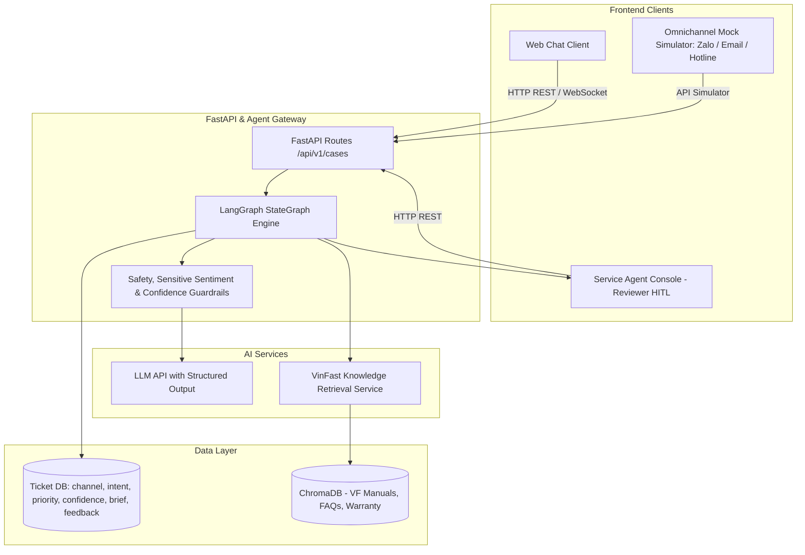
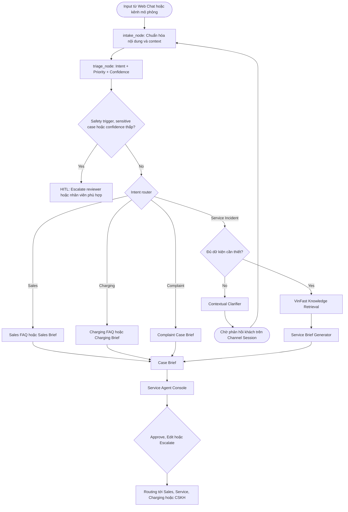

# Architecture Document — VinFast ServiceFlow AI (VFO2O-18)

## 1. System Overview

VinFast ServiceFlow AI là hệ thống AI Agent tổng đài đa kênh (Web Chat thật, cùng mô phỏng Zalo, Email, Hotline call transcript) hỗ trợ tiếp nhận, phân loại 4 nhóm Intent, làm rõ dữ kiện có ngữ cảnh, tra cứu cẩm nang kỹ thuật & chính sách VinFast, tổng hợp **Case Brief** chuẩn hóa và hỗ trợ Reviewer điều phối (routing) chính xác đến bộ phận tiếp nhận tiếp theo.

## 2. Architecture Diagram

## 3. Core Components & Intent Routing

### 3.1 Intent Router & Specialized Briefs
Hệ thống phân hóa rõ ràng theo 4 nhóm intent, tránh áp đặt luồng kỹ thuật cho mọi yêu cầu:
1. **Bán hàng / Tư vấn xe (Sales):** Tra cứu thông số xe, phiên bản, giá bán, gói pin $\to$ Tạo **Sales Inquiry Brief**.
2. **Sạc & Pin (Charging):** Hướng dẫn sạc, giải đáp chính sách thuê/mua pin, cách xử lý trụ sạc $\to$ Tạo **Charging Support Brief**.
3. **Khiếu nại dịch vụ (Complaint):** Đánh giá mức độ nhạy cảm/bức xúc (Sentiment analysis), ghi nhận phản ánh $\to$ Tạo **Complaint Case Brief** (ưu tiên chuyển người xử lý).
4. **Dịch vụ & Sự cố kỹ thuật (Service/Incident):** Kiểm tra dữ kiện (dòng xe, mã lỗi, tình trạng pin, vị trí), thực hiện Contextual Clarification nếu thiếu, tra cứu cẩm nang kỹ thuật và sinh **Service Brief** chi tiết cho xưởng/cứu hộ.

### 3.2 Human-in-the-Loop (HITL) & Dispatching
- **Agent không tự ý dispatch:** Agent chỉ tạo Case Brief và đề xuất Routing.
- **Reviewer là người quyết định cuối cùng:** Cố vấn dịch vụ / Manager kiểm tra trên **Service Agent Console**, bấm *Approve / Edit / Escalate* rồi mới thực hiện dispatch chính thức đến bộ phận tương ứng.
- **Cảnh báo khẩn cấp:** Với các tình huống nguy hiểm (mất phanh, bốc khói, chết máy trên cao tốc), Agent cung cấp ngay hướng dẫn an toàn tiêu chuẩn và số Hotline cứu hộ chính thức; không tự xác nhận là đã điều xe cứu hộ đến nơi.

### 3.3 Database & Storage Layer
Lưu trữ toàn diện trong SQLite/PostgreSQL:
- `source_channel`: `web_chat`, `zalo`, `email`, `hotline_transcript`
- `intent`: `sales`, `charging`, `complaint`, `service_incident`, `out_of_scope`
- `priority`: `low`, `medium`, `high`, `critical`
- `confidence`: Điểm tự tin của LLM trong phân loại/trích xuất
- `suggested_routing`: Bộ phận đề xuất bàn giao
- `brief_data`: Dữ liệu JSON của Case Brief
- `reviewer_feedback`: Ghi nhận chỉnh sửa của Reviewer (phục vụ evaluation)
- `ticket_status`: `OPEN`, `WAITING_USER`, `PENDING_REVIEW`, `ROUTED`, `CLOSED`

## 4. Guardrails & Safety Thresholds

1. **Safety Trigger:** Ngắt hỏi, cấp cứu khẩn cấp khi phát hiện từ khóa nguy hiểm sinh mạng/an toàn giao thông.
2. **Sensitive Complaint Guardrail:** Tự động gắn cờ escalate với các khiếu nại gay gắt hoặc tranh chấp bảo hành/tài chính không chắc chắn.
3. **Low Confidence Escalation:** Nếu confidence score của intent classification hoặc RAG retrieval < 0.75, chuyển sang Reviewer duyệt thủ công.
4. **Out-of-Scope Filter:** Lịch sự từ chối các yêu cầu ngoài phạm vi xe điện và dịch vụ VinFast.
