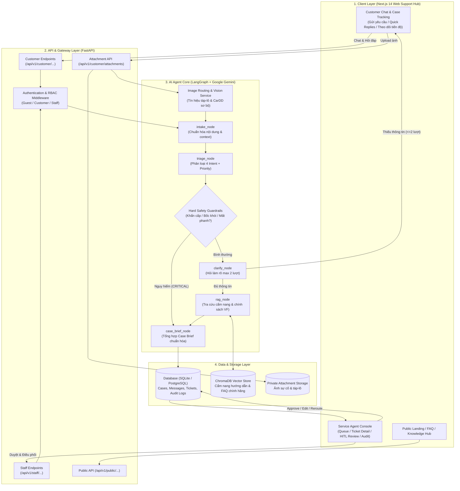

# VFO2O-18 VinFast ServiceFlow AI

> **Web Support Hub** tiếp nhận yêu cầu khách hàng xe điện VinFast, phân loại chính xác 4 nhóm Intent, tự động hỏi làm rõ dữ kiện có ngữ cảnh, tra cứu cẩm nang kỹ thuật & chính sách VinFast qua RAG, tổng hợp **Case Brief** chuẩn hóa và hỗ trợ Reviewer điều phối (Routing) đúng bộ phận dịch vụ.

[](https://fastapi.tiangolo.com)
[](https://nextjs.org/)
[](https://langchain-ai.github.io/langgraph/)
[](https://ai.google.dev/)
[](https://www.trychroma.com/)
[](LICENSE)

---

## 1. Vấn đề (Problem Statement)

### Ai đang gặp vấn đề?
- **Khách hàng xe điện VinFast (VF3, VF5, VF6, VF7, VF8, VF9, VF e34, tài xế Xanh SM/GSM):** Khi gặp sự cố kỹ thuật, trục trặc trụ sạc, hoặc thắc mắc bảo hành, khách hàng thường mô tả qua hội thoại tự do, thiếu các dữ kiện kỹ thuật then chốt (dòng xe, dung lượng pin %, mã lỗi táp-lô, vị trí trạm sạc, ngữ cảnh phát sinh).
- **Nhân viên CSKH & Cố vấn dịch vụ (Service Staff):** Mất nhiều lượt chat/gọi điện hỏi lặp đi lặp lại để lấy đủ thông tin cơ bản; việc bàn giao ca trực hoặc chuyển phiếu sang bộ phận kỹ thuật dễ bị thất lạc hoặc sai lệch dữ liệu.
- **Reviewer / Service Manager:** Thiếu màn hình kiểm soát tập trung để rà soát các trường hợp nhạy cảm, sự cố khẩn cấp (chập cháy, mất phanh, rủi ro an toàn) hoặc các case có độ tự tin phân loại thấp trước khi điều phối thực tế.

### Định vị sản phẩm & Phạm vi MVP
- **Tên triển khai MVP:** *VinFast ServiceFlow AI — Web Support Hub tiếp nhận và chuẩn hóa bàn giao case cho nhân viên dịch vụ.*
- **Định vị chính xác:** Đóng vai trò là **lớp tiếp nhận, chuẩn hóa và điều phối (Intake & Triage Layer)**. 
- **Quy tắc cốt lõi (ADR-001):** Hệ thống **KHÔNG PHẢI là "AI sửa xe" hay "AI tự ra lệnh cứu hộ"**. Việc chẩn đoán chuyên sâu, cứu hộ hiện trường và sửa chữa thực tế do Kỹ thuật viên & Chuyên viên VinFast xử lý. AI là cầu nối tiếp nhận 24/7, sàng lọc an toàn và tổng hợp hồ sơ nghiệp vụ.
- **Kênh tiếp nhận MVP (ADR-004):** Tập trung hoàn thiện **Web Support Hub** phục vụ 3 nhóm vai trò (`Guest`, `Customer`, `Staff`). Mở rộng sang Zalo OA, Hotline hay Voice AI là phạm vi tương lai (Future Scope).

---

## 2. Giải pháp (Solution)

VinFast ServiceFlow AI mang đến quy trình tiếp nhận và xử lý khép kín:

### Feature 1: Web Intake & 4-Intent Triage
- Khách hàng gửi yêu cầu qua giao diện **Web Chat** (hỗ trợ cả văn bản và hình ảnh cảnh báo/ngoại thất xe).
- AI Agent phân loại yêu cầu vào 4 nhóm Intent chuẩn nghiệp vụ:
  1. `Charging/Battery` *(Làm sâu)*: Trục trặc trụ sạc, không nhận súng, sạc ngắt quãng, lỗi giao tiếp pin.
  2. `Service/Incident` *(Làm sâu)*: Cảnh báo đèn táp-lô, rùa vàng, lỗi 12V, điều hòa, sự cố kỹ thuật.
  3. `Sales/General Info` *(Làm tinh gọn)*: Hỏi thông số xe, chính sách pin, hướng dẫn sử dụng tính năng trên app VinFast (tra cứu RAG có nguồn kiểm chứng).
  4. `Complaint/Feedback` *(Làm tinh gọn)*: Tiếp nhận phản ánh thái độ, chậm trễ $\rightarrow$ Thu thập thông tin cốt lõi và chuyển thẳng cho nhân viên.
- Đánh giá mức độ ưu tiên (`Low`, `Medium`, `High`, `Critical`) cùng điểm tự tin (`Confidence Score`).

### Feature 2: Contextual Clarification & RAG Retrieval
- **Làm rõ có ngữ cảnh (Contextual Clarifier):** Với nhánh Dịch vụ & Sạc pin, nếu phát hiện thiếu dữ kiện cốt lõi (dòng xe, mã lỗi, vị trí, tình trạng pin), Agent chủ động hỏi làm rõ **tối đa 2 lượt**, mỗi lượt 1 câu hỏi tập trung kèm các chip trả lời nhanh (**Quick Replies**).
- **Quy tắc an toàn sau 2 lượt (ADR-002):** Nếu sau 2 lượt khách vẫn chưa cung cấp đủ dữ kiện, hệ thống tự động chốt case ở trạng thái `Needs Information` để bàn giao cho nhân viên tiếp quản, không hỏi lặp gây phiền hà.
- **RAG có trích dẫn nguồn công khai:** Tra cứu kho tài liệu cẩm nang kỹ thuật & chính sách VinFast đã kiểm chứng, luôn đính kèm link tài liệu nguồn chính hãng.

### Feature 3: Case Brief & Human-in-the-Loop (HITL) Dispatching
- Agent tổng hợp toàn bộ diễn biến thành **Case Brief** chuẩn hóa: *Vấn đề chính, Thông số xe (Model, Pin %), Mã lỗi/Hiện tượng, Mức độ ưu tiên, Hành động đề xuất*.
- **Reviewer là người quyết định cuối cùng (ADR-005):** Agent không tự ý dispatch. Case Brief được chuyển lên **Service Agent Console** để nhân viên rà soát, Duyệt (`Approve`), Chỉnh sửa (`Edit`), Điều phối lại (`Reroute`), hoặc Đóng (`Close`).
- **An toàn là trên hết (Hard Safety Guardrails):** Khi phát hiện nguy cơ an toàn (chập điện, bốc khói, mất phanh, rùa vàng nghiêm trọng), hệ thống lập tức hiển thị cảnh báo an toàn kèm hotline cứu hộ khẩn cấp 24/7 và tạo case ưu tiên `CRITICAL`.

### Feature 4: Sơ bộ Tín hiệu Hình ảnh (Image Triage & CarDD)
- Khách hàng có thể tải lên ảnh đèn cảnh báo táp-lô, màn hình trụ sạc hoặc ảnh va quẹt ngoại thất xe.
- Hệ thống hỗ trợ định tuyến ảnh tự động (`image_routing`) và nhận diện sơ bộ dấu hiệu cảnh báo táp-lô qua Vision/OCR, hoặc nhận diện vùng hư hỏng thân vỏ qua CarDD.
- **Nguyên tắc an toàn:** Kết quả phân tích ảnh chỉ dùng làm tín hiệu gợi ý ngữ cảnh cho Agent hỏi làm rõ, tuyệt đối không tự kết luận hỏng hóc cơ khí thay thế cho kỹ thuật viên.

---

## 3. Kiến trúc Hệ thống (System Architecture)

Hệ thống được thiết kế theo kiến trúc 4 tầng phân lập rõ ràng (theo `docs/architecture/system-overview.md` và `docs/architecture_diagram.md`):



> ### Sơ đồ Kiến trúc & Luồng Hoạt động Trực quan
> Hệ thống được tài liệu hóa chi tiết qua 3 sơ đồ hoạt động trực quan trong [`docs/architecture/`](docs/architecture/):
> - **[Activity Tổng thể MVP Main (Khách hàng — AI LangGraph — Nhân viên)](docs/architecture/Activity%20diagram%20system.jpg)**
> - **[Sơ đồ Hoạt động Toàn hệ thống (End-to-End System Activity)](docs/architecture/serviceflow-system-activity.png)**
> - **[Sơ đồ Một lượt Hội thoại Khách hàng](docs/architecture/serviceflow-customer-activity.png)**
>
> Cùng các sơ đồ chuẩn hóa kiến trúc SVG:
> - [Sơ đồ Thành phần Hệ thống (Component Diagram)](docs/architecture/serviceflow-component.svg)
> - [Sơ đồ Triển khai (Deployment Diagram)](docs/architecture/serviceflow-deployment.svg)
> - [Sơ đồ Ca sử dụng (Use Case Diagram)](docs/architecture/serviceflow-usecase.svg)
> - [Sơ đồ Trình tự RAG (RAG Sequence Diagram)](docs/architecture/serviceflow-rag-sequence.svg)
> - [Sơ đồ Cơ sở Dữ liệu (Database Schema)](docs/architecture/database-schema.svg)

---

## 4. Công nghệ & Thành phần AI (Tech Stack)

| Lớp | Công nghệ | Chi tiết sử dụng trong dự án |
|---|---|---|
| **AI Agent Orchestration** | LangGraph 0.2 + LangChain 0.3 | Quản lý State Machine: `intake`, `safety`, `cardd_review`, `triage`, `clarify`, `rag`, `general`, `case_brief` |
| **LLM Inference** | Google Gemini (`gemini-2.0-flash`) HOẶC OpenAI Gateway (`gpt-5.6` qua LiteLLM) | Phân loại Intent có cấu trúc (Structured Outputs), tóm tắt Case Brief và đàm thoại. Cấu hình chuyển đổi linh hoạt qua `.env` |
| **Vision & Image Triage** | Google Gemini Vision & CarDD Runtime | Phân tích ảnh đèn táp-lô, màn hình trụ sạc và nhận diện sơ bộ va chạm ngoại thất xe |
| **Vector DB (RAG) & Embeddings** | ChromaDB + ONNX Quantized Model | Chạy offline hoàn toàn với mô hình `Xenova/multilingual-e5-small` nhúng cục bộ qua `onnxruntime` |
| **Backend API** | FastAPI 0.115 + Uvicorn | RESTful API, Pydantic v2 validation, xác thực phân quyền Role-Based (Guest, Customer, Staff) |
| **Database** | SQLite (MVP) / PostgreSQL Ready | SQLAlchemy 2.0 ORM lưu trữ Cases, Messages, Tickets, Attachments, Audit Logs |
| **Frontend Web** | Next.js 14 (App Router) + React 18 | Giao diện Customer Chat Hub, Quick Replies, Responsive UI, Tailwind CSS, Lucide Icons |
| **DevOps & Containers** | Docker & Docker Compose | Đóng gói toàn diện Full-stack (`frontend` port 3000, `backend` port 8000), tự động nạp model AI khi khởi động |

---

## 5. Hướng dẫn Cài đặt & Chạy (Quick Start)

### Yêu cầu tiên quyết
- **Docker & Docker Compose** (khuyến nghị cho chạy nhanh full-stack)
- HOẶC **Python 3.11+**, **Node.js 18+ & npm** (cho phát triển cục bộ từng phần)
- **Git**

### Bước 1: Clone kho mã nguồn
```bash
git clone https://github.com/AI20K-Build-Phase-Cohort-4/P-142.git
cd P-142
```

---

### Cách 1: Khởi chạy nhanh bằng Docker Compose (Khuyến nghị)

Chỉ cần một lệnh duy nhất để build và khởi chạy cả Backend (FastAPI + ChromaDB) và Frontend (Next.js):

```bash
# 1. Tạo file .env từ mẫu (nếu chưa có)
cp .env.example .env

# 2. Khởi chạy toàn bộ hệ thống bằng Docker Compose
docker compose up --build -d
```

> **Ghi chú tự động:** Khi container backend khởi động lần đầu, kịch bản `docker-entrypoint.sh` sẽ tự động kiểm tra và tải mô hình ONNX `multilingual-e5-small` về thư mục `data/models/` nếu chưa có.
> - **Frontend (Web Support Hub):** `http://localhost:3000`
> - **Backend API & Swagger Docs:** `http://localhost:8000/docs`
> - **Kiểm tra trạng thái container:** `docker compose ps`
> - **Xem nhật ký hoạt động:** `docker compose logs -f`

---

### Cách 2: Khởi chạy thủ công từng phần (Dành cho Lập trình viên)

#### 1. Thiết lập Backend (FastAPI + AI Agent)
```bash
# Tạo và kích hoạt môi trường ảo Python
python -m venv .venv
source .venv/bin/activate       # Trên Linux/macOS
# hoặc trên Windows PowerShell:
.venv\Scripts\Activate.ps1

# Cài đặt các thư viện phụ thuộc
pip install -r requirements.txt

# Tải trước mô hình nhúng cục bộ ONNX (bắt buộc cho RAG)
python scripts/download_models.py

# Tạo file cấu hình môi trường
cp .env.example .env
```

Mở file `.env` và chọn phương thức cấu hình LLM phù hợp:
```env
# Tùy chọn A: Sử dụng OpenAI-compatible Gateway / LiteLLM (Khuyến nghị)
OPENAI_BASE_URL=https://litellm.vlearn.dev/v1
OPENAI_API_KEY=your_gateway_key_here
MODEL=openai/gpt-5.6

# Tùy chọn B: Sử dụng trực tiếp Google Gemini API
GOOGLE_API_KEY=your_google_gemini_api_key_here

# Cấu hình chung
DATABASE_URL=sqlite:///./data/app.db
CORS_ORIGINS=http://localhost:3000
```

#### 2. Khởi chạy Backend Server
```bash
uvicorn src.main:app --reload --port 8000
```
- API Backend hoạt động tại: `http://localhost:8000`
- Tài liệu tương tác Swagger UI: `http://localhost:8000/docs`

#### 3. Khởi chạy Frontend (Next.js Web Support Hub)
Mở một cửa sổ dòng lệnh mới:
```bash
cd frontend
npm install
npm run dev
```
- Ứng dụng Web hoạt động tại: `http://localhost:3000`
- Các phân hệ giao diện:
  - **Trang chủ & Tra cứu kiến thức (Public/Guest):** `http://localhost:3000` (chat tối đa 5 lượt)
  - **Khung Chat & Quản lý Case (Customer):** `http://localhost:3000/chat`
  - **Bàn làm việc Cố vấn Dịch vụ (Staff Console):** `http://localhost:3000/staff`

---

## 6. Danh mục API Endpoints Chính

| Phân hệ | Phương thức | Endpoint | Mô tả chức năng |
|---|---|---|---|
| **Hệ thống** | `GET` | `/health` | Kiểm tra tình trạng hoạt động (Health check) |
| **Xác thực** | `POST` | `/api/v1/auth/otp/send` | Gửi mã OTP demo cho số điện thoại khách hàng |
| | `POST` | `/api/v1/auth/otp/verify` | Xác thực OTP và cấp session truy cập |
| **Customer** | `POST` | `/api/v1/customer/sessions` | Khởi tạo phiên trò chuyện mới cho khách hàng |
| | `POST` | `/api/v1/customer/chat` | Gửi tin nhắn đến Agent (tiếp nhận văn bản & xử lý hội thoại) |
| | `POST` | `/api/v1/customer/attachments` | Tải ảnh sự cố táp-lô / thân vỏ lên hệ thống |
| | `GET` | `/api/v1/customer/cases` | Danh sách các case thuộc về khách hàng hiện tại |
| | `GET` | `/api/v1/customer/cases/{id}` | Chi tiết tiến độ, Case Brief và lịch sử chat của case |
| | `POST` | `/api/v1/customer/cases/{id}/confirm` | Khách xác nhận: `Đã được hỗ trợ` hoặc `Vẫn chưa giải quyết` |
| **Staff Console** | `GET` | `/api/v1/staff/dashboard/summary` | Thống kê tổng quan số lượng case theo mức ưu tiên và trạng thái |
| | `GET` | `/api/v1/staff/tickets` | Danh sách hàng đợi ticket cần duyệt hoặc đang xử lý |
| | `GET` | `/api/v1/staff/tickets/{id}` | Chi tiết Case Brief, dữ liệu trích xuất và ảnh đính kèm |
| | `PATCH`| `/api/v1/staff/tickets/{id}/review` | Reviewer thao tác: `Approve`, `Edit`, `Reroute`, `Escalate`, `Close` |
| **Public Hub** | `GET` | `/api/v1/public/articles` | Danh sách bài viết hướng dẫn sử dụng và chính sách công khai |

---

## 7. Cấu trúc Thư mục Dự án

```
P-142/
├── frontend/                       # Web Support Hub (Next.js 14 App Router)
│   ├── src/
│   │   ├── app/                    # Routing pages (/, /chat, /staff)
│   │   └── features/
│   │       ├── auth/               # Xác thực SĐT & OTP demo
│   │       ├── chat/               # Giao diện chat, Quick Prompts, Emergency Banner
│   │       └── staff/              # Service Agent Console, Ticket Queue, Review Modal
│   └── package.json
├── src/                            # Mã nguồn Backend (FastAPI + LangGraph)
│   ├── agents/                     # LangGraph AI Agent Core
│   │   ├── graph.py                # Định nghĩa StateGraph, các edge và router
│   │   ├── state.py                # Schema AgentState (TypedDict)
│   │   ├── guardrails.py           # Bộ lọc an toàn cứng (Hard Safety Rules)
│   │   └── nodes/                  # Các node xử lý: intake, triage, clarify, rag, brief...
│   ├── api/                        # FastAPI Route Controllers
│   │   ├── customer.py             # Customer Chat & Case APIs
│   │   ├── staff.py                # Staff Service Console APIs
│   │   ├── auth.py                 # Xác thực & Phân quyền
│   │   └── public.py               # Public Articles & Knowledge Hub
│   ├── services/                   # Các dịch vụ nền tảng
│   │   ├── rag_service.py          # Tra cứu tài liệu ChromaDB
│   │   ├── dashboard_vision_service.py # Phân tích ảnh táp-lô qua Gemini Vision
│   │   ├── image_routing.py        # Phân loại tự động định tuyến loại ảnh
│   │   └── vision/                 # Module CarDD nhận diện va chạm ngoại thất
│   ├── models/schemas.py           # Pydantic Schemas cho API & Case Brief
│   ├── db.py                       # Cấu hình SQLAlchemy & Session
│   ├── config.py                   # Cấu hình Settings qua Pydantic
│   └── main.py                     # Entry point khởi chạy ứng dụng FastAPI
├── tests/                          # Bộ kiểm thử tự động (pytest)
│   ├── test_agents/                # Unit test Guardrails, Triage, RAG, Clarify
│   └── test_api/                   # Integration test API Customer & Staff
├── docs/                           # Tài liệu kỹ thuật, kiến trúc & thẩm định
│   ├── architecture/               # Toàn bộ sơ đồ kiến trúc chuẩn hóa (SVG & Markdown)
│   ├── decisions/                  # Kiến trúc quyết định (ADR-001 đến ADR-005)
│   ├── product/                    # Phạm vi MVP, User Flows, Kịch bản Demo
│   └── eval_evidences.md           # Báo cáo kiểm thử thực tế Gate 2
├── eval/                           # Dữ liệu benchmark & kết quả đánh giá AI
├── scripts/                        # Script cài đặt hooks ghi log AI và tiện ích
├── requirements.txt                # Thư viện phụ thuộc Python
└── README.md                       # Tài liệu giới thiệu chính thức của dự án
```

---

## 8. Kết quả Thử nghiệm & Đánh giá (Evaluation Evidence)

Theo quy định đánh giá định kỳ của chương trình VinUni AI20K:
- **Báo cáo chi tiết Gate 2:** Được ghi nhận đầy đủ tại [`docs/eval_evidences.md`](docs/eval_evidences.md).
- **Phương pháp thực hiện:** Chạy 5 tình huống thực tế (TC01 đến TC05) qua API backend với dữ liệu thật, không mock phản hồi, kiểm tra toàn bộ luồng tạo case, hỏi làm rõ, kích hoạt an toàn và duyệt điều phối.

| Mã ca | Kịch bản kiểm tra | Intent | Kết quả thực tế | Trạng thái |
| :---: | :--- | :---: | :--- | :---: |
| **TC01** | Báo lỗi sạc trụ P01, nhân viên duyệt, khách theo dõi | `Charging/Battery` | Luồng bàn giao và cập nhật tiến độ chạy tốt; ghi nhận lỗi chuẩn hóa tên địa điểm | Cần tinh chỉnh |
| **TC02** | Khách thiếu thông tin sau 2 lượt hỏi | `Charging/Battery` | Dừng hỏi đúng 2 lượt, tạo case `Needs Information` theo đúng ADR-002 | Cần tinh chỉnh |
| **TC03** | Khách báo xe có mùi khét / nguy cơ bốc khói | `Service/Incident` | Kích hoạt cảnh báo khẩn cấp `CRITICAL` lập tức, gửi số Hotline cứu hộ | Cần tinh chỉnh |
| **TC04** | Khách gửi khiếu nại thái độ dịch vụ | `Complaint/Feedback` | Tiếp nhận phản ánh, trích xuất brief và chuyển thẳng cho nhân viên | **ĐẠT (PASS)** |
| **TC05** | Tra cứu cẩm nang bảo hành & giải thích đèn cảnh báo | `Sales/General Info` | RAG trích dẫn chính xác link tài liệu chính hãng của VinFast | **ĐẠT (PASS)** |

---

## 9. Danh mục 10 Deliverables (AI20K Build Phase)

| # | Deliverable | Vị trí lưu trữ | Trạng thái |
|---|---|---|:---:|
| 1 | **Source code** | Thư mục `src/` và `frontend/` | Hoàn thành |
| 2 | **README.md** | [`/README.md`](README.md) | Hoàn thành |
| 3 | **Architecture Diagram** | [`docs/architecture_diagram.md`](docs/architecture_diagram.md) & [`docs/architecture/`](docs/architecture/) | Hoàn thành (7 sơ đồ SVG) |
| 4 | **AI Logs** | Ghi nhận tự động qua hooks đẩy lên hệ thống chấm | Đang hoạt động |
| 5 | **Live URL / Deploy** | Cấu hình triển khai Web & API | Đang triển khai |
| 6 | **Video Demo** | `presentation/video_demo.md` | Đang hoàn thiện |
| 7 | **Pitch Deck** | `presentation/` | Đang hoàn thiện |
| 8 | **Weekly Journal** | [`/JOURNAL.md`](JOURNAL.md) | Cập nhật định kỳ |
| 9 | **Worklog** | [`/WORKLOG.md`](WORKLOG.md) | Cập nhật định kỳ |
| 10 | **Evaluation Evidence** | [`docs/eval_evidences.md`](docs/eval_evidences.md) & thư mục `eval/` | Hoàn thành Gate 2 |

---

## 10. Đội ngũ Phát triển (Team VFO2O-18)

| Thành viên | Vai trò chính | Mã học viên | Trách nhiệm chính |
|---|---|---|---|
| **Ngô Thế Việt** | Project Manager, Product Lead, Frontend Engineer | `2A202602594` | Quản lý tiến độ, thiết kế UX/UI, hiện thực giao diện Web Support Hub & Staff Console |
| **Bùi Đăng Khôi** | AI Engineer, Data & Benchmark | `2A202602434` | Thu thập dữ liệu, xây dựng bộ benchmark kiểm thử và đánh giá độ chính xác mô hình |
| **Đức Long** | AI Engineer, Workflow & RAG | `2A202602633` | Hiện thực LangGraph Agent, Hard Safety Guardrails, ChromaDB RAG & Vision Triage |
| **Trọng Triển** | Backend Engineer, Database & APIs | `2A202602837` | Xây dựng kiến trúc API FastAPI, Database ORM, xác thực phân quyền và nghiệp vụ Case |

---

## 11. Giấy phép (License)

Dự án được phân phối dưới giấy phép mã nguồn mở [MIT License](LICENSE).
