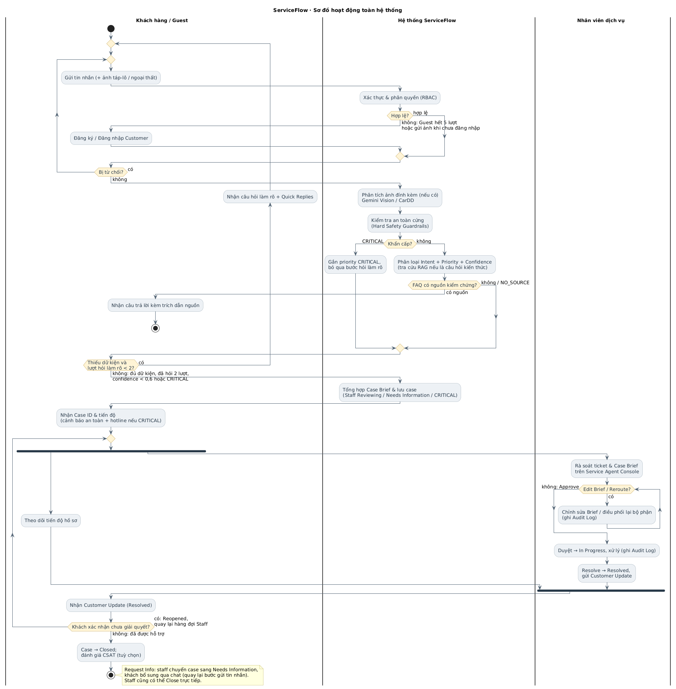
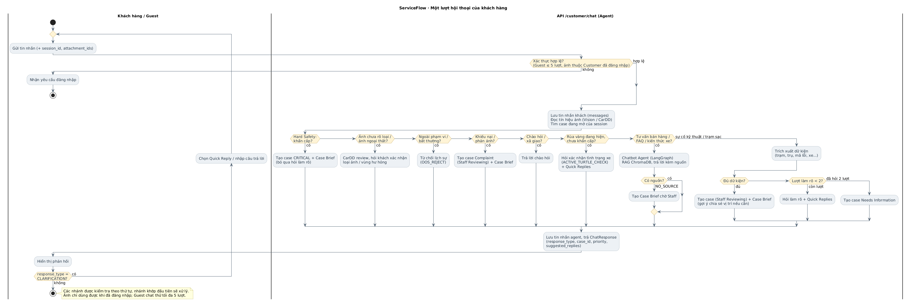

# VFO2O-18 VinFast ServiceFlow AI
 
> **Link web demo:** https://vfserv-ai.vercel.app/ (Use for test) 

> **Web Support Hub - VFServ** là Web tiếp nhận yêu cầu của khách hàng dùng xe ô tô điện VinFast, hỗ trợ khách hàng giải đáp các thắc mắc thường gặp (thông tin xe, hướng dẫn sử dụng, chính sách bảo hành, sạc pin, các vấn đề kỹ thuật). Đồng thời, VFServ có thể phân loại chính xác 4 nhóm Intent(đã được nhóm nghiên cứu ideas và pain point), tự động hỏi làm rõ dữ kiện có ngữ cảnh, tra cứu cẩm nang kỹ thuật & chính sách VinFast qua RAG, tổng hợp **Case Brief** chuẩn hóa và hỗ trợ Staff điều phối (Routing) đúng bộ phận dịch vụ.

[](https://fastapi.tiangolo.com)
[](https://nextjs.org/)
[](https://langchain-ai.github.io/langgraph/)
[](https://docs.litellm.ai/)
[](https://www.trychroma.com/)
[](LICENSE)

---

## 1. Vấn đề (Problem Statement)

### Ai đang gặp vấn đề?
- **Khách hàng xe điện VinFast (VF3, VF5, VF6, VF7, VF8, VF9, VF e34, tài xế Xanh SM/GSM):** Khi gặp sự cố kỹ thuật, trục trặc trụ sạc hoặc thắc mắc bảo hành, khách hàng thường mô tả qua hội thoại tự do, hoặc có thể qua ít nhất là 2 kênh để được yêu cầu hỗ trợ, bên cạnh đó còn thiếu các dữ kiện kỹ thuật then chốt (dòng xe, dung lượng pin %, mã lỗi táp-lô, vị trí trạm sạc, ngữ cảnh phát sinh), nhân viên chưa thể xác định được chính xác
- **Nhân viên CSKH & Cố vấn dịch vụ (Service Staff):** Mất nhiều lượt chat/gọi điện hỏi lặp đi lặp lại để lấy đủ thông tin cơ bản; việc bàn giao ca trực hoặc chuyển phiếu sang bộ phận kỹ thuật dễ bị thất lạc hoặc sai lệch dữ liệu.
- **Reviewer / Service Manager:** Thiếu màn hình kiểm soát tập trung để rà soát các trường hợp nhạy cảm, sự cố khẩn cấp (chập cháy, mất phanh, rủi ro an toàn) hoặc các case có độ tự tin phân loại thấp trước khi điều phối thực tế.

### Định vị sản phẩm & Phạm vi MVP
- **Tên triển khai MVP:** *VinFast ServiceFlow AI — Web Support Hub tiếp nhận và chuẩn hóa bàn giao case cho nhân viên dịch vụ.*
- **Định vị chính xác:** Đóng vai trò là **lớp tiếp nhận, chuẩn hóa và điều phối (Intake & Triage Layer)**. 
- **Quy tắc cốt lõi (ADR-001):** Hệ thống **KHÔNG PHẢI là "AI sửa xe" hay "AI tự ra lệnh cứu hộ"**. Việc chẩn đoán chuyên sâu, cứu hộ hiện trường và sửa chữa thực tế do Kỹ thuật viên & Chuyên viên VinFast xử lý. AI là cầu nối tiếp nhận 24/7, sàng lọc an toàn và tổng hợp hồ sơ nghiệp vụ.
- **Kênh tiếp nhận MVP (ADR-004):** Tập trung hoàn thiện **Web Support Hub** phục vụ 3 nhóm vai trò (`Guest`, `Customer`, `Staff`). Mở rộng sang Zalo OA, Hotline hay Voice AI là phạm vi tương lai (Future Scope).

---

## 2. Giải pháp (Solution)

VFServ mang đến quy trình tiếp nhận và xử lý khép kín:

### Feature 1: Web Intake & 4-Intent Triage
- Khách hàng gửi yêu cầu qua giao diện **Web Chat** (hỗ trợ cả văn bản và hình ảnh cảnh báo/ngoại thất xe).
- AI Agent phân loại yêu cầu vào 4 nhóm Intent chuẩn nghiệp vụ:
  1. `Charging/Battery` *(Làm sâu)*: Trục trặc trụ sạc, không nhận súng, sạc ngắt quãng, lỗi giao tiếp pin.
  2. `Service/Incident` *(Làm sâu)*: Cảnh báo đèn táp-lô, rùa vàng, lỗi 12V, điều hòa, sự cố kỹ thuật.
  3. `Sales/General Info` *(Làm tinh gọn)*: Hỏi thông số xe, chính sách pin, hướng dẫn sử dụng tính năng trên app VinFast (tra cứu RAG có nguồn kiểm chứng).
  4. `Complaint/Feedback` *(Làm tinh gọn)*: Tiếp nhận phản ánh thái độ, chậm trễ $\rightarrow$ Thu thập thông tin cốt lõi và chuyển thẳng cho nhân viên.
- Đánh giá mức độ ưu tiên (`Low`, `Medium`, `High`, `Critical`) cùng điểm tự tin (`Confidence Score`).

### Feature 2: Contextual Clarification & RAG Retrieval
- **Làm rõ có ngữ cảnh (Contextual Clarifier):** Với nhánh Dịch vụ & Sạc pin, nếu phát hiện thiếu dữ kiện cốt lõi (dòng xe, mã lỗi, vị trí, tình trạng pin), Agent chủ động hỏi làm rõ **tối đa 2 lượt**, mỗi lượt 1 câu hỏi tập trung kèm các chip trả lời nhanh (**Quick Replies**).
- **Quy tắc an toàn sau 2 lượt (ADR-002):** Nếu sau 2 lượt khách vẫn chưa cung cấp đủ dữ kiện, hệ thống tự động chốt case ở trạng thái `Needs Information` để bàn giao cho nhân viên tiếp quản, không hỏi lặp gây phiền hà.
- **RAG có trích dẫn nguồn công khai:** Tra cứu kho tài liệu cẩm nang kỹ thuật & chính sách VinFast đã kiểm chứng, luôn đính kèm link tài liệu nguồn chính hãng.

### Feature 3: Case Brief & Human-in-the-Loop (HITL) Dispatching
- Agent tổng hợp toàn bộ diễn biến thành **Case Brief** chuẩn hóa: *Vấn đề chính, Thông số xe (Model, Pin %), Mã lỗi/Hiện tượng, Mức độ ưu tiên, Hành động đề xuất*.
- **Reviewer là người quyết định cuối cùng (ADR-005):** Agent không tự ý dispatch. Case Brief được chuyển lên **Service Agent Console** để nhân viên rà soát, Duyệt (`Approve`), Chỉnh sửa (`Edit`), Điều phối lại (`Reroute`), Yêu cầu bổ sung (`Request Info`), Giải quyết (`Resolve`), Đóng (`Close`) hoặc Mở lại (`Reopen`).
- **Xác nhận, CSAT & tự động đóng sau 72h:** Sau khi nhân viên `Resolve`, khách xác nhận `Đã được hỗ trợ` $\rightarrow$ `Closed` kèm đánh giá CSAT 1–5 sao (1–2 sao có thể chọn tag lý do), hoặc báo `Vẫn chưa giải quyết` $\rightarrow$ `Reopened` và quay lại hàng đợi Staff. Case `Resolved` mà khách không phản hồi quá 72 giờ được job nền tự động đóng và ghi vết `[SYSTEM AUTO-CLOSE]` trong audit log.
- **An toàn là trên hết (Hard Safety Guardrails):** Khi phát hiện nguy cơ an toàn (chập điện, bốc khói, mất phanh, rùa vàng nghiêm trọng), hệ thống lập tức hiển thị cảnh báo an toàn kèm hotline cứu hộ khẩn cấp 24/7 và tạo case ưu tiên `CRITICAL`.

### Feature 4: Sơ bộ Tín hiệu Hình ảnh (Image Triage & CarDD)
- Khách hàng có thể tải lên ảnh đèn cảnh báo táp-lô, màn hình trụ sạc hoặc ảnh va quẹt ngoại thất xe.
- Hệ thống hỗ trợ định tuyến ảnh tự động (`image_routing`) và nhận diện sơ bộ dấu hiệu cảnh báo táp-lô qua Vision/OCR, hoặc nhận diện vùng hư hỏng thân vỏ qua CarDD.
- **Nguyên tắc an toàn:** Kết quả phân tích ảnh chỉ dùng làm tín hiệu gợi ý ngữ cảnh cho Agent hỏi làm rõ, tuyệt đối không tự kết luận hỏng hóc cơ khí thay thế cho kỹ thuật viên.

---

## 3. Kiến trúc Hệ thống (System Architecture)

Hệ thống được thiết kế theo kiến trúc phân tầng khép kín giữa **Web Support Hub (Next.js 14 Frontend)**, **FastAPI Gateway (RBAC, Storage & Session)**, và **AI Agent Core (LangGraph StateGraph, LLM Gateway `openai/gpt-5.6` qua LiteLLM, CarDD & Local RAG)**:

### 1. Sơ đồ Hoạt động Toàn hệ thống (End-to-End System Activity)
Mô tả quy trình nghiệp vụ 3 làn bơi xuyên suốt từ Khách hàng $\to$ Hệ thống ServiceFlow $\to$ Nhân viên dịch vụ (HITL Review, Điều phối & Đóng hồ sơ):



---

### 2. Sơ đồ Pipeline AI & LangGraph State Machine (MVP Main)
Trực quan hóa chi tiết luồng xử lý của AI Agent qua 8 node nghiệp vụ (`intake`, `safety`, `cardd_review`, `triage`, `clarify`, `rag`, `general`, `case_brief`):


---

### 3. Sơ đồ Xử lý Một lượt Hội thoại Khách hàng (Customer Chat Turn Activity)
Mô tả thứ tự rẽ nhánh theo chuỗi điều kiện cascade độc lập khi nhận một request chat qua `/api/v1/customer/chat`:



---

> **Các sơ đồ kiến trúc hệ thống bổ sung:**
> - [Sơ đồ Thành phần Hệ thống (Component Diagram)](docs\architecture\serviceflow-component.jpg)
> - [Sơ đồ Triển khai (Deployment Diagram)](docs/architecture/serviceflow-deployment.svg)
> - [Sơ đồ Ca sử dụng (Use Case Diagram)](docs/architecture/serviceflow-usecase.jpg)
> - [Sơ đồ Trình tự (Sequence Diagram)](docs/architecture/sequence-diagram.jpg)
> - [Sơ đồ Cơ sở Dữ liệu (Database Schema)](docs/architecture/database-schema.svg)
> - [ER Diagram – Main Application Database (app.db)](docs/architecture/ER-diagram-appdb.jpg)
> - [ER Diagram – Agent Session Database (agent.db)](docs/architecture/ER-diagram-agentdb.jpg)
---

## 4. Công nghệ & Thành phần AI (Tech Stack)

| Lớp | Công nghệ | Chi tiết sử dụng trong dự án |
|---|---|---|
| **AI Agent Orchestration** | LangGraph 0.2 + LangChain 0.3 | Quản lý State Machine: `intake`, `safety`, `cardd_review`, `triage`, `clarify`, `rag`, `general`, `case_brief` |
| **LLM Inference** | OpenAI-compatible Gateway (`openai/gpt-5.6` qua LiteLLM, mặc định trong `src/config.py`); tùy chọn Google Gemini trực tiếp | Phân loại Intent có cấu trúc (Structured Outputs), tóm tắt Case Brief và đàm thoại. Cấu hình qua `.env` (`OPENAI_BASE_URL`, `OPENAI_API_KEY`, `MODEL_NAME`/`MODEL`) |
| **Vision & Image Triage** | Vision model `gpt-6-luna` (`VISION_PROVIDER=openai`, mặc định) hoặc Gemini (`gemini-3.5-flash` cho Dashboard Vision); CarDD Runtime (mặc định tắt, bật bằng `CARDD_ENABLED=true`) | Phân tích ảnh đèn táp-lô, màn hình trụ sạc và nhận diện sơ bộ va chạm ngoại thất xe |
| **Vector DB (RAG) & Embeddings** | ChromaDB + ONNX Quantized Model | Chạy offline hoàn toàn với mô hình `Xenova/multilingual-e5-small` nhúng cục bộ qua `onnxruntime` |
| **Backend API** | FastAPI 0.115 + Uvicorn | RESTful API, Pydantic v2 validation, xác thực JWT và phân quyền Role-Based (Guest, Customer, Staff), job nền `case_lifecycle` tự đóng case `Resolved` quá 72h |
| **Database** | SQLite (MVP) / PostgreSQL Ready | SQLAlchemy 2.0 ORM lưu trữ Cases, Messages, Tickets, Attachments, Audit Logs |
| **Frontend Web** | Next.js 14 (App Router) + React 18 | Giao diện Customer Chat Hub, Quick Replies, Responsive UI, Tailwind CSS, Lucide Icons |
| **DevOps & Containers** | Docker & Docker Compose | Đóng gói toàn diện Full-stack (`frontend` port 3000, `backend` port 8000), tự động nạp model AI khi khởi động |

---

## 5. Hướng dẫn Cài đặt & Chạy (Quick Start)

### Yêu cầu tiên quyết
- **Docker & Docker Compose** (khuyến nghị cho chạy nhanh full-stack)
- HOẶC **Python 3.11+**, **Node.js 18+ & npm** (cho phát triển cục bộ từng phần)
- **Git**

### Bước 1: Clone kho mã nguồn
```bash
git clone https://github.com/AI20K-Build-Phase-Cohort-4/P-142.git
cd P-142
```

---

### Cách 1: Khởi chạy nhanh bằng Docker Compose (Khuyến nghị)

Chỉ cần một lệnh duy nhất để build và khởi chạy cả Backend (FastAPI + ChromaDB) và Frontend (Next.js):

```bash
# 1. Tạo file .env từ mẫu (nếu chưa có)
cp .env.example .env

# 2. Khởi chạy toàn bộ hệ thống bằng Docker Compose
docker compose up --build -d
```

> **Ghi chú tự động:** Khi container backend khởi động lần đầu, kịch bản `scripts/docker-entrypoint.sh` (gọi `scripts/download_models.py`) sẽ tự động kiểm tra và tải mô hình ONNX `multilingual-e5-small` về thư mục `data/models/` nếu chưa có.
> - **Frontend (Web Support Hub):** `http://localhost:3000`
> - **Backend API & Swagger Docs:** `http://localhost:8000/docs`
> - **Kiểm tra trạng thái container:** `docker compose ps`
> - **Xem nhật ký hoạt động:** `docker compose logs -f`

---

### Cách 2: Khởi chạy thủ công từng phần (Dành cho Lập trình viên)

#### 1. Thiết lập Backend (FastAPI + AI Agent)
```bash
# Tạo và kích hoạt môi trường ảo Python
python -m venv .venv
source .venv/bin/activate       # Trên Linux/macOS
# hoặc trên Windows PowerShell:
.venv\Scripts\Activate.ps1

# Cài đặt các thư viện phụ thuộc
pip install -r requirements.txt

# Tải trước mô hình nhúng cục bộ ONNX (bắt buộc cho RAG)
python scripts/download_models.py

# Tạo file cấu hình môi trường
cp .env.example .env
```

Mở file `.env` và chọn phương thức cấu hình LLM phù hợp:
```env
# Tùy chọn A: OpenAI-compatible Gateway / LiteLLM (Khuyến nghị, là mặc định trong src/config.py)
OPENAI_BASE_URL=your_base_url_openai
OPENAI_API_KEY=your_gateway_key_here
MODEL_NAME=openai/gpt-5.6        # hoặc dùng MODEL=...; nếu đặt MODEL thì MODEL ghi đè MODEL_NAME
VISION_PROVIDER=openai
VISION_MODEL=gpt-6-luna

# Tùy chọn B: Sử dụng trực tiếp Google Gemini API (phải để TRỐNG OPENAI_API_KEY)
GOOGLE_API_KEY=your_google_gemini_api_key_here
MODEL_NAME=gemini-2.5-flash
VISION_PROVIDER=google
DASHBOARD_VISION_MODEL=gemini-3.5-flash

# Cấu hình chung
DATABASE_URL=sqlite:///./data/app.db
CORS_ORIGINS=http://localhost:3000
AUTH_SECRET_KEY=                 # bắt buộc khi APP_ENV=production, tối thiểu 32 ký tự ngẫu nhiên
```

> **Lưu ý:** Backend chỉ dùng Gemini trực tiếp khi tên model chứa `gemini` **và** API key bắt đầu bằng `AIza`. Key được lấy theo thứ tự `OPENAI_API_KEY` rồi `GOOGLE_API_KEY`, nên nếu `OPENAI_API_KEY` còn giá trị mẫu (`sk-...`) thì request vẫn đi qua OpenAI client.

Chuẩn hóa tin nhắn không dấu/viết tắt dùng cấu hình riêng, không đổi model trả lời chính:

```env
NORMALIZATION_MODEL=gemini-2.5-flash-lite
NORMALIZATION_TIMEOUT_S=3
GOOGLE_API_KEY=your_google_gemini_api_key_here
```

Bước chuẩn hóa ưu tiên khóa Google trực tiếp (kể cả khi model chính dùng OpenAI); hoặc dùng `OPENAI_API_KEY` và `OPENAI_BASE_URL` của gateway có hỗ trợ model Gemini này. Khi thiếu cấu hình, hết thời gian hoặc model lỗi, hệ thống giữ chuẩn hóa bằng luật và hỏi lại từ mơ hồ. Không gửi tên model Gemini đến endpoint OpenAI trực tiếp.

Câu rõ nghĩa và sự cố khẩn cấp đã xác định không gọi model chuẩn hóa. Câu cần ngữ cảnh có tối đa một lần gọi, giới hạn 256 output token, tắt thinking khi dùng Google trực tiếp, không retry và dùng chung deadline của lượt chat. Một lượt vẫn có thể gọi model trả lời chính theo giới hạn cũ. Lịch sử giữ tin nhắn gốc sau khi ẩn PII; các mở rộng từ làm thay đổi mã lỗi, số liệu hoặc suy diễn sự cố bị từ chối. Ví dụ: `phanh ko an` nhận cảnh báo mất phanh; `ko co khoi` không báo cháy; `bh pin VF8` được diễn giải theo ngữ cảnh hoặc hỏi lại. `xe chay` được hỏi rõ là chạy hay cháy.

Kiểm thử riêng: `python -m pytest tests/test_services/test_chat_normalization.py tests/test_api/test_chat_normalization.py -q`.

#### 1b. Tạo tài khoản Staff
Khách hàng tự đăng ký tại `/register`. Tài khoản Staff không đăng ký công khai, tạo bằng một trong hai cách:
```bash
# Triển khai thật: tạo 1 tài khoản Staff, mật khẩu nhập tương tác (lưu dạng hash Argon2id)
python -m src.create_staff staff@example.com

# Chỉ môi trường dev/test: tạo tài khoản Staff mặc định và các ca mẫu (--reset xóa sạch DB trước khi seed)
python -m src.seed [--reset]
```
Với Docker: `docker compose exec backend python -m src.create_staff staff@example.com`.

#### 2. Khởi chạy Backend Server
```bash
uvicorn src.main:app --reload --port 8000
```
- API Backend hoạt động tại: `http://localhost:8000`
- Tài liệu tương tác Swagger UI: `http://localhost:8000/docs`

#### 3. Khởi chạy Frontend (Next.js Web Support Hub)
Mở một cửa sổ dòng lệnh mới:
```bash
cd frontend
npm install
npm run dev
```
- Ứng dụng Web hoạt động tại: `http://localhost:3000`
- Các phân hệ giao diện:
  - **Trang chủ & Tra cứu kiến thức (Public/Guest):** `http://localhost:3000` (chat tối đa 5 lượt)
  - **Đăng nhập / Đăng ký:** `http://localhost:3000/login`, `http://localhost:3000/register`
  - **Khung Chat (Customer):** `http://localhost:3000/chat`
  - **Theo dõi hồ sơ, xác nhận kết quả, mở lại, đánh giá CSAT (Customer):** `http://localhost:3000/track-case`
  - **Bàn làm việc Cố vấn Dịch vụ (Staff Console):** `http://localhost:3000/console`

---

## 6. Danh mục API Endpoints Chính

> Base URL `/api/v1` (trừ `/health`). Danh sách đầy đủ kèm schema xem Swagger tại `http://localhost:8000/docs`; đặc tả chi tiết tại [`docs/architecture/api-contract.md`](docs/architecture/api-contract.md).

| Phân hệ | Phương thức | Endpoint | Mô tả chức năng |
|---|---|---|---|
| **Hệ thống** | `GET` | `/health` | Kiểm tra tình trạng hoạt động (Health check) |
| | `GET` | `/api/v1/status` | Trạng thái AI Agent & Knowledge Base (frontend hiển thị ở khung chat) |
| **Xác thực** | `POST` | `/api/v1/auth/register` | Đăng ký tài khoản Customer (username + mật khẩu), trả JWT |
| | `POST` | `/api/v1/auth/login` | Đăng nhập (Customer hoặc Staff), trả JWT |
| | `GET` / `PATCH` | `/api/v1/auth/me` | Xem / cập nhật hồ sơ người dùng hiện tại |
| **Public Hub** | `GET` | `/api/v1/public/articles` | Bài viết hướng dẫn sử dụng và chính sách công khai |
| | `GET` | `/api/v1/public/support-insights` | Tình huống thường gặp đã biên soạn, ẩn danh |
| **Customer** | `POST` | `/api/v1/customer/chat` | Gửi tin nhắn đến Agent (Guest tối đa 5 lượt, Customer đã đăng nhập) |
| | `POST` | `/api/v1/customer/attachments` | Tải ảnh táp-lô / thân vỏ lên hệ thống |
| | `POST` | `/api/v1/customer/location` | Gửi vị trí (consent hoặc tự nhập) cho case |
| | `GET` | `/api/v1/customer/cases` | Danh sách case của khách (lọc `query`, `status`) |
| | `GET` | `/api/v1/customer/cases/{id}` | Chi tiết case: Case Brief, timeline cập nhật, ảnh, lịch sử chat |
| | `GET` | `/api/v1/customer/cases/{id}/status` | Trạng thái hiện tại và thông điệp cho khách |
| | `GET` | `/api/v1/customer/cases/{id}/service-points` | Điểm dịch vụ / trạm sạc gợi ý theo vị trí |
| | `POST` | `/api/v1/customer/cases/{id}/confirmation` | Xác nhận `RESOLVED_CONFIRMED` (`Closed`) hoặc `STILL_UNRESOLVED` (`Reopened`) |
| | `POST` | `/api/v1/customer/cases/{id}/actions` | Hành động của khách: `CONFIRM_RESOLUTION` hoặc `REOPEN` (hỗ trợ cả Guest qua header `X-Session-Id`) |
| | `POST` | `/api/v1/customer/cases/{id}/reopen` | Mở lại case đang `Resolved` / `Closed` |
| | `POST` | `/api/v1/customer/cases/{id}/feedback` | Gửi / cập nhật đánh giá CSAT 1–5 sao (case `Resolved`/`Closed`) |
| | `POST` | `/api/v1/customer/cases/{id}/safety-acknowledgement` | Khách xác nhận đã ở vị trí an toàn (case khẩn cấp đang mở) |
| | `GET` | `/api/v1/customer/sessions/{session_id}/history` | Lịch sử hội thoại của một phiên chat |
| **Staff Console** | `GET` | `/api/v1/staff/dashboard` | Thống kê số lượng case theo mức ưu tiên và trạng thái |
| | `GET` | `/api/v1/staff/routing-directory` | Danh sách bộ phận tiếp nhận để điều phối |
| | `GET` | `/api/v1/staff/tickets` | Hàng đợi ticket (lọc `status`, `priority`) |
| | `GET` | `/api/v1/staff/tickets/{id}` | Chi tiết Case Brief, dữ liệu trích xuất, ảnh, CSAT, vị trí |
| | `POST` | `/api/v1/staff/tickets/{id}/actions` | Reviewer thao tác: `APPROVE`, `EDIT_BRIEF`, `REROUTE`, `REQUEST_INFO`, `RESOLVE`, `CLOSE`, `REOPEN` |

> Ngoài các route trên, backend còn có `POST /api/v1/chat`, `POST /api/v1/public/chat`, nhóm `/api/v1/agent/*` và `/api/v1/cases` (tag `cases-legacy`). Đây là các route tương thích, không thuộc luồng chính của frontend (trừ `/status`) nên không liệt kê ở đây.

---

## 7. Cấu trúc Thư mục Dự án

```
P-142/
├── frontend/                       # Web Support Hub (Next.js 14 App Router)
│   ├── src/
│   │   ├── app/                    # Routing pages (/, /login, /register, /chat, /track-case, /console)
│   │   └── features/
│   │       ├── landing/            # Landing page, điểm vào Guest chat
│   │       ├── chat/               # Giao diện chat, Quick Replies, Emergency Banner
│   │       ├── console/            # Service Agent Console, Ticket Queue, Ticket Detail Panel
│   │       └── shared/             # AuthContext, UserProfileModal, component dùng chung
│   └── package.json
├── src/                            # Mã nguồn Backend (FastAPI + LangGraph)
│   ├── agents/                     # LangGraph AI Agent Core
│   │   ├── graph.py                # Định nghĩa StateGraph, các edge và router
│   │   ├── state.py                # Schema AgentState (TypedDict)
│   │   ├── guardrails.py           # Bộ lọc an toàn cứng (Hard Safety Rules)
│   │   └── nodes/                  # Các node xử lý: intake, triage, clarify, rag, brief...
│   ├── api/                        # FastAPI Route Controllers
│   │   ├── customer.py             # Customer Chat & Case APIs
│   │   ├── staff.py                # Staff Service Console APIs
│   │   ├── auth.py                 # Đăng nhập, đăng ký, hồ sơ người dùng (JWT)
│   │   ├── routes.py               # /chat, /public/chat, /status (chat tương thích)
│   │   └── public.py               # Public Articles & Knowledge Hub
│   ├── services/                   # Các dịch vụ nền tảng
│   │   ├── rag_service.py          # Tra cứu tài liệu ChromaDB
│   │   ├── case_lifecycle.py       # Job nền tự động đóng case Resolved quá 72h
│   │   ├── dashboard_vision_service.py # Phân tích ảnh táp-lô qua Gemini Vision
│   │   ├── image_routing.py        # Phân loại tự động định tuyến loại ảnh
│   │   └── vision/                 # Module CarDD nhận diện va chạm ngoại thất
│   ├── models/                     # db_models.py (SQLAlchemy) & schemas.py (Pydantic API / Case Brief)
│   ├── db.py                       # Cấu hình SQLAlchemy & Session
│   ├── config.py                   # Cấu hình Settings qua Pydantic
│   ├── seed.py / create_staff.py   # Seed dữ liệu dev; tạo tài khoản Staff
│   └── main.py                     # Entry point FastAPI, khởi động job auto-close
├── tests/                          # Bộ kiểm thử tự động (pytest)
│   ├── test_agents/                # Unit test Guardrails, Triage, RAG, Clarify
│   ├── test_api/                   # Integration test API Customer & Staff
│   └── test_eval/                  # Test bộ benchmark, chất lượng RAG
├── docs/                           # Tài liệu kỹ thuật, kiến trúc & thẩm định
│   ├── architecture/               # Toàn bộ sơ đồ kiến trúc chuẩn hóa (SVG & Markdown)
│   ├── decisions/                  # Kiến trúc quyết định (ADR-001 đến ADR-006)
│   ├── product/                    # Phạm vi MVP, User Flows, Kịch bản Demo
│   └── eval_evidences.md           # Báo cáo kiểm thử thực tế Gate 2
├── eval/                           # Dữ liệu benchmark & kết quả đánh giá AI
├── scripts/                        # Script cài đặt hooks ghi log AI và tiện ích
├── requirements.txt                # Thư viện phụ thuộc Python
└── README.md                       # Tài liệu giới thiệu chính thức của dự án
```

---

## 8. Kết quả Thử nghiệm & Đánh giá (Evaluation Evidence)

Theo quy định đánh giá của chương trình, nhóm đã thực hiện kiểm thử E2E trên hệ thống thực tế:
- **Báo cáo chi tiết Gate 2:** Được ghi nhận đầy đủ tại [`docs/eval_evidences.md`](docs/eval_evidences.md).
- **Phương pháp thực hiện:** Chạy 10 kịch bản kiểm thử thực tế (`TC01` đến `TC10`) qua API backend với cơ sở dữ liệu thật, không mock phản hồi, kiểm tra toàn bộ luồng chào hỏi, giải thích kiến thức, tra cứu RAG, tiếp nhận khiếu nại, hỏi làm rõ tối đa 2 lượt, cập nhật ngữ cảnh, kích hoạt an toàn khẩn cấp, phân quyền RBAC và khép kín vòng đời xử lý của Staff.

| Mã ca | Kịch bản kiểm tra | Intent / Phạm vi | Kết quả thực tế | Trạng thái |
| :---: | :--- | :---: | :--- | :---: |
| **TC01** | Giới thiệu khả năng hỗ trợ của Trợ lý AI | `Sales/General Info` | Trả lời trực tiếp các chức năng hỗ trợ kèm nút gợi ý; không tạo case thừa | **ĐẠT (PASS)** |
| **TC02** | Giải thích ý nghĩa biểu tượng cảnh báo con rùa | `Sales/General Info` | Giải thích cơ chế giới hạn công suất (Turtle Mode), nêu rõ giới hạn kiến thức chung | **ĐẠT (PASS)** |
| **TC03** | Tra cứu thời hạn bảo hành xe VinFast VF8 | `Sales/General Info` | Cả 3 lần gọi (cold/warm) đều trả đúng 10 năm / 200.000 km kèm trích dẫn nguồn `SRC-002` | **ĐẠT (PASS)** |
| **TC04** | Tiếp nhận phản ánh / khiếu nại dịch vụ | `Complaint/Feedback` | Tự động tạo hồ sơ khiếu nại chuyển CSKH; không tự gán sai dòng xe khi khách chưa nêu | **ĐẠT (PASS)** |
| **TC05** | Báo sự cố sạc đã cung cấp đủ dữ kiện ngay từ đầu | `Charging/Battery` | Bóc tách chính xác tên trạm sạc, mã trụ, mã lỗi, mức pin và tạo ngay hồ sơ `Staff Reviewing` | **ĐẠT (PASS)** |
| **TC06** | Khách báo sự cố nhưng thiếu thông tin qua 3 lượt | `Service/Incident` | Hỏi làm rõ tối đa đúng 2 lượt; dừng hỏi và lập hồ sơ `Needs Information` ở lượt thứ 3 | **ĐẠT (PASS)** |
| **TC07** | Khách đính chính lại dòng xe trong cùng phiên | `Charging/Battery` | Cập nhật dòng xe từ `VF8` sang `VF9` trên cùng mã hồ sơ, bảo toàn các dữ kiện trụ sạc/pin đã nhập | **ĐẠT (PASS)** |
| **TC08** | Sự cố khói/mùi khét khẩn cấp khi xe đang đỗ sạc | `Service/Incident` | Tạo hồ sơ `CRITICAL`, bật banner khẩn cấp & hướng dẫn ngắt sạc, rời khỏi xe an toàn | **ĐẠT (PASS)** |
| **TC09** | Kiểm tra phân quyền truy cập hồ sơ (RBAC & Ownership) | `Auth / Security` | Chủ hồ sơ đọc thành công (`200`); tài khoản Customer khác hoặc truy cập trái phép Staff Queue bị chặn (`403`) | **ĐẠT (PASS)** |
| **TC10** | Nhân viên xử lý và khách hàng xác nhận đóng hồ sơ | `HITL Lifecycle` | Chuyển trạng thái chuẩn xác `In Progress` $\rightarrow$ `Resolved` $\rightarrow$ `Closed`, khớp toàn vẹn trên Database | **ĐẠT (PASS)** |

---

## 9. Danh mục 10 Deliverables (AI20K Build Phase)

| # | Deliverable | Vị trí lưu trữ | Trạng thái |
|---|---|---|:---:|
| 1 | **Source code** | Thư mục `src/` và `frontend/` | Hoàn thành |
| 2 | **README.md** | [`/README.md`](README.md) | Hoàn thành |
| 3 | **Architecture Diagram** | [`docs/architecture_diagram.md`](docs/architecture_diagram.md) & [`docs/architecture/`](docs/architecture/) | Hoàn thành (7 sơ đồ SVG) |
| 4 | **AI Logs** | Ghi nhận tự động qua hooks đẩy lên hệ thống chấm | Đang hoạt động |
| 5 | **Live URL / Deploy** | Cấu hình triển khai Web & API | Đang triển khai |
| 6 | **Video Demo** | [`presentation/README.md`](presentation/README.md) | Đang hoàn thiện |
| 7 | **Pitch Deck** | [`presentation/`](presentation/) | Đang hoàn thiện |
| 8 | **Weekly Journal** | [`/JOURNAL.md`](JOURNAL.md) | Cập nhật định kỳ |
| 9 | **Worklog** | [`/WORKLOG.md`](WORKLOG.md) | Cập nhật định kỳ |
| 10 | **Evaluation Evidence** | [`docs/eval_evidences.md`](docs/eval_evidences.md) & thư mục `eval/` | Hoàn thành Gate 2 |

---

## 10. Đội ngũ Phát triển (Team T-142)

| Thành viên | Vai trò chính | Mã học viên | Trách nhiệm chính |
|---|---|---|---|
| **Ngô Thế Việt** | Project Manager, Product Lead, Frontend Engineer | `2A202602594` | Quản lý tiến độ, thiết kế UX/UI, hiện thực giao diện Web Support Hub & Staff Console |
| **Phạm Đình Bảo Khôi** | AI Engineer, Data & Benchmark | `2A202602434` | Thu thập dữ liệu, xây dựng bộ benchmark kiểm thử. Tích hợp GPS và tham gia xây dựng phần nhận diện ảnh |
| **Đinh Đức Long** | AI Engineer, Workflow & RAG | `2A202602633` | Thu thập và xây dựng dữ liệu, LangGraph Agent, Hard Safety Guardrails, ChromaDB RAG & Vision Triage, Đánh giá metric + Langfuse DB |
| **Trọng Triển** | Backend Engineer, Database & APIs | `2A202602837` | Xây dựng kiến trúc API FastAPI, Database ORM, xác thực phân quyền và nghiệp vụ Case |

---

## 11. Giấy phép (License)

Dự án được phân phối dưới giấy phép mã nguồn mở [MIT License](LICENSE).
