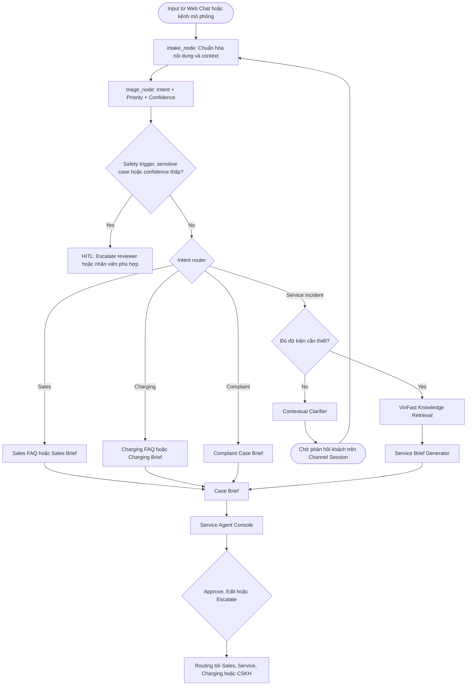

# VFO2O-18 VinFast ServiceFlow AI

> **AI Agent tổng đài đa kênh** tiếp nhận yêu cầu hội thoại tự do từ nhiều kênh, phân loại chính xác 4 nhóm Intent, hỏi làm rõ dữ kiện có ngữ cảnh, tra cứu cẩm nang kỹ thuật & chính sách VinFast, tạo **Case Brief** chuẩn hóa và hỗ trợ Reviewer điều phối (Routing) đúng bộ phận cho khách hàng Xe VinFast.

---

## 1. Vấn đề (Problem Statement)

### Ai đang gặp vấn đề?
- **Khách hàng xe điện VinFast (VF3, VF5, VF6, VF7, VF8, VF9, VF e34, tài xế Xanh SM/GSM):** Gửi yêu cầu qua nhiều kênh phi cấu trúc (Web Chat, Zalo, Email, Hotline) khi cần tư vấn xe, hỗ trợ sạc/pin, bảo dưỡng/sự cố kỹ thuật hoặc khiếu nại dịch vụ.
- **Nhân viên CSKH và Cố vấn dịch vụ:** Mất nhiều lượt nhắn tin/gọi điện hỏi lại do hội thoại tự do thường thiếu dữ kiện cần thiết (dòng xe, pin còn bao nhiêu %, mã lỗi trên taplo, vị trí xe, hoàn cảnh xảy ra vấn đề).
- **Reviewer / Service Manager:** Thiếu công cụ kiểm soát tập trung các case nhạy cảm, khẩn cấp (nguy cơ an toàn, tranh chấp bảo hành) hoặc case có độ tự tin phân loại thấp từ AI.

### Tại sao giải pháp hiện tại chưa đủ?
- **Ứng dụng VinFast:** Đã hỗ trợ các tác vụ theo dõi xe, cảnh báo lỗi, đặt lịch xưởng và gọi cứu hộ. Tuy nhiên, ứng dụng chỉ dành cho khách đã cài app/đăng nhập xe và không phải là điểm tiếp nhận duy nhất.
- **Kênh tiếp nhận đa kênh:** Hàng ngàn yêu cầu hàng ngày vẫn đổ về qua Web Chat, Zalo OA, Hotline hoặc Email.
- **Định vị sản phẩm:** Nhóm tập trung vào **lớp tiếp nhận, chuẩn hóa và điều phối thông minh (Intake & Triage Layer)** trước khi bàn giao cho bộ phận xử lý phù hợp, thay vì xây lại các tính năng có sẵn trên ứng dụng VinFast.

---

## 2. Giải pháp (Solution)

VinFast ServiceFlow AI là web application hỗ trợ tiếp nhận và điều phối yêu cầu khách hàng đa kênh với quy trình khép kín:

### Feature 1: Omnichannel Intake & 4-Intent Triage
- Khách gửi yêu cầu qua **Web Chat** (kênh tương tác thật) hoặc qua **Channel Simulator** (mô phỏng input từ Zalo, Email, Hotline call transcript).
- AI Agent phân loại yêu cầu thành 4 nhóm Intent rõ ràng:
  1. `Tư vấn / Bán hàng` (Sales & Product Advisory)
  2. `Sạc & Pin` (Charging & Battery Support)
  3. `Khiếu nại & Góp ý dịch vụ` (Complaints & Feedback)
  4. `Dịch vụ & Sự cố kỹ thuật` (Service & Technical Incidents)
- Đánh giá mức độ ưu tiên (`Low`, `Medium`, `High`, `Critical`) kèm điểm tự tin (`Confidence Score`).

### Feature 2: Intent-Specific Routing & Contextual Clarification
- **Nhánh Bán hàng (Sales):** Tra cứu thông số, giá bán, gói pin $\to$ Tạo **Sales Inquiry Brief**.
- **Nhánh Sạc & Pin (Charging):** Hướng dẫn trụ sạc, quy định pin $\to$ Tạo **Charging Support Brief**.
- **Nhánh Khiếu nại (Complaint):** Nhận diện mức độ bức xúc (Sentiment), ghi nhận phản ánh $\to$ Tạo **Complaint Case Brief**.
- **Nhánh Dịch vụ/Sự cố (Service):**
  - Tự động kiểm tra slot dữ kiện (dòng xe, mã lỗi, vị trí, tình trạng pin).
  - Nếu thiếu dữ kiện: Gửi câu hỏi làm rõ (**Contextual Clarification**) về Channel Session của khách, chờ phản hồi rồi tiếp tục chu trình.
  - Tra cứu cẩm nang kỹ thuật & chính sách VinFast (RAG) $\to$ Tạo **Service Brief** kỹ thuật.

### Feature 3: Case Brief & Human-in-the-Loop (HITL) Dispatching
- Agent tổng hợp toàn bộ thông tin thành **Case Brief** chuẩn hóa.
- **Không tự ý dispatch:** Agent chỉ đề xuất routing và hiển thị lên **Service Agent Console**.
- **Reviewer là người quyết định cuối cùng:** Cố vấn dịch vụ / Manager xem xét, duyệt (*Approve*), chỉnh sửa (*Edit*) hoặc chuyển tiếp (*Escalate*) trước khi dispatch đến xưởng dịch vụ, đội cứu hộ, sales hoặc CSKH.
- **An toàn là trên hết:** Với case khẩn cấp/nguy hiểm, Agent lập tức cung cấp hướng dẫn an toàn tiêu chuẩn và số Hotline cứu hộ chính thức; không tự nhận là đã gọi cứu hộ đến nơi.

---

## 3. Kiến trúc hệ thống (System Architecture)



---

## 4. AI Components & Technology Stack

| Thành phần | Công nghệ | Vai trò & Trách nhiệm |
|---|---|---|
| **Intake & Triage** | LangGraph Node + Structured LLM | Tiếp nhận đa kênh, chuẩn hóa tin nhắn, phân loại 4 Intent kèm điểm Confidence |
| **Contextual Clarifier** | LangGraph State Loop | Phát hiện thiếu dữ kiện cốt lõi (nhánh Service), hỏi làm rõ có ngữ cảnh và duy trì session |
| **Vector DB (RAG)** | ChromaDB | Lưu trữ tài liệu chính hãng, FAQ xe điện, chính sách bảo hành, cẩm nang hướng dẫn sử dụng VinFast |
| **LLM Inference** | LLM API (Structured Output) | Cấu hình linh hoạt theo môi trường (`gpt-4o-mini`, `gpt-4o`, `gemini-1.5-flash`...) |
| **Guardrails & Safety** | Rule Engine + Sentiment Guard | Kích hoạt khi có **Safety trigger**, **Khiếu nại nhạy cảm** hoặc **Score < 0.60 / Sự cố** (HITL) |
| **Case Brief Generator** | Pydantic Schema + Prompting | Tạo Case Brief chuẩn hóa: *Sales Inquiry Brief, Charging Brief, Complaint Brief, Service Brief* |
| **Database** | SQLite (MVP) / PostgreSQL | Lưu `source_channel`, `intent`, `priority`, `confidence_score`, `suggested_action`, `captured_fields`, `reviewer_feedback`, `status` |
| **Service Agent Console** | React / Next.js / Tailwind | Bảng điều khiển cho Reviewer — **người quyết định cuối cùng** phê duyệt, sửa đổi và dispatch |

---

## 5. Quick Start

```bash
# 1. Clone repository
git clone https://github.com/AI20K-Build-Phase-Cohort-4/P-142.git
cd P-142

# 2. Cài đặt môi trường ảo
python3.11 -m venv .venv
source .venv/bin/activate      # Windows: .venv\Scripts\activate
pip install -r requirements.txt

# 3. Cấu hình biến môi trường
cp .env.example .env
# Điền OPENAI_API_KEY và AI_LOG_API_KEY vào .env

# 4. Cài đặt hook ghi log AI
bash scripts/setup_hooks.sh                                      # Linux / macOS
powershell -ExecutionPolicy Bypass -File scripts\setup_hooks.ps1 # Windows

# 5. Chạy Backend API
uvicorn src.main:app --reload --port 8000
```

Swagger UI có tại: `http://localhost:8000/docs`

---

## 6. API Endpoints

| Method | Path | Description |
|---|---|---|
| GET | `/health` | Health check hệ thống |
| POST | `/api/v1/cases` | Tạo case từ yêu cầu khách hàng (Web Chat / Simulator) |
| POST | `/api/v1/cases/{id}/messages` | Gửi tin nhắn mới / phản hồi câu hỏi làm rõ |
| GET | `/api/v1/cases/{id}` | Lấy chi tiết case, lịch sử chat và Case Brief |
| PATCH | `/api/v1/cases/{id}` | Reviewer duyệt (Approve), chỉnh sửa routing, escalate hoặc đóng case |

---

## 7. Deliverables Checklist

- [x] GitHub Repo Setup
- [x] README_boilerplate.md (Project Description)
- [x] PRD & Brief Draft
- [x] Architecture Diagram (`docs/architecture_diagram.md`)
- [x] AI Logs (Auto-collected via hooks)
- [ ] Live URL / Deploy
- [ ] Video Demo
- [ ] Pitch Deck (`presentation/`)
- [x] Weekly Journal (`JOURNAL.md`)
- [x] Worklog (`WORKLOG.md`)
- [ ] Evaluation Evidence (`eval/results/`)

---

## 8. Team VFO2O-18

| Thành viên | Vai trò chính | Mã học viên |
|---|---|---|
| **Thế Việt** | Project Manager, BA, Frontend / UI UX | 2A202602594 |
| **Khôi** | AI Engineer, Data & Evaluation Benchmark | 2A202602434 |
| **Long** | AI Engineer, LangGraph Workflow, RAG & Guardrails | 2A202602633 |
| **Triển** | Backend Engineer, API Routes & Database | 2A202602837 |

---

## 9. License

MIT
