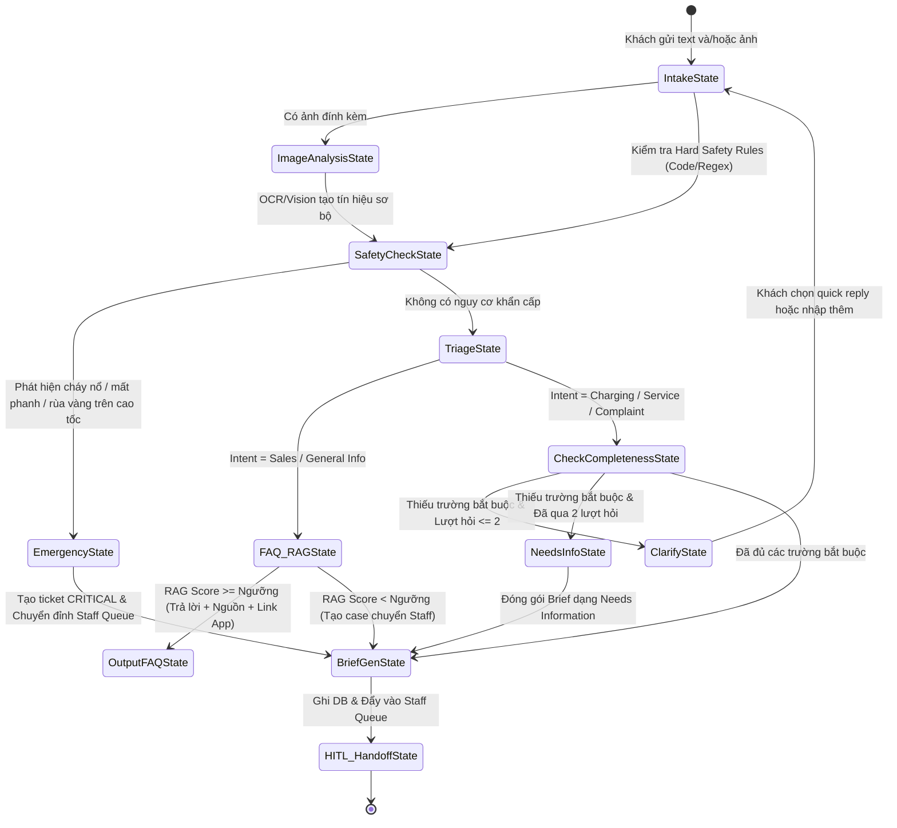

# AI Agent Workflow Specification

> **Người phụ trách chính:** Long (AI Engineer)  
> **Cập nhật lần cuối:** 2026-09-24  
> **Trạng thái:** In Review (Đã cập nhật Rule Clarification 2 lượt, Safe Guidance và No-PII)

---

## 1. Trạng thái Máy hữu hạn của Agent (Agent State Machine)

> **Sơ đồ Trực quan Chính thức:**
> - [Activity Tổng thể MVP Main (Khách hàng — AI LangGraph — Nhân viên)](Activity%20diagram%20system.jpg)
> - [Sơ đồ Một lượt Hội thoại Khách hàng](serviceflow-customer-activity.png)

Agent hoạt động theo quy trình tuần tự có kiểm soát chặt chẽ:

```text
[1. INTAKE] ──> [2. HARD SAFETY & TRIAGE] ──> [3. CLARIFY (Max 2 turns) or RAG] ──> [4. BRIEF GENERATION] ──> [5. HITL HANDOFF]
```



---

## 2. Chi tiết từng Bước Xử lý trong Pipeline

### Bước 1: Intake (Tiếp nhận & Làm sạch)
* Chuẩn hóa văn bản đầu vào: loại bỏ ký tự rác, tách ngữ cảnh hội thoại gần nhất ($N=5$ tin nhắn gần nhất).
* Nếu có ảnh: lưu attachment riêng tư, chạy OCR/Vision để lấy `ocr_text`, `detected_signals`, `vision_confidence`, `image_type`. Kết quả là `visual_evidence` đầu vào cho Triage, dùng được cho sự cố hoặc câu hỏi sản phẩm/chính sách.
* Nếu ảnh mờ hoặc `vision_confidence` thấp: Agent yêu cầu ảnh rõ hơn hoặc chuyển Staff Review; không tự suy đoán lỗi xe.
* Tuyệt đối không yêu cầu hoặc lưu trữ PII cá nhân thật (Họ tên, SĐT thật, CCCD, Biển số thật).

### Bước 2: Hard Safety Rules & Triage
* **Hard Safety Check (Quy tắc cứng chạy bằng regex/code trước khi gọi LLM):**
  * Tổ hợp nguy hiểm: `cháy`, `bốc khói`, `mất phanh`, `nổ lốp`, `tai nạn`, `kẹt chân ga`, `ngập nước đến sàn` HOẶC `rùa vàng` + `cao tốc / giảm công suất nguy hiểm` $\rightarrow$ Đặt cờ `Priority = CRITICAL`, bỏ qua hỏi làm rõ và kích hoạt cảnh báo an toàn tức thì.
  * Nếu chỉ có biểu tượng `rùa vàng` thông thường: Gán `Priority = HIGH`, chuyển sang luồng làm rõ sự cố.
* **LLM Triage Classification:**
  * Phân loại 1 trong 4 intent: `Charging/Battery`, `Service/Incident`, `Sales/General Info`, `Complaint/Feedback`.
  * Tính điểm tin cậy `confidence_score` $\in [0.0, 1.0]$.
* **Location routing:** Khi Intent là `Charging/Battery`, `Service/Incident`, hoặc Sales có nhu cầu tìm showroom, Agent hiển thị card xin consent: `Dùng vị trí hiện tại / Nhập khu vực / Bỏ qua`. Không tự lấy GPS nền hoặc GPS từ EXIF ảnh.
  * Critical: tạo Case Brief tối thiểu và đẩy Staff Queue **trước**; vị trí là dữ kiện bổ sung không chặn cảnh báo/case.
  * High/Normal: vị trí là một dữ kiện có thể gom trong tối đa 2 lượt clarification.

### Bước 3: Clarification & RAG Routing
* Nếu là **FAQ/Thông tin:** Truy vấn Vector Store với các tài liệu đã kiểm chứng. Bắt buộc có metadata nguồn (`url`, `title`, `verified_date`). Nếu không có nguồn uy tín, chuyển sang tạo Case hỗ trợ.
* Nếu là **Sự cố Kỹ thuật (Charging / Service):** Kiểm tra danh sách trường thông tin bắt buộc (Required Fields).
  * **Quy tắc:** Tối đa 2 lượt hỏi chủ động. Mỗi lượt gửi 1 câu hỏi gom nhiều dữ kiện, kèm Quick Replies.
  * Sau 2 lượt nếu vẫn thiếu, tạo case với trạng thái `Needs Information` để Staff hỗ trợ trực tiếp.

### Bước 4: Case Brief Generation (Tổng hợp Phiếu)
* Sinh cấu trúc JSON Case Brief chuẩn hóa:
  * `summary`: Tóm tắt 1 câu ngắn gọn về vấn đề.
  * `vehicle_info`: Dòng xe, mã mô phỏng (`VF-SF-xxxxx`), % Pin hiện tại (nếu có).
  * `incident_details`: Mã lỗi, vị trí trạm sạc / địa điểm, hiện tượng ghi nhận.
  * `suggested_action`: Hành động gợi ý an toàn cho Chuyên viên Dịch vụ.
  * `confidence_score`: Điểm tự tin của Agent.

### Bước 5: HITL Handoff (Bàn giao cho Con người)
* Ghi dữ liệu vào bảng `cases` với trạng thái: `Staff Reviewing` (hoặc `Needs Information`).
* Gửi sự kiện cập nhật thời gian thực sang Staff Queue.
* Trả về cho Customer: `case_id`, `status: "Staff Reviewing"`, hướng dẫn an toàn chuẩn mực.
* Khi Staff `Resolve`: gửi Customer Update gồm kết quả an toàn, next step, điểm hỗ trợ gợi ý (nếu có) và nút `Đã được hỗ trợ / Vẫn chưa giải quyết`. Customer xác nhận sẽ `Closed`; phản ánh lại sẽ `Reopened`.
* Agent không sử dụng case raw của Customer khác để trả lời. Nội dung “Tình huống thường gặp” chỉ truy xuất từ RAG/FAQ hoặc bài viết đã được Staff duyệt và ẩn danh.
