# Data Model & Schema Specification

> **Người phụ trách chính:** Triển (Backend Developer) - Việt
> **Cập nhật lần cuối:** 2026-10-10 (đồng bộ với `src/models/db_models.py`)  
> **Trạng thái:** In Review (Đã chuẩn hóa No-PII Schema & Ticket Lifecycle)

---

## 1. Chuẩn hóa Vòng đời Ticket (Ticket Status State Machine)

> [!IMPORTANT]
> **Quy định Thống nhất Trạng thái:**  
> Không dùng các tên trạng thái khác nhau giữa UI, Backend API, Database và Tài liệu. Chỉ sử dụng duy nhất tập trạng thái sau:
> 
> `New` $\rightarrow$ `Needs Information` $\rightarrow$ `Staff Reviewing` $\rightarrow$ `In Progress` $\rightarrow$ `Resolved` $\rightarrow$ `Closed` (và `Reopened`).

* **`New`**: Ticket vừa được khởi tạo bởi hệ thống.
* **`Needs Information`**: Hệ thống hoặc Staff đang chờ khách hàng phản hồi bổ sung thông tin (sau 2 lượt clarify tự động hoặc do Staff yêu cầu).
* **`Staff Reviewing`**: Đã tạo Case Brief, đang chờ nhân viên dịch vụ xem xét/phê duyệt phương án.
* **`In Progress`**: Nhân viên đã duyệt phương án và đang trong quá trình xử lý kỹ thuật/hỗ trợ.
* **`Resolved`**: Nhân viên đã đưa ra phương án giải quyết xong cho sự cố.
* **`Closed`**: Khách hàng xác nhận hài lòng, Staff đóng case, hoặc hệ thống tự động đóng khi case ở `Resolved` quá 72 giờ mà khách không phản hồi (`case_lifecycle.py`).
* **`Reopened`**: Khách hàng phản ánh lại vì sự cố chưa được xử lý triệt để.

---

## 2. Sơ đồ Thực thể Quan hệ (Entity Relationship Diagram)

```mermaid
erDiagram
    CASE ||--o{ MESSAGE : contains
    CASE ||--|| CASE_BRIEF : has
    CASE ||--o{ STAFF_AUDIT_LOG : tracks
    CASE ||--o{ ATTACHMENT : includes
    CASE ||--o| CUSTOMER_FEEDBACK : receives
    CASE ||--o| CASE_LOCATION : may_have
    CASE ||--o{ CASE_UPDATE : receives
    USER ||--o{ CASE : owns
    
    CASE {
        string id PK "e.g. CASE-20260924-001"
        string user_id FK "Nullable - chủ sở hữu là tài khoản đăng nhập"
        string session_id "Customer chat session identifier"
        string mock_customer_id "Mocked ID, e.g. CUST_MOCK_01"
        string mock_customer_name "Nullable - Demo Seed Only"
        string mock_customer_phone "Nullable - Demo Seed Only"
        string vehicle_code_mock "Nullable - format VF-SF-xxxxx"
        string vehicle_model "VF3 | VF5 | VF6 | VF7 | VF8 | VF9 | e34"
        string intent "Charging/Battery | Service/Incident | Sales/General Info | Complaint/Feedback"
        string priority "LOW | MEDIUM | HIGH | CRITICAL"
        string status "New | Needs Information | Staff Reviewing | In Progress | Resolved | Closed | Reopened"
        string safety_status "unconfirmed | customer_reported_safe"
        datetime safety_acknowledged_at "Nullable"
        int incident_version "Default 1"
        string assigned_staff_id "Nullable FK"
        datetime created_at
        datetime updated_at
    }

    USER {
        string id PK "UUID"
        string username "Unique"
        string password_hash
        string role "CUSTOMER | STAFF"
        string full_name "Nullable"
        string phone "Nullable"
        string vehicle_model "Nullable"
        string mock_customer_id "Nullable; no real VinFast verification"
        datetime created_at
    }

    CUSTOMER_FEEDBACK {
        string id PK "UUID"
        string case_id FK "UNIQUE - mỗi case một đánh giá"
        int rating "1 to 5"
        string comment "Nullable"
        jsonb reason_tags "Nullable - tag lý do khi 1-2 sao"
        datetime created_at
        datetime updated_at
    }

    CHAT_SESSION {
        string id PK
        string owner "user id hoặc guest id"
        string lease_token "Nullable"
        datetime lease_until "Nullable"
        jsonb memory_states
    }

    CHAT_REQUEST_RECORD {
        string id PK
        string owner
        string session_id
        string request_hash "Chống gửi trùng request"
        jsonb response
    }

    ATTACHMENT {
        string id PK
        string case_id FK "Nullable before case creation"
        string message_id FK
        string storage_key "Private path only"
        string mime_type
        string analysis_status "UPLOADED | ANALYZED | FAILED"
        string ocr_text "Nullable"
        jsonb detected_signals "Nullable"
        float vision_confidence "Nullable"
    }

    CASE_LOCATION {
        string case_id FK
        string status "CONSENTED | MANUAL | NOT_SHARED | UNKNOWN"
        string source "BROWSER_GPS | USER_TEXT | MAP_PICKER"
        string location_label
        float latitude "Nullable"
        float longitude "Nullable"
        string precision "APPROXIMATE | EXACT"
        boolean share_with_staff
    }

    CASE_UPDATE {
        string id PK
        string case_id FK
        string author_type "STAFF | SYSTEM | CUSTOMER"
        string status_after_update
        string customer_message "Nội dung an toàn hiển thị Customer"
        string next_step "Nullable"
        boolean awaiting_customer_confirmation
        datetime created_at
    }

    MESSAGE {
        string id PK "UUID"
        string case_id FK "Nullable if not created yet"
        string session_id "Session identifier"
        string sender_type "CUSTOMER | AGENT | STAFF | SYSTEM"
        string content "Text content"
        jsonb metadata "Citations, Quick Replies, Clarification Turn, etc."
        datetime created_at
    }

    CASE_BRIEF {
        string id PK "UUID"
        string case_id FK "Unique"
        string summary "Tóm tắt sự cố"
        jsonb captured_fields "SOC, error_code, charger_id..."
        string suggested_action "Hành động gợi ý cho kỹ thuật"
        float confidence_score "0.0 to 1.0"
        boolean is_edited_by_staff "Default: false"
        datetime generated_at
    }

    STAFF_AUDIT_LOG {
        string id PK "UUID"
        string case_id FK
        string staff_id "ID nhân viên; CUSTOMER_<user_id> hoặc SYSTEM_AUTO_CLOSE nếu do khách/hệ thống"
        string action "APPROVE | EDIT_BRIEF | REROUTE | REQUEST_INFO | RESOLVE | CLOSE | REOPEN"
        jsonb previous_state "Snapshot trước thay đổi"
        jsonb new_state "Snapshot sau thay đổi"
        string notes "Ghi chú của nhân viên"
        datetime created_at
    }
```

---

## 3. Schema Chi tiết (Data Dictionary)

### 3.1. Bảng `cases`
| Tên Cột | Kiểu Dữ liệu | Nullable | Ràng buộc / Mặc định | Ý nghĩa |
| :--- | :--- | :---: | :--- | :--- |
| `id` | `VARCHAR(32)` | No | `PRIMARY KEY` | Mã định danh Case (`CASE-YYYYMMDD-XXX`) |
| `user_id` | `VARCHAR(36)` | Yes | `FOREIGN KEY users(id)`, index | Chủ sở hữu là tài khoản đăng nhập; `NULL` với case của phiên guest |
| `session_id` | `VARCHAR(64)` | No | index | Định danh phiên chat web |
| `mock_customer_id` | `VARCHAR(50)` | Yes | | ID khách hàng mô phỏng (không dùng PII thật) |
| `mock_customer_name`| `VARCHAR(100)` | Yes | | Tên khách mô phỏng (chỉ dùng seed demo) |
| `mock_customer_phone`| `VARCHAR(20)` | Yes | | SĐT mô phỏng (chỉ dùng seed demo) |
| `vehicle_code_mock` | `VARCHAR(50)` | Yes | | Mã xe mô phỏng (`VF-SF-00231`) |
| `vehicle_model` | `VARCHAR(50)` | Yes | | Dòng xe (`VF3`, `VF5`, `VF6`, `VF7`, `VF8`, `VF9`, `e34`) |
| `intent` | `VARCHAR(50)` | No | | Phân loại Intent |
| `priority` | `VARCHAR(20)` | No | Default `'MEDIUM'` | `LOW`, `MEDIUM`, `HIGH`, `CRITICAL` |
| `status` | `VARCHAR(30)` | No | Default `'New'` | Trạng thái vòng đời ticket |
| `safety_status` | `VARCHAR(30)` | No | Default `'unconfirmed'` | `unconfirmed` hoặc `customer_reported_safe` |
| `safety_acknowledged_at` | `TIMESTAMP WITH TZ` | Yes | | Thời điểm khách xác nhận đã ở vị trí an toàn |
| `incident_version` | `INTEGER` | No | Default `1` | Phiên bản sự cố, dùng để chống xác nhận an toàn trên dữ liệu cũ |
| `assigned_staff_id` | `VARCHAR(50)` | Yes | | ID nhân viên phụ trách |
| `created_at` | `TIMESTAMP WITH TZ` | No | `NOW()` | Thời gian tạo |
| `updated_at` | `TIMESTAMP WITH TZ` | No | `NOW()` | Thời gian cập nhật cuối |

### 3.2. Bảng `case_briefs`
| Tên Cột | Kiểu Dữ liệu | Nullable | Ràng buộc / Mặc định | Ý nghĩa |
| :--- | :--- | :---: | :--- | :--- |
| `id` | `VARCHAR(36)` | No | `PRIMARY KEY` | UUID |
| `case_id` | `VARCHAR(32)` | No | `UNIQUE REFERENCES cases(id)` | Khóa ngoại tới `cases` |
| `summary` | `TEXT` | No | | Tóm tắt sự cố của khách |
| `captured_fields` | `JSONB` | No | `{}` | Trường chi tiết (Mã lỗi, Trụ sạc, SOC...) |
| `suggested_action`| `TEXT` | Yes | | Hành động AI đề xuất cho Staff |
| `confidence_score`| `FLOAT` | No | | Điểm tự tin của AI (0.0 - 1.0) |
| `is_edited_by_staff`| `BOOLEAN` | No | Default `FALSE` | Đánh dấu Staff có sửa Brief không |
| `generated_at` | `TIMESTAMP WITH TZ` | No | `NOW()` | Thời điểm AI tạo Brief |

### 3.3. Bảng `users`
| Tên Cột | Kiểu Dữ liệu | Nullable | Ràng buộc / Mặc định | Ý nghĩa |
| :--- | :--- | :---: | :--- | :--- |
| `id` | `VARCHAR(36)` | No | `PRIMARY KEY` | UUID |
| `username` | `VARCHAR(100)` | No | `UNIQUE`, index | Tên đăng nhập |
| `password_hash` | `VARCHAR(256)` | No | | Mật khẩu đã băm (Argon2id) |
| `role` | `VARCHAR(20)` | No | Default `'CUSTOMER'` | `CUSTOMER` hoặc `STAFF` (`GUEST` không có dòng trong bảng) |
| `full_name` | `VARCHAR(100)` | Yes | | Tên xưng hô, tùy chọn |
| `phone` | `VARCHAR(20)` | Yes | | Tùy chọn |
| `vehicle_model` | `VARCHAR(50)` | Yes | | Dòng xe |
| `mock_customer_id` | `VARCHAR(50)` | Yes | | Mã khách hàng nội bộ do backend gán, không phải dữ liệu thật |
| `created_at` | `TIMESTAMP WITH TZ` | No | | Thời gian tạo |

### 3.4. Bảng `customer_feedback`
| Tên Cột | Kiểu Dữ liệu | Nullable | Ràng buộc / Mặc định | Ý nghĩa |
| :--- | :--- | :---: | :--- | :--- |
| `id` | `VARCHAR(36)` | No | `PRIMARY KEY` | UUID |
| `case_id` | `VARCHAR(32)` | No | `UNIQUE REFERENCES cases(id)` | Mỗi case chỉ có một đánh giá |
| `rating` | `INTEGER` | No | 1 đến 5 | Điểm CSAT |
| `comment` | `TEXT` | Yes | | Nhận xét |
| `reason_tags` | `JSON` | Yes | | Tag lý do nhanh khi đánh giá 1–2 sao |
| `created_at` | `TIMESTAMP WITH TZ` | No | | Lần gửi đầu |
| `updated_at` | `TIMESTAMP WITH TZ` | No | | Lần sửa gần nhất |

### 3.5. Bảng `staff_audit_logs`
| Tên Cột | Kiểu Dữ liệu | Nullable | Ràng buộc / Mặc định | Ý nghĩa |
| :--- | :--- | :---: | :--- | :--- |
| `id` | `VARCHAR(36)` | No | `PRIMARY KEY` | UUID |
| `case_id` | `VARCHAR(32)` | No | `REFERENCES cases(id)`, index | Case bị tác động |
| `staff_id` | `VARCHAR(50)` | No | | ID/tên nhân viên; `CUSTOMER_<user_id>` khi khách mở lại; `SYSTEM_AUTO_CLOSE` khi hệ thống tự đóng |
| `action` | `VARCHAR(30)` | No | | `APPROVE`, `EDIT_BRIEF`, `REROUTE`, `REQUEST_INFO`, `RESOLVE`, `CLOSE`, `REOPEN` |
| `previous_state` / `new_state` | `JSON` | Yes | | Snapshot trước và sau thao tác |
| `notes` | `TEXT` | Yes | | Ghi chú |
| `created_at` | `TIMESTAMP WITH TZ` | No | | Thời gian thao tác |

### 3.6. Quy tắc Location, Confirmation, CSAT & Auto-close
* `case_locations` chỉ được tạo khi Customer consent hoặc tự nhập khu vực. Không đọc vị trí từ ảnh/EXIF.
* `Resolved` có thể kèm `awaiting_customer_confirmation = true`; không thêm trạng thái mới.
* Customer chọn `Đã được hỗ trợ` $\rightarrow$ `Closed`; chọn `Vẫn chưa giải quyết` $\rightarrow$ `Reopened` và quay lại Staff Queue.
* Customer Support Center chỉ query Case/Message/Case Update có `user_id` thuộc user đăng nhập.
* “Tình huống thường gặp” là public content đã biên soạn, không dùng bảng `cases`, `messages`, `attachments` để hiển thị cho Customer khác.
* Quyền truy cập case: `case.user_id == user.id` (tài khoản đăng nhập) hoặc `case.session_id` khớp phiên guest; Staff được bypass theo role.
* CSAT chỉ gửi được khi case `Resolved` hoặc `Closed`; gửi lại sẽ cập nhật bản cũ trong 7 ngày kể từ lần gửi đầu.
* Auto-close: case `Resolved` quá 72 giờ không có phản hồi từ khách được chuyển sang `Closed`; ghi `staff_audit_logs` (`staff_id = SYSTEM_AUTO_CLOSE`) và `case_updates` (`author_type = SYSTEM`).

### 3.7. Migration
Schema được tạo từ SQLAlchemy models; với SQLite, hàm `ensure_schema()` trong `src/db.py` tự bổ sung các cột còn thiếu (`cases.user_id`, `cases.safety_*`, `cases.incident_version`, `users.full_name/phone/vehicle_model/mock_customer_id`, `customer_feedback.reason_tags/updated_at`) và tạo unique index `uq_customer_feedback_case_id` khi khởi động. Thư mục `migrations/` chứa các revision Alembic (đọc `DATABASE_URL`). 

> [!WARNING]
> Tính đến 2026-10-10, chưa có revision Alembic nào cho `customer_feedback.reason_tags` và unique index `uq_customer_feedback_case_id`; hai thay đổi này hiện chỉ được áp dụng bởi `ensure_schema()` trên SQLite. Nếu triển khai bằng PostgreSQL và dựa vào `alembic upgrade head`, cần bổ sung revision tương ứng trước khi dùng tính năng CSAT.