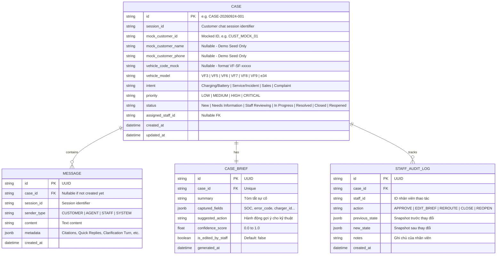

# Data Model & Schema Specification

> **Người phụ trách chính:** Triển (Backend Lead)  
> **Cập nhật lần cuối:** 2026-09-24  
> **Trạng thái:** In Review (Đã chuẩn hóa No-PII Schema & Ticket Lifecycle)

---

## 1. Chuẩn hóa Vòng đời Ticket (Ticket Status State Machine)

> [!IMPORTANT]
> **Quy định Thống nhất Trạng thái:**  
> Tuyệt đối không dùng các tên trạng thái khác nhau giữa UI, Backend API, Database và Tài liệu. Chỉ sử dụng duy nhất tập trạng thái sau:
> 
> `New` $\rightarrow$ `Needs Information` $\rightarrow$ `Staff Reviewing` $\rightarrow$ `In Progress` $\rightarrow$ `Resolved` $\rightarrow$ `Closed` (và `Reopened`).

* **`New`**: Ticket vừa được khởi tạo bởi hệ thống.
* **`Needs Information`**: Hệ thống hoặc Staff đang chờ khách hàng phản hồi bổ sung thông tin (sau 2 lượt clarify tự động hoặc do Staff yêu cầu).
* **`Staff Reviewing`**: Đã tạo Case Brief, đang chờ nhân viên dịch vụ xem xét/phê duyệt phương án.
* **`In Progress`**: Nhân viên đã duyệt phương án và đang trong quá trình xử lý kỹ thuật/hỗ trợ.
* **`Resolved`**: Nhân viên đã đưa ra phương án giải quyết xong cho sự cố.
* **`Closed`**: Khách hàng xác nhận hài lòng hoặc tự động đóng sau thời gian quy định.
* **`Reopened`**: Khách hàng phản ánh lại vì sự cố chưa được xử lý triệt để.

---

## 2. Sơ đồ Thực thể Quan hệ (Entity Relationship Diagram)

---

## 3. Schema Chi tiết (Data Dictionary)

### 3.1. Bảng `cases`
| Tên Cột | Kiểu Dữ liệu | Nullable | Ràng buộc / Mặc định | Ý nghĩa |
| :--- | :--- | :---: | :--- | :--- |
| `id` | `VARCHAR(32)` | No | `PRIMARY KEY` | Mã định danh Case (`CASE-YYYYMMDD-XXX`) |
| `session_id` | `VARCHAR(64)` | No | | Định danh phiên chat web |
| `mock_customer_id` | `VARCHAR(50)` | Yes | | ID khách hàng mô phỏng (không dùng PII thật) |
| `mock_customer_name`| `VARCHAR(100)` | Yes | | Tên khách mô phỏng (chỉ dùng seed demo) |
| `mock_customer_phone`| `VARCHAR(20)` | Yes | | SĐT mô phỏng (chỉ dùng seed demo) |
| `vehicle_code_mock` | `VARCHAR(50)` | Yes | | Mã xe mô phỏng (`VF-SF-00231`) |
| `vehicle_model` | `VARCHAR(50)` | Yes | | Dòng xe (`VF3`, `VF5`, `VF6`, `VF7`, `VF8`, `VF9`, `e34`) |
| `intent` | `VARCHAR(50)` | No | | Phân loại Intent |
| `priority` | `VARCHAR(20)` | No | Default `'MEDIUM'` | `LOW`, `MEDIUM`, `HIGH`, `CRITICAL` |
| `status` | `VARCHAR(30)` | No | Default `'Staff Reviewing'` | Trạng thái vòng đời ticket |
| `assigned_staff_id` | `VARCHAR(50)` | Yes | | ID nhân viên phụ trách |
| `created_at` | `TIMESTAMP WITH TZ` | No | `NOW()` | Thời gian tạo |
| `updated_at` | `TIMESTAMP WITH TZ` | No | `NOW()` | Thời gian cập nhật cuối |

### 3.2. Bảng `case_briefs`
| Tên Cột | Kiểu Dữ liệu | Nullable | Ràng buộc / Mặc định | Ý nghĩa |
| :--- | :--- | :---: | :--- | :--- |
| `id` | `VARCHAR(36)` | No | `PRIMARY KEY` | UUID |
| `case_id` | `VARCHAR(32)` | No | `UNIQUE REFERENCES cases(id)` | Khóa ngoại tới `cases` |
| `summary` | `TEXT` | No | | Tóm tắt sự cố của khách |
| `captured_fields` | `JSONB` | No | `{}` | Trường chi tiết (Mã lỗi, Trụ sạc, SOC...) |
| `suggested_action`| `TEXT` | Yes | | Hành động AI đề xuất cho Staff |
| `confidence_score`| `FLOAT` | No | | Điểm tự tin của AI (0.0 - 1.0) |
| `is_edited_by_staff`| `BOOLEAN` | No | Default `FALSE` | Đánh dấu Staff có sửa Brief không |
| `generated_at` | `TIMESTAMP WITH TZ` | No | `NOW()` | Thời điểm AI tạo Brief |
