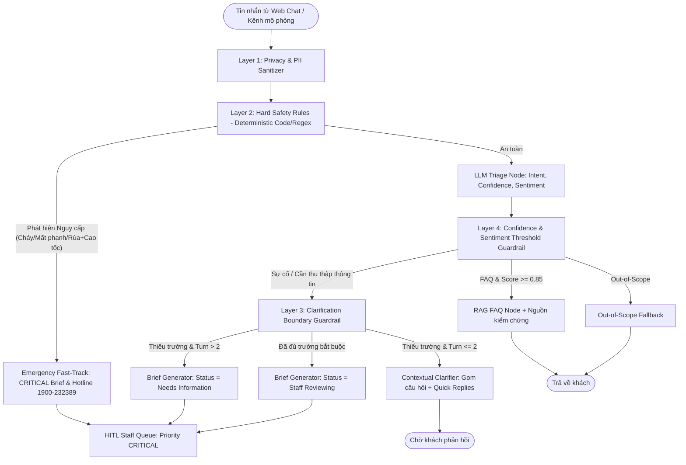

# LangGraph State Schema & Guardrails Specification

> **Người phụ trách chính:** Long (AI Engineer)  
> **Cập nhật lần cuối:** 2026-09-28  
> **Trạng thái:** Implemented (`src/agents/state.py`, `src/agents/guardrails.py`, `tests/test_agents/test_guardrails.py`)

---

## 1. Tổng quan Kiến trúc

Tài liệu này đặc tả chi tiết **State Schema** và **Hệ thống 4 Tầng Guardrails** của VinFast ServiceFlow AI, vận hành trên nền tảng LangGraph StateGraph.

---

## 2. Chi tiết State Schema (`src/agents/state.py`)

Mọi thông tin trong chu trình xử lý được lưu trữ tập trung tại `AgentState` (`TypedDict`):

| Nhóm trường | Tên thuộc tính | Kiểu dữ liệu | Ý nghĩa & Quy chuẩn |
| :--- | :--- | :--- | :--- |
| **Session Context** | `session_id` `case_id` `mock_customer_id` `vehicle_model` `vehicle_code_mock` | `str` `str \| None` `str \| None` `str \| None` `str \| None` | Tuyệt đối không lưu PII thật; chỉ sử dụng mã mô phỏng (ví dụ `VF-SF-00231`) và các dòng xe hỗ trợ (`VF3` ... `VF9`, `e34`). |
| **Conversation** | `messages` `latest_user_message` `clarification_turn` `max_clarification_turns` `suggested_replies` | `Annotated[list[BaseMessage], add_messages]` `str` `int` `int` `list[str]` | Lịch sử chat (LangGraph reducer), số lượt hỏi làm rõ ($\le 2$), và danh sách Quick Replies cho giao diện người dùng. |
| **Triage & Safety** | `intent` `priority` `confidence_score` `is_critical` `safety_trigger` | `IntentType \| None` `PriorityLevel` `float` `bool` `str \| None` | Phân loại 4 nhóm Intent chính, mức độ ưu tiên (`LOW`, `MEDIUM`, `HIGH`, `CRITICAL`), cờ khẩn cấp và mã nguyên nhân kích hoạt. |
| **Slot Completion** | `captured_fields` `missing_fields` | `dict[str, Any]` `list[str]` | Các trường dữ liệu kỹ thuật đã trích xuất (`error_code`, `charger_id`, v.v.) và danh sách trường còn thiếu. |
| **RAG Retrieval** | `is_rag_query` `rag_context` `rag_citations` `rag_similarity_score` | `bool` `list[str]` `list[CitationSource]` `float` | Dữ liệu tra cứu cẩm nang và nguồn kiểm chứng (`url`, `verified_at`, `status_code=200`). |
| **Ticket Output** | `case_brief` `ticket_status` `response_type` `final_response` `safe_guidance` | `CaseBriefData \| None` `TicketStatus` `ResponseType` `str` `str \| None` | Hồ sơ Case Brief hoàn chỉnh, trạng thái ticket chuẩn hóa theo Data Model, câu trả lời và hướng dẫn an toàn cho khách. |
| **Diagnostics** | `guardrails` `error` | `GuardrailAuditFlags` `str \| None` | Cờ nhật ký audit ghi nhận can thiệp của các tầng Guardrails. |

---

## 3. Hệ thống 4 Tầng Guardrails (`src/agents/guardrails.py`)

### Tầng 1: Privacy & PII Sanitizer Guardrail
* **Nhiệm vụ:** Lọc bỏ và ẩn danh hóa số điện thoại, CCCD/CMND, biển số xe thật của khách hàng trước khi đưa dữ liệu vào LLM prompt hoặc cơ sở dữ liệu.
* **Quy chuẩn Masking:**
  * SĐT: `0912345678` $\rightarrow$ `[REDACTED_PHONE]`
  * CCCD: `001234567890` $\rightarrow$ `[REDACTED_NATIONAL_ID]`
  * Biển số xe: `29A-98765` $\rightarrow$ `[REDACTED_LICENSE_PLATE]`

### Tầng 2: Hard Safety Rules Guardrail (Deterministic Code/Regex)
* **Nhiệm vụ:** Chạy độc lập bằng regex/mã nguồn trước LLM. Phát hiện lập tức các tình huống rủi ro tính mạng để kích hoạt phản hồi khẩn cấp tức thì.
* **Bảng Ma trận An toàn:**
  * **Đơn lẻ Nguy cấp:** `cháy`, `bốc khói`, `mùi khét`, `mất phanh`, `hẫng phanh`, `kẹt chân ga`, `nổ lốp`, `tai nạn lật`, `ngập nước đến sàn` $\rightarrow$ `CRITICAL`, cấp hotline `1900-232389`, bypass làm rõ.
  * **Tổ hợp Nguy cấp:** `rùa vàng` + (`cao tốc` OR `mất kiểm soát` OR `giảm công suất nguy hiểm` OR `dừng giữa đường`) $\rightarrow$ `CRITICAL`.
  * **Rùa vàng thông thường:** `rùa vàng` ở điều kiện bình thường (bãi đỗ, trong ngõ) $\rightarrow$ `HIGH` (không gán nhầm sang `CRITICAL`).

### Tầng 3: Boundary Guardrails (Clarification & Out-of-Scope)
* **Khóa cứng 2 lượt hỏi làm rõ:**
  * Lượt 1 & Lượt 2: Gom toàn bộ các trường còn thiếu (`missing_fields`) vào **đúng 1 câu hỏi duy nhất**, kèm `suggested_replies`.
  * Khi `clarification_turn == 2` mà vẫn thiếu dữ kiện: Khóa hỏi, tạo Case với trạng thái `Needs Information`, gắn cờ `missing_info_flag = True` và chuyển giao cho nhân viên trực tiếp hỗ trợ.
* **Out-of-Scope:** Lịch sự từ chối các câu hỏi nằm ngoài phạm vi xe điện VinFast.

### Tầng 4: HITL Decision & Confidence Threshold Guardrails
* **Quy tắc bắt buộc 100% qua Human Review (Staff Console):**
  1. Toàn bộ ticket thuộc Intent `Charging/Battery`, `Service/Incident`, `Complaint/Feedback`.
  2. Mọi trường hợp có mức độ ưu tiên `CRITICAL` hoặc `HIGH`.
  3. LLM Confidence score $< 0.60$.
  4. Câu hỏi tra cứu FAQ nhưng điểm tương đồng vector RAG $< 0.70$ hoặc không có nguồn kiểm chứng.

---

## 4. Kiểm thử Đơn vị & Độ bao phủ

Toàn bộ logic được kiểm thử tự động tại [`tests/test_agents/test_guardrails.py`](file:///d:/142.AI20K/P-142/tests/test_agents/test_guardrails.py) với 19 unit test cases bao quát:
- Che giấu PII (SĐT, CCCD, Biển số xe).
- Khẩn cấp độc lập: Khói/cháy (`TEST-005`), Mất phanh (`TEST-011`), Kẹt ga.
- Tổ hợp rùa vàng trên cao tốc (`TEST-003`) vs Rùa vàng điều kiện bình thường (`TEST-004`).
- Giới hạn 2 lượt hỏi làm rõ (turn boundary).
- Kiểm tra danh mục trường bắt buộc theo Intent.
- Điều kiện cưỡng chế duyệt người (HITL mandatory).
