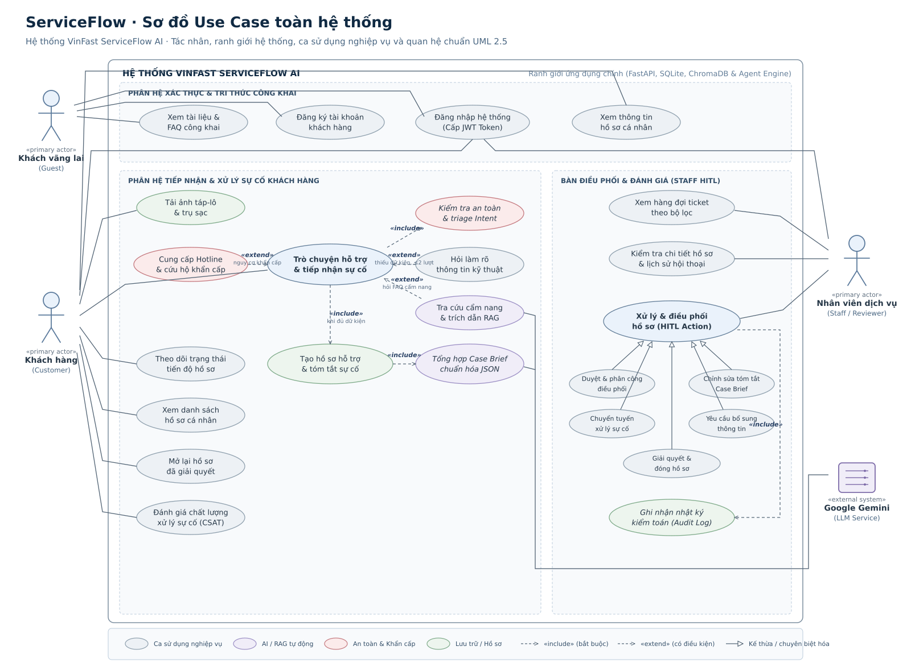

# ServiceFlow — Sơ đồ Use Case toàn hệ thống



Tài liệu này mô tả sơ đồ ca sử dụng (Use Case Diagram) toàn diện cho hệ thống **VinFast ServiceFlow AI**, tuân thủ chuẩn ký hiệu UML 2.5. Sơ đồ tập trung vào ranh giới hệ thống, các tác nhân (Actors), các mục tiêu người dùng có ý nghĩa (User Goals), và các mối quan hệ cấu trúc giữa các ca sử dụng (`«include»`, `«extend»`, và chuyên biệt hóa / generalization).

---

## 1. Quyết định Thiết kế & Chuẩn Ký hiệu UML

1. **Ranh giới Hệ thống (System Boundary):**
   - Đại diện cho toàn bộ phạm vi ứng dụng chính của VinFast ServiceFlow AI (gồm backend FastAPI, database quan hệ SQLite, kho vector ChromaDB, và agent phân loại / tổng hợp sự cố).
   - Được phân chia thành 3 phân hệ logic trực quan:
     - **Phân hệ Xác thực & Tri thức Công khai** (Public Knowledge & Identity Management)
     - **Phân hệ Tiếp nhận & Xử lý Sự cố Khách hàng** (Customer Service & Incident Intake)
     - **Phân hệ Bàn Điều phối & Đánh giá của Nhân viên - HITL** (Staff Reviewer Console & Dispatch)

2. **Quy ước Tác nhân (Actors):**
   - **Tác nhân Con người Chính (Primary Human Actors):** Đặt bên ngoài ranh giới hệ thống:
     - `Khách vãng lai (Guest)`: Người dùng chưa đăng nhập, chỉ truy cập thông tin công khai và đăng ký/đăng nhập.
     - `Khách hàng (Customer)`: Chủ phương tiện xe điện VinFast đã đăng nhập, gửi tin nhắn, tải ảnh, theo dõi trạng thái và đánh giá dịch vụ.
     - `Nhân viên dịch vụ (Staff / Reviewer)`: Kỹ thuật viên / điều phối viên tại xưởng dịch vụ hoặc tổng đài CSKH, kiểm duyệt Case Brief và ra quyết định dispatch.
   - **Tác nhân Hệ thống Ngoài (Secondary / External System Actor):**
     - `Google Gemini (LLM Service)`: Nền tảng mô hình ngôn ngữ lớn bên ngoài, hỗ trợ phân tích ngữ nghĩa, trích xuất thực thể, tổng hợp tóm tắt sự cố (Case Brief) và sinh câu trả lời RAG kèm trích dẫn.

3. **Ngữ nghĩa Mối quan hệ Chuẩn UML:**
   - **Liên kết (Association - Đường nét liền):** Kết nối giữa Tác nhân và Ca sử dụng mà tác nhân đó trực tiếp tương tác.
   - **`«include»` (Bắt buộc - Mũi tên nét đứt từ Base Use Case tới Included Use Case):** Ca sử dụng cơ sở luôn luôn thực thi ca sử dụng được bao gồm như một phần không thể thiếu (ví dụ: `Trò chuyện hỗ trợ` bắt buộc include `Kiểm tra an toàn & triage Intent`; `Xử lý hồ sơ HITL` bắt buộc include `Ghi nhận nhật ký kiểm toán`).
   - **`«extend»` (Mở rộng có điều kiện - Mũi tên nét đứt từ Extending Use Case tới Base Use Case):** Hành vi mở rộng chỉ được kích hoạt tại các điểm mở rộng (extension points) cụ thể khi thỏa mãn điều kiện nhất định (ví dụ: `Cung cấp Hotline khẩn cấp` extend `Trò chuyện hỗ trợ` khi phát hiện nguy cơ nguy hiểm; `Hỏi làm rõ kỹ thuật` extend khi thiếu trường dữ liệu).
   - **Kế thừa / Chuyên biệt hóa (Generalization - Mũi tên tam giác rỗng `──▷`):** 5 thao tác xử lý cụ thể của Staff (`APPROVE`, `EDIT_BRIEF`, `REROUTE`, `REQUEST_INFO`, `RESOLVE / CLOSE`) là các dạng chuyên biệt hóa của ca sử dụng cha `Xử lý & điều phối hồ sơ (HITL Action)`.

4. **Kiểu dáng Trực quan & Bảng màu:**
   - Nền trắng tuyệt đối (`#ffffff`), phông chữ DejaVu Sans / Arial không chân, hiển thị sắc nét ở mọi độ thu phóng và đạt chuẩn xuất bản báo cáo kỹ thuật khổ A4.
   - Nhóm màu thể hiện lớp kiến trúc:
     - *Xanh nhạt (`#eaf2fb`)*: Ca sử dụng tương tác cốt lõi của người dùng.
     - *Xám xanh (`#edf1f5`)*: Ca sử dụng nghiệp vụ thông thường.
     - *Tím nhạt (`#f0edf8`)*: Ca sử dụng ứng dụng AI / RAG tự động.
     - *Hồng nhạt (`#fbebeb`)*: Ca sử dụng an toàn, kiểm tra nguy cơ khẩn cấp.
     - *Xanh lá nhạt (`#edf5ee`)*: Ca sử dụng liên quan đến lưu trữ hồ sơ, tệp đính kèm và nhật ký kiểm toán.

---

## 2. Bảng Đối chiếu Ca Sử dụng với Mã Nguồn (Traceability Matrix)

Mọi thực thể, ca sử dụng và mối quan hệ trong sơ đồ đều được ánh xạ trực tiếp tới mã nguồn hiện có trong checkout:

| STT | Ca Sử dụng (Use Case) | Tác nhân chính | Quan hệ kèm theo | Bằng chứng mã nguồn / API Endpoint |
| :---: | :--- | :--- | :--- | :--- |
| **1** | **Xem tài liệu & FAQ công khai** | Khách vãng lai (Guest) | Association | `src/api/public.py` (`GET /api/v1/public/articles`); schema `PublicArticlesData`, `ArticleItem` |
| **2** | **Đăng ký tài khoản khách hàng** | Khách vãng lai (Guest) | Association | `src/api/auth.py` (`POST /api/v1/auth/register`); tạo `User` với role `CUSTOMER` |
| **3** | **Đăng nhập hệ thống (Cấp JWT Token)** | Guest, Customer, Staff | Association | `src/api/auth.py` (`POST /api/v1/auth/login`); `src/services/auth.py` (`create_token`) |
| **4** | **Xem thông tin hồ sơ cá nhân** | Customer, Staff | Association | `src/api/auth.py` (`GET /api/v1/auth/me`); dependency `get_current_user` |
| **5** | **Tải ảnh táp-lô & trụ sạc** | Khách hàng (Customer) | Association | `src/api/customer.py` (`POST /api/v1/customer/attachments`); model `Attachment`, lưu `data/attachments` |
| **6** | **Trò chuyện hỗ trợ & tiếp nhận sự cố** | Khách hàng (Customer) | Association | `src/api/customer.py` (`POST /api/v1/customer/chat`); xử lý đa lượt với `session_id` |
| **7** | **Kiểm tra an toàn & triage Intent** | Hệ thống (Tự động) | `«include»` từ UC-6 | `src/agents/guardrails.py` (`evaluate_hard_safety`), `src/api/customer.py` (Rule CRITICAL / HIGH) |
| **8** | **Cung cấp Hotline & cứu hộ khẩn cấp** | Hệ thống (Tự động) | `«extend»` tới UC-6 | `src/api/customer.py` (Kích hoạt khi gặp `cháy`, `mất phanh`, `rùa vàng cao tốc`; trả Hotline 1900-232389) |
| **9** | **Hỏi làm rõ thông tin kỹ thuật** | Hệ thống (Tự động) | `«extend»` tới UC-6 | `src/api/customer.py` (Kích hoạt khi thiếu thông tin; giới hạn tối đa 2 lượt kèm Quick Replies) |
| **10** | **Tra cứu cẩm nang & trích dẫn RAG** | Hệ thống (Tự động) | `«extend»` tới UC-6, liên kết Google Gemini | `src/services/rag_service.py` (`vinfast_knowledge_base` ChromaDB), `src/agents/chatbot_agent.py` |
| **11** | **Tạo hồ sơ hỗ trợ & tóm tắt sự cố** | Khách hàng (Customer) | `«include»` từ UC-6 | `src/api/customer.py` (Sinh mã `CASE-YYYYMMDD-XXX`, tạo bản ghi bảng `cases`) |
| **12** | **Tổng hợp Case Brief chuẩn hóa JSON** | Hệ thống (AI) | `«include»` từ UC-11, liên kết Google Gemini | `src/models/db_models.py` (bảng `case_briefs`), trích xuất `captured_fields`, `confidence_score` |
| **13** | **Theo dõi trạng thái tiến độ hồ sơ** | Khách hàng (Customer) | Association | `src/api/customer.py` (`GET /api/v1/customer/cases/{case_id}/status`); kiểm tra quyền sở hữu |
| **14** | **Xem danh sách hồ sơ cá nhân** | Khách hàng (Customer) | Association | `src/api/customer.py` (`GET /api/v1/customer/cases`); lọc theo `user_id` / `mock_customer_id` |
| **15** | **Mở lại hồ sơ đã giải quyết** | Khách hàng (Customer) | Association | `src/api/customer.py` (`POST /api/v1/customer/cases/{case_id}/reopen`); chỉ cho phép khi Resolved/Closed |
| **16** | **Đánh giá chất lượng xử lý sự cố (CSAT)**| Khách hàng (Customer) | Association | `src/api/customer.py` (`POST /api/v1/customer/cases/{case_id}/feedback`); lưu `CustomerFeedback` |
| **17** | **Xem hàng đợi ticket theo bộ lọc** | Nhân viên (Staff) | Association | `src/api/staff.py` (`GET /api/v1/staff/tickets`); lọc theo `status`, `priority`, `missing_info_flag` |
| **18** | **Kiểm tra chi tiết hồ sơ & lịch sử** | Nhân viên (Staff) | Association | `src/api/staff.py` (`GET /api/v1/staff/tickets/{case_id}`); nạp đầy đủ Brief, Messages, AuditLog |
| **19** | **Xử lý & điều phối hồ sơ (HITL Action)**| Nhân viên (Staff) | Association | `src/api/staff.py` (`POST /api/v1/staff/tickets/{case_id}/actions`); yêu cầu vai trò `STAFF` |
| **20** | **Duyệt & phân công điều phối (`APPROVE`)** | Nhân viên (Staff) | Generalization UC-19 | `StaffAction.APPROVE` $\to$ chuyển trạng thái ticket thành `In Progress` |
| **21** | **Chỉnh sửa tóm tắt Case Brief (`EDIT_BRIEF`)**| Nhân viên (Staff) | Generalization UC-19 | `StaffAction.EDIT_BRIEF` $\to$ cập nhật brief, đánh dấu `is_edited_by_staff = True` |
| **22** | **Chuyển tuyến xử lý sự cố (`REROUTE`)** | Nhân viên (Staff) | Generalization UC-19 | `StaffAction.REROUTE` $\to$ điều phối xưởng dịch vụ / cứu hộ / chuyên viên pin |
| **23** | **Yêu cầu bổ sung thông tin (`REQUEST_INFO`)**| Nhân viên (Staff) | Generalization UC-19 | `StaffAction.REQUEST_INFO` $\to$ chuyển trạng thái ticket về `Needs Information` |
| **24** | **Giải quyết & đóng hồ sơ (`RESOLVE`/`CLOSE`)**| Nhân viên (Staff) | Generalization UC-19 | `StaffAction.RESOLVE`, `StaffAction.CLOSE` $\to$ cập nhật vòng đời ticket |
| **25** | **Ghi nhận nhật ký kiểm toán (Audit Log)** | Hệ thống (Tự động) | `«include»` từ UC-19 | `src/models/db_models.py` (bảng `staff_audit_logs`); ghi nhận `staff_id`, `action`, `previous_state`, `new_state`, `notes` |

---

## 3. Các Giới hạn Nghiệp vụ & Nguyên tắc Bảo vệ (Architectural Guardrails)

1. **Nguyên tắc Không lưu Thông tin Định danh Nhạy cảm (No-PII Policy):**
   - Không yêu cầu và không lưu trữ CCCD, số khung VIN thật, biển số xe thật hoặc số điện thoại cá nhân trong hồ sơ.
   - Khách hàng định danh qua `mock_customer_id` (ví dụ `CUST_MOCK_01`) và mã xe giả lập `vehicle_code_mock` (ví dụ `VF-SF-00231`).
   - Tệp đính kèm (`Attachment`) được lưu trữ trong thư mục riêng tư (`data/attachments/`), chỉ trích xuất tín hiệu sơ bộ qua OCR/Vision; tuyệt đối không dùng ảnh một mình để tự động kết luận hay đóng ticket.

2. **Giới hạn Lượt làm rõ Thông tin (Clarification Boundary Rule):**
   - Trợ lý AI chỉ chủ động hỏi làm rõ **tối đa 2 lượt** (`clarification_turn <= 2`).
   - Mỗi câu hỏi gom các dữ kiện còn thiếu kèm gợi ý trả lời nhanh (Quick Replies).
   - Nếu sau 2 lượt khách hàng vẫn chưa cung cấp đủ dữ kiện kỹ thuật bắt buộc, hệ thống tự động tạo hồ sơ với trạng thái `Needs Information` để nhân viên hỗ trợ tiếp quản, không để phiên chat bị lặp vô tận.

3. **Nguyên tắc Phê duyệt bởi Con người (Human-in-the-Loop - HITL):**
   - AI Agent chỉ đóng vai trò phân loại (Triage), làm rõ và tổng hợp Case Brief. AI **không tự ý điều phối (dispatch)** xưởng dịch vụ hoặc cử xe cứu hộ.
   - Bắt buộc 100% các ticket thuộc nhóm Sự cố kỹ thuật (`Service/Incident`), Sạc & Pin (`Charging/Battery`), Khiếu nại (`Complaint/Feedback`), hoặc có độ ưu tiên `HIGH` / `CRITICAL` phải xuất hiện trên **Service Agent Console** để nhân viên duyệt trước khi điều phối thực tế.

4. **Kiểm tra An toàn Khẩn cấp Bằng Code (Hard Safety Rules):**
   - Các từ khóa nguy cơ tính mạng/cháy nổ/mất phanh được đánh giá bằng Regex/Code độc lập trước khi gửi prompt tới LLM.
   - Khi kích hoạt, hệ thống ngắt ngay luồng hỏi làm rõ, hiển thị hướng dẫn an toàn tiêu chuẩn, cung cấp Hotline 1900-232389, tạo hồ sơ mức `CRITICAL` và đẩy thẳng lên đầu hàng đợi Staff.

---

## 4. Hướng dẫn Tái tạo & Kiểm tra

- **Mã nguồn PlantUML:** [serviceflow-usecase.puml](serviceflow-usecase.puml)
- **Tập lệnh sinh SVG chính thức:** [serviceflow-usecase.py](serviceflow-usecase.py)

Tái tạo tệp SVG từ thư mục gốc của repository:

```bash
python3 docs/architecture/serviceflow-usecase.py
```

Tệp đầu ra `docs/architecture/serviceflow-usecase.svg` đã được kiểm tra:
- Cú pháp XML chuẩn xác, cấu trúc thẻ đóng/mở hợp lệ.
- Thẻ `viewBox="0 0 1600 1180"` đảm bảo hiển thị đúng tỷ lệ trên mọi thiết bị và nền tảng (GitHub, VS Code SVG Preview, Word/LaTeX).
- Phông chữ tiêu chuẩn DejaVu Sans kết hợp Arial đảm bảo không bị lỗi vỡ chữ trên cả hệ điều hành Linux, macOS và Windows.
