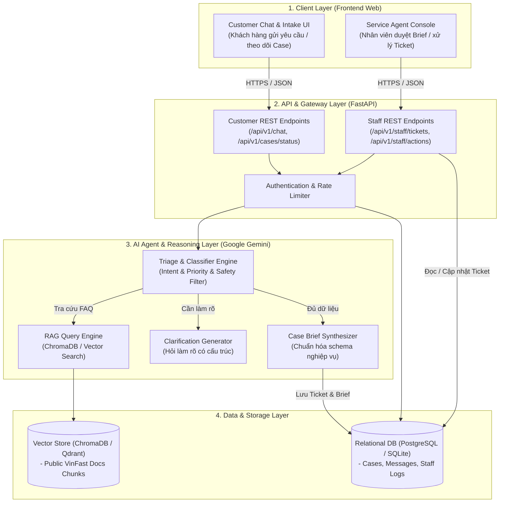

# System Overview Architecture

> **Người phụ trách chính:** Long (AI/Agent) + Triển (Backend)  
> **Cập nhật lần cuối:** 2026-09-24  
> **Trạng thái:** Draft / In Review

---

## 1. Kiến trúc Tổng thể Hệ thống (High-Level Architecture)

---

## 2. Các Thành phần Cốt lõi (Core Components)

### 2.1. Client Layer (Frontend)
* **Customer Chat App:** 
  * Cung cấp giao diện chat trực quan, hiển thị tin nhắn, gợi ý trả lời nhanh (quick replies), màn hình thông tin Ticket & Trạng thái.
  * **Quy tắc an toàn:** Không bao giờ hiển thị suy luận nội bộ (Chain-of-Thought) của AI cho khách hàng.
* **Service Agent Console (Staff):**
  * Dashboard quản lý ticket theo thời gian thực (Ticket Queue).
  * Chi tiết Ticket (Ticket Detail): Xem Case Brief do AI trích xuất, xem lại đoạn chat của khách, các nút thao tác `Approve`, `Edit`, `Reroute`, `Close`.

### 2.2. API Layer (FastAPI / Python)
* Tiếp nhận và xác thực request từ Client.
* Kiểm soát phân quyền (Role-based: Customer vs Staff).
* Chuyển tiếp payload vào Agent Pipeline và lưu vết dữ liệu vào cơ sở dữ liệu.

### 2.3. AI Agent Layer (Google Gemini SDK)
* **Triage Engine:** Phân loại 4 Intent (`Charging/Battery`, `Service/Incident`, `Sales/General Info`, `Complaint/Feedback`).
* **Hard Rule & Safety Guard:** Kiểm tra từ khóa khẩn cấp trước khi cho LLM xử lý.
* **Brief Generator:** Định dạng thông tin rời rạc thành JSON Case Brief có cấu trúc nghiêm ngặt.

### 2.4. Data & Storage Layer
* **Database quan hệ (SQLite cho MVP / PostgreSQL cho Prod):** Lưu trữ bảng `cases`, `messages`, `case_briefs`, `staff_audit_logs`.
* **Vector Database:** Lưu trữ embeddings các tài liệu công khai chính thức của VinFast phục vụ RAG.
