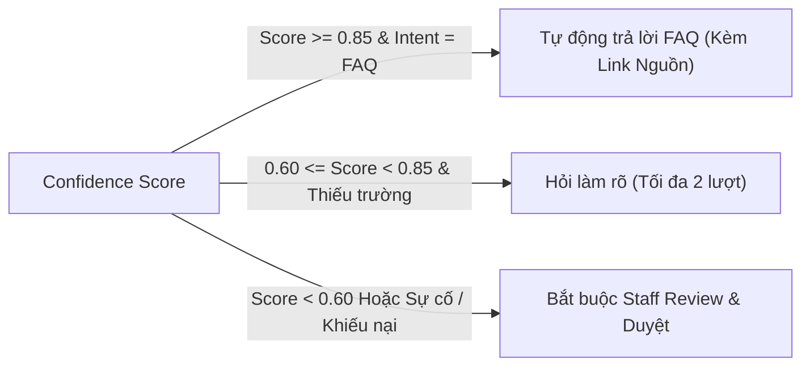

# Triage & Human-in-the-Loop (HITL) Rules

> **Người phụ trách chính:** Long (AI) + Khôi (RAG/Data)  
> **Cập nhật lần cuối:** 2026-09-24  
> **Trạng thái:** In Review (Đã cập nhật Rule Critical kết hợp & Giới hạn Clarification)

---

## 1. Bảng Quy tắc Triage Cứng (Hard Rules & Keyword Matrix)

> [!CAUTION]
> Các quy tắc dưới đây là **Hard Rule bằng Code/Regex**, thực thi độc lập trước khi gửi prompt cho LLM. Không được để các quy tắc an toàn này chỉ nằm trong System Prompt.

| Mức độ Ưu tiên | Điều kiện / Tổ hợp Tín hiệu Kích hoạt | Hành vi Hệ thống | Bắt buộc Staff Review? |
| :--- | :--- | :--- | :---: |
| **CRITICAL** | 1. `cháy`, `khói`, `mất phanh`, `nổ lốp`, `tai nạn`, `kẹt chân ga`, `ngập nước đến sàn` 2. **Tổ hợp:** `rùa vàng` + (`cao tốc` OR `không kiểm soát` OR `giảm công suất nguy hiểm` OR `dừng giữa đường`) | - Hiển thị ngay cảnh báo an toàn & Hotline cứu hộ (1900-232389). - Bỏ qua bước hỏi làm rõ. - Tạo Case Brief mức CRITICAL và đẩy lên đỉnh hàng đợi Staff. | **BẮT BUỘC 100%** |
| **HIGH** | 1. `không nhận sạc`, `ngắt sạc liên tục`, `lỗi BMS`, `lỗi súng sạc`, `mất nguồn 12V`, `không mở được cửa` 2. `rùa vàng` (khi xe vẫn di chuyển bình thường, không ở điều kiện nguy hiểm) | - Kích hoạt luồng hỏi làm rõ (tối đa 2 lượt gom thông tin). - Tạo Case Brief kỹ thuật. - Đẩy vào Staff Queue để kỹ thuật viên duyệt. | **BẮT BUỘC 100%** |
| **MEDIUM** | `điều hòa không mát`, `màn hình đơ/treo`, `kính không lên`, `cảm biến áp suất lốp`, `khiếu nại thái độ`, `chậm bảo dưỡng` | - Thu thập thông tin mô tả chi tiết (tối đa 2 lượt). - Tạo Case Brief và điều phối xưởng dịch vụ / CSKH. | **BẮT BUỘC 100%** |
| **LOW** | `hỏi tính năng app`, `tra cứu bảo hành`, `giá xe`, `hướng dẫn ứng dụng VinFast`, `tính năng ADAS` | - Truy xuất RAG FAQ công khai. - Trả lời kèm trích dẫn URL đã kiểm chứng. - Nếu không có nguồn tin cậy, chuyển tạo Case hỗ trợ. | Không (trừ khi RAG thất bại hoặc khách yêu cầu gặp người) |

---

## 2. Bảng Danh mục Trường Thông tin Bắt buộc & Quy tắc Clarification

### 2.1. Danh mục Trường Bắt buộc theo từng Intent
| Intent | Các trường Bắt buộc (Required Fields) | Gợi ý thu thập |
| :--- | :--- | :--- |
| `Charging/Battery` *(Làm sâu)* | 1. Dòng xe (VF3, VF5, VF6, VF7, VF8, VF9, e34) 2. Vị trí trạm sạc / Mã trụ sạc (nếu có) 3. Hiện tượng cụ thể / Mã lỗi màn hình / Màu đèn trụ | Gom vào 1 câu hỏi làm rõ kèm Quick Replies |
| `Service/Incident` *(Làm sâu)* | 1. Dòng xe 2. Biểu tượng đèn cảnh báo / Mã lỗi hiển thị 3. Tình trạng vận hành xe (có di chuyển an toàn được không) | Gom câu hỏi an toàn + mã cảnh báo |
| `Complaint/Feedback` *(Tinh gọn)* | 1. Showroom / Xưởng dịch vụ liên quan 2. Nội dung phản ánh tóm tắt | Thu thập ngắn gọn, chuyển ngay Staff quản lý |
| `Sales/General Info` *(Tinh gọn)* | 1. Chủ đề tra cứu (Tính năng app, Dịch vụ pin, Cảnh báo) | Truy vấn RAG FAQ từ tài liệu chính thức |

### 2.2. Quy chuẩn Giới hạn Làm rõ (Clarification Boundary Rule)
> [!IMPORTANT]
> * **Tối đa 2 lượt** Agent chủ động gửi câu hỏi làm rõ.
> * **Mỗi lượt chỉ gửi đúng 1 tin nhắn**, có thể gom nhiều dữ kiện cần hỏi và **bắt buộc kèm Quick Replies** để khách bấm chọn nhanh.
> * **Xử lý trạng thái rõ ràng:**
>   * **Sau 2 lượt vẫn thiếu dữ kiện:** Tạo Case $\rightarrow$ `Status = Needs Information`. Case này vẫn xuất hiện ở Staff Queue với nhãn "Thiếu thông tin" để Staff có thể tự tiếp quản hoặc gửi yêu cầu bổ sung.
>   * **Khi đủ dữ kiện và Agent sinh Brief hoàn chỉnh:** Vòng đời chuyển dịch tuần tự: `New` $\rightarrow$ `Staff Reviewing` $\rightarrow$ `In Progress`.

---

## 3. Ngưỡng Tự tin (Confidence Threshold) & Điều kiện bắt buộc HITL

Hệ thống tính toán `confidence_score` $\in [0.0, 1.0]$ cho việc phân loại Intent và trích xuất dữ liệu:

### Các trường hợp BẮT BUỘC 100% phải qua Human Review (Staff Console):
1. Toàn bộ ticket thuộc Intent `Charging/Battery`, `Service/Incident`, `Complaint/Feedback`.
2. Mọi trường hợp có cờ `CRITICAL` hoặc `HIGH`.
3. Câu hỏi tra cứu thông tin (FAQ) nhưng điểm tương đồng vector RAG $< 0.70$ hoặc không có tài liệu trích dẫn.
4. Mọi yêu cầu liên quan đến cam kết tài chính, bồi thường, khiếu nại chất lượng dịch vụ.

---

## 4. Ghi nhận Log Đánh giá Nhân viên (Staff Reviewer Feedback Audit)

Để đánh giá độ chính xác của AI Agent qua thời gian, hệ thống ghi log mọi thao tác của Staff trên Console:

* `original_ai_brief`: Bản tóm tắt do AI sinh ra.
* `edited_staff_brief`: Bản tóm tắt sau khi nhân viên chỉnh sửa (nếu có).
* `action_taken`: `APPROVE` | `EDIT_BRIEF` | `REROUTE` | `REQUEST_INFO` | `CLOSE` | `REOPEN`.
* `staff_correction_category`: `WRONG_INTENT`, `MISSED_CRITICAL_INFO`, `INCORRECT_SUGGESTION`, `HALLUCINATION`.
