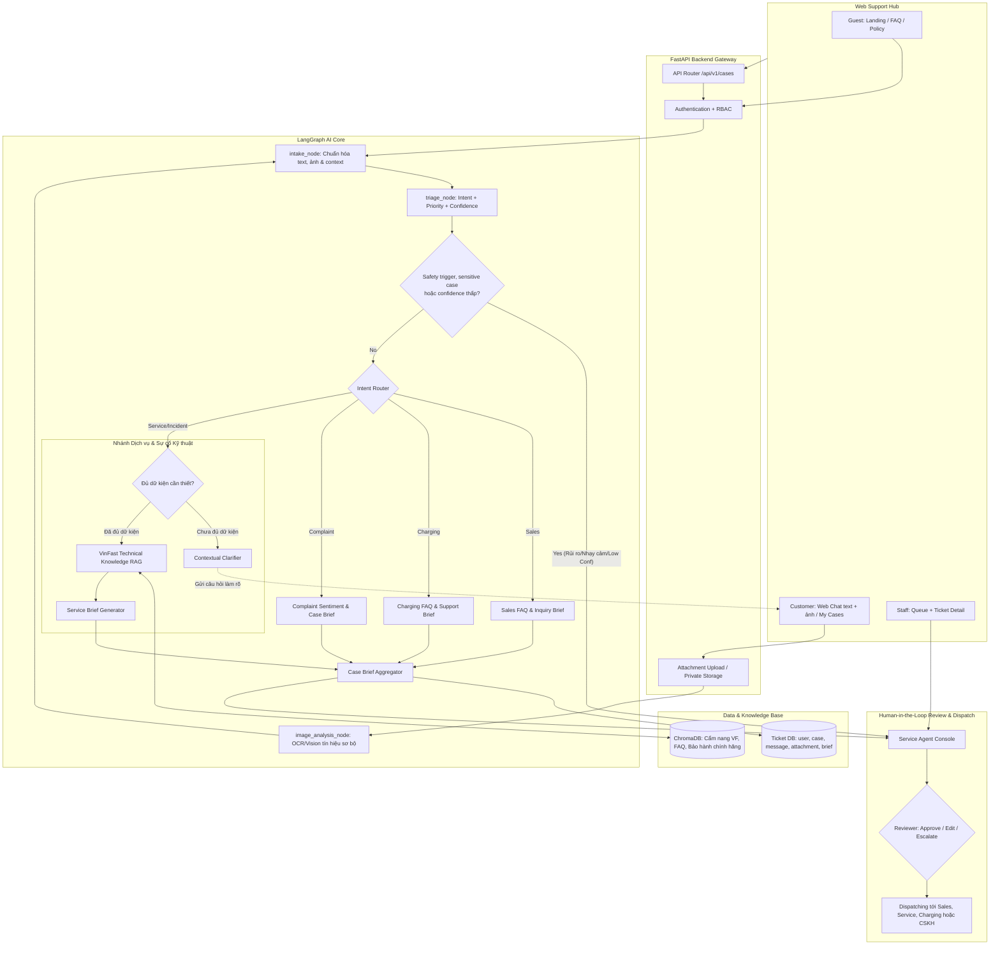
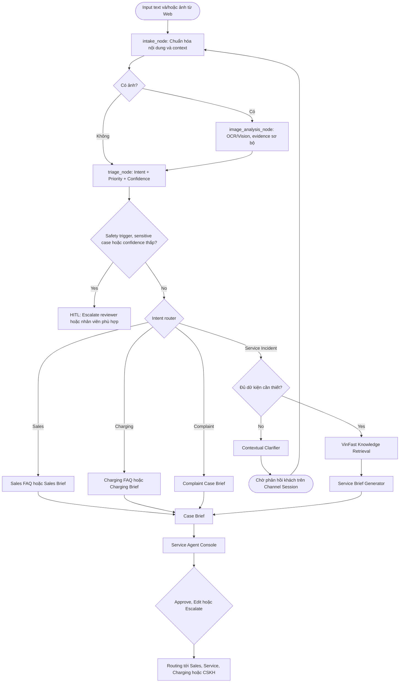

# Architecture Diagram — VinFast ServiceFlow AI (VFO2O-18)

## 1. System Overview (Web Support Hub & Service Flow)

---

## 2. LangGraph Detailed State Machine

---

## 3. Component Details & Responsibility Matrix

| Component | Technology | Chỉnh lại theo kiến trúc chuẩn |
|---|---|---|
| **Vector DB** | ChromaDB / FAISS | Lưu trữ tài liệu chính hãng, FAQ xe điện, chính sách bảo hành, cẩm nang hướng dẫn sử dụng xe VinFast |
| **LLM Inference** | LLM API hỗ trợ Structured Output | Cấu hình linh hoạt theo môi trường (`gpt-4o-mini`, `gpt-4o`, `gemini-1.5-flash`, v.v.) phục vụ phân loại intent, trích xuất slot, tóm tắt brief |
| **Guardrails & Safety** | Rule Engine + Sentiment + Guard Prompts | Bổ sung **confidence threshold**, bắt **complaint sensitive case**, **safety emergency trigger** và chính sách từ chối yêu cầu ngoài phạm vi |
<!-- update info from feature/ai-long branch: merge giữ nguyên cả hai phiên bản để nhóm review sau. -->
<!-- Hai phần bên dưới có thể khác nhau về trạng thái, phạm vi hoặc số liệu; chưa chọn một phiên bản thay cho phiên bản còn lại. -->

<!-- Phiên bản feature/ai-khoi -->
| **Database** | SQLite (MVP) / PostgreSQL | Lưu trữ đầy đủ: `source_channel`, `intent`, `priority`, `confidence_score`, `suggested_action`, `captured_fields`, `reviewer_feedback`, `status` |

<!-- Phiên bản feature/ai-long -->
| **Attachment / Vision** | Private storage + OCR/Vision API | Lưu ảnh táp-lô; trích xuất tín hiệu sơ bộ để hỏi context, không chẩn đoán kỹ thuật |
| **Database** | SQLite (MVP) / PostgreSQL | Lưu user/role, case, message, attachment, intent, priority, brief, audit log, ticket status |
| **Console (HITL)** | React / Next.js / Tailwind UI | Service Agent Console — **Reviewer là người quyết định cuối cùng** với escalation, chỉnh sửa brief và routing trước khi dispatch |
