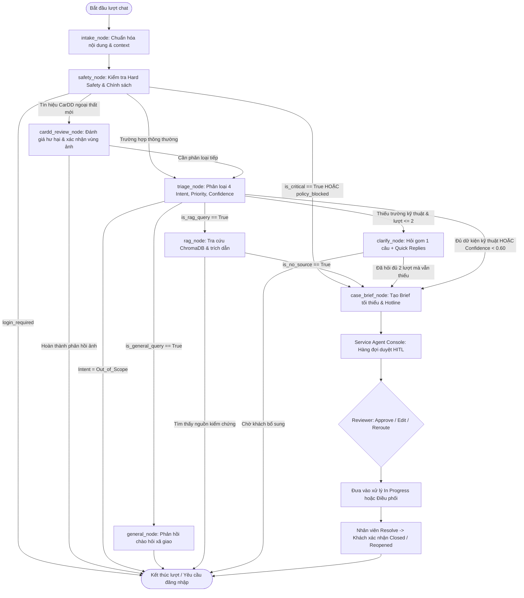

# Architecture Diagram — VinFast ServiceFlow AI (VFO2O-18)

## 1. System Overview (Web Support Hub & Service Flow)

Hệ thống kết hợp giữa Web Support Hub (Frontend), Gateway API (FastAPI) và AI Core (LangGraph StateGraph). Dưới đây là sơ đồ hoạt động tổng thể và các luồng chi tiết.

### Sơ đồ Trực quan Chính thức

#### 1. Activity Tổng thể MVP Main (Khách hàng — Hệ thống AI — Nhân viên)


#### 2. Sơ đồ Hoạt động Toàn hệ thống (End-to-End System Activity)


#### 3. Sơ đồ Xử lý Một lượt Hội thoại Khách hàng (Customer Chat Turn Activity)


---

## 2. Kiến trúc Phân tầng Kỹ thuật (Layered Architecture)

```mermaid
graph TB
    subgraph ClientLayer[1. Web Support Hub (Next.js 14)]
        Guest[Guest: Landing / FAQ / Giới hạn 5 lượt]
        Customer[Customer: Web Chat / Upload ảnh / Theo dõi Case]
        Staff[Staff: Service Agent Console / Hàng đợi / Review]
    end

    subgraph APILayer[2. FastAPI Gateway & RBAC]
        Router[API Routers: /customer, /staff, /auth, /public]
        Auth[Authentication + RBAC: JWT, Session Isolation]
        Upload[Attachment Upload / Private Storage]
        Location[Location Consent + Service Point API]
    end

    subgraph AgentLayer[3. LangGraph AI Core]
        IntakeNode[intake_node: Chuẩn hóa text, ảnh & context]
        SafetyNode[safety_node: Hard Safety Rules & Policy Check]
        CarddNode[cardd_review_node: Tín hiệu CarDD & xác nhận ảnh]
        TriageNode[triage_node: Intent + Priority + Confidence]
        GeneralNode[general_node: Xã giao & chào hỏi]
        RagNode[rag_node: RAG ChromaDB & Trích dẫn nguồn]
        ClarifyNode[clarify_node: Hỏi làm rõ tối đa 2 lượt + Quick Replies]
        BriefNode[case_brief_node: Tổng hợp Case Brief chuẩn hóa]
    end

    subgraph DataLayer[4. Data & Knowledge Base]
        DB[(Relational DB: Users, Sessions, Cases, Messages, Briefs, Audit)]
        VDB[(ChromaDB: Cẩm nang VF, FAQ, Bảo hành chính hãng)]
        Models[(Local ONNX Models: multilingual-e5-small embeddings)]
    end

    subgraph HITLLayer[5. Human-in-the-Loop Review & Dispatch]
        Console[Service Agent Console]
        ReviewerAction{Reviewer: Approve / Edit / Reroute / Request Info}
        ResolveAction[Resolve Ticket & Gửi Customer Update]
    end

    Guest --> Auth
    Customer --> Router
    Customer --> Upload
    Customer --> Location
    Staff --> Console
    Router --> Auth
    Auth --> IntakeNode
    Upload --> IntakeNode
    Location --> BriefNode
    IntakeNode --> SafetyNode
    
    SafetyNode -- Khẩn cấp / Vi phạm --> BriefNode
    SafetyNode -- Ảnh ngoại thất / CarDD --> CarddNode
    SafetyNode -- Bình thường --> TriageNode

    CarddNode --> TriageNode
    TriageNode -- Xã giao --> GeneralNode
    TriageNode -- FAQ / Sales --> RagNode
    TriageNode -- Sự cố / Thiếu dữ kiện --> ClarifyNode
    TriageNode -- Đủ dữ kiện / Confidence thấp --> BriefNode

    ClarifyNode -- Hết 2 lượt / Cần hồ sơ --> BriefNode
    RagNode -- Không tìm thấy nguồn --> BriefNode
    RagNode <--> VDB
    VDB <--> Models

    BriefNode --> DB
    BriefNode --> Console
    Console --> ReviewerAction
    ReviewerAction --> ResolveAction
```

---

## 3. LangGraph State Machine Chi tiết (Khớp mã nguồn `src/agents/graph.py`)



---

## 4. Bảng Chi tiết Thành phần Kỹ thuật & Trách nhiệm (Component Matrix)

| Thành phần | Công nghệ | Trách nhiệm & Hiện thực thực tế |
|---|---|---|
| **Vector DB** | ChromaDB (Local SQLite) | Lưu trữ vector embeddings tài liệu cẩm nang VinFast (VF3, VF5, VF8, VF9, e34), FAQ sạc pin và bảo hành. |
| **Local Embedding Model** | `Xenova/multilingual-e5-small` (ONNX Quantized) | Tự động tải qua `scripts/download_models.py` lưu tại `data/models/multilingual-e5-small/`, suy luận nhúng cục bộ không phụ thuộc API ngoài. |
| **LLM Inference** | Google Gemini (`gemini-2.0-flash`) HOẶC OpenAI Gateway (`openai/gpt-5.6` qua LiteLLM) | Phân loại Intent có cấu trúc, trích xuất thực thể (slot filling), tóm tắt Case Brief và đàm thoại. Cấu hình linh hoạt qua `.env`. |
| **Guardrails & Hard Safety** | Rule Engine Regex + Boundary Guards | Phát hiện khẩn cấp độc lập & kết hợp (rùa vàng trên cao tốc, bốc khói, mất phanh), chặn PII (SĐT, CCCD, biển số), chặn Out-of-Scope và khóa cứng 2 lượt clarification. |
| **Image & Vision Triage** | Google Gemini Vision & CarDD Runtime | Tự động phân loại định tuyến ảnh táp-lô, màn hình trụ sạc hoặc nhận diện sơ bộ vùng va chạm ngoại thất xe. |
| **Location & Service Points** | Location Consent API + Seed Service Points | Gợi ý 3-5 xưởng dịch vụ hoặc trạm sạc VinFast gần nhất khi khách đồng ý chia sẻ vị trí hoặc nhập khu vực. |
| **Database & ORM** | SQLite (MVP) / PostgreSQL | SQLAlchemy 2.0 ORM lưu trữ Cases, Messages, Attachments, Case Briefs, Chat Sessions và Staff Audit Logs. |
| **Frontend Web** | Next.js 14 App Router + Tailwind CSS | Phục vụ Web Support Hub gồm Customer Chat, Public Knowledge Hub, và Service Agent Console với cơ chế Session Isolation. |

