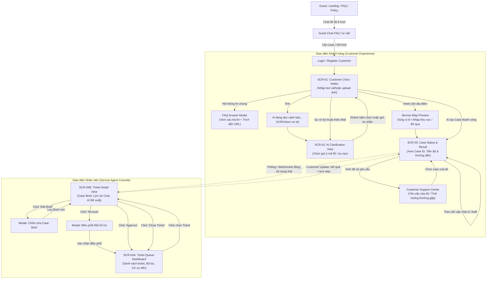

# UI Flow Diagram & Navigation

> **Người phụ trách chính:** Việt (UI/UX Lead)  
> **Cập nhật lần cuối:** 2026-09-24  
> **Trạng thái:** Draft / In Review

---

## 1. Sơ đồ Click-Flow Toàn diện

---

## 2. Quy tắc Điều hướng & Trải nghiệm (UX Rules)

1. **Không chặn người dùng (Non-blocking):** Khi AI đang xử lý Triage, màn hình Chat phải hiển thị trạng thái `AI đang phân tích thông tin...` với hiệu ứng skeleton / pulse nhẹ, không làm đơ giao diện.
2. **Cảnh báo khẩn cấp (Emergency Banner):** Nếu case bị đánh dấu `CRITICAL`, giao diện Customer xuất hiện banner đỏ cố định ở đỉnh màn hình: *"Đây là tình huống khẩn cấp. Vui lòng giữ an toàn và gọi ngay Hotline 1900-232389."*
3. **Phản hồi trạng thái tức thời cho Staff:** Mỗi khi Staff bấm `Approve` hoặc `Edit`, nút bấm hiển thị trạng thái loading spinner ngắn (< 500ms) và chuyển sang ticket tiếp theo trong hàng đợi tự động (Next ticket in queue).
4. **Location consent:** Map không hiển thị mặc định. Chỉ hiển thị khi triage cần địa điểm; Customer chọn `Dùng vị trí hiện tại`, `Nhập khu vực` hoặc `Bỏ qua`.
5. **Support Center:** Case search, timeline và chat history chỉ áp dụng case của Customer đăng nhập. “Tình huống thường gặp” là knowledge content đã biên soạn/ẩn danh.
