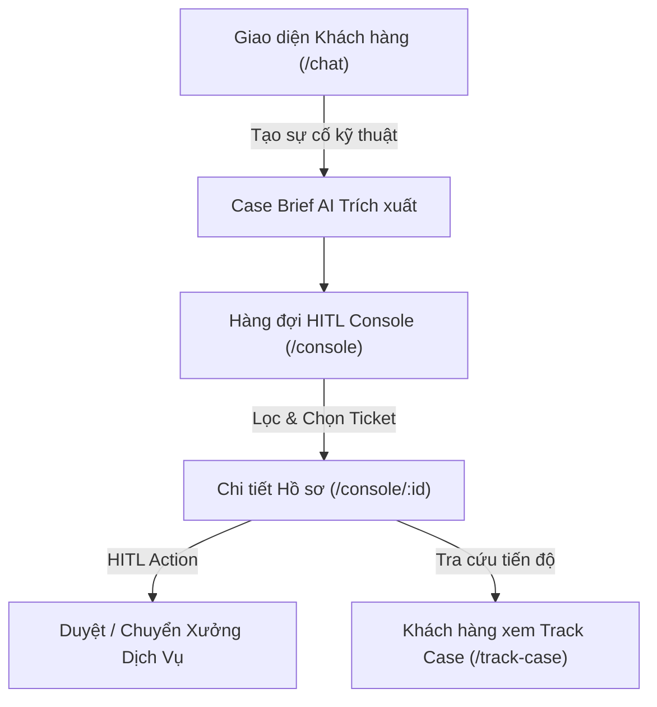

# Báo Cáo Hiện Trạng & Lộ Trình Phát Triển UI/UX Frontend
> **Dự án:** VinFast ServiceFlow AI (P-142)  
> **Phiên bản Milestone:** Demo v1.0 — Phục vụ buổi báo cáo / demo  
> **Cập nhật ngày:** 30/09/2026  
> **Người phụ trách:** Frontend & UI/UX Team  
> **Tài liệu tham chiếu:** [screen-spec.md](screen-spec.md) | [ui-flow.md](ui-flow.md)

---

## 1. Tổng Quan Những Gì Đã Làm (What Has Been Done)

Dựa trên tiêu chuẩn của bộ kỹ năng **Senior UI/UX Orchestrator** và đặc tả màn hình (`screen-spec.md`), toàn bộ giao diện người dùng (Frontend) đã được tái cấu trúc, chuẩn hóa và khóa trạng thái ổn định phục vụ buổi Demo.

---

### 1.1. Bàn Điều Phối Dịch Vụ (HITL Console — `/console`)

Đây là màn hình cốt lõi dành cho **Cố vấn Dịch vụ / Nhân viên Kỹ thuật xưởng**:

1. **Dải chỉ số vận hành (4-KPI Metric Strip):**
   - **Tổng hồ sơ:** Thống kê tổng số phiếu trong ca trực.
   - **Chờ duyệt (Staff Reviewing):** Điểm nhấn màu vàng hổ phách kèm chấm xung nhịp (`animate-ping`) cảnh báo các ca cần người duyệt gấp.
   - **Khẩn cấp (CRITICAL):** Điểm nhấn đỏ lửa cảnh báo các sự cố dừng xe trên cao tốc, kẹt sạc hoặc lỗi pin nghiêm trọng.
   - **Đang xử lý / Hoàn tất:** Tỷ lệ giải quyết hồ sơ trong ngày.
2. **Thanh điều khiển tìm kiếm & Lọc đa chiều (Command Filter Bar):**
   - **Tìm kiếm tức thì:** Tìm theo mã hồ sơ (`CASE-2026...`), mã định danh khách (`CUST_MOCK_01`), dòng xe (`VF8`, `VF5`...), hoặc phân loại lỗi.
   - **Tab trạng thái kèm số đếm:** `Tất cả`, `Chờ duyệt`, `Cần bổ sung`, `Đang xử lý`, `Đã giải quyết` tự động cập nhật số lượng badge.
   - **Bộ lọc mức ưu tiên:** `CRITICAL`, `HIGH`, `MEDIUM`, `LOW` với màu sắc nhận diện tiêu chuẩn.
   - **Sắp xếp linh hoạt:** Sắp xếp theo *Mới nhất*, *Mức ưu tiên cao nhất*, hoặc *Độ tin cậy AI*.
   - **Nút "Đặt lại bộ lọc":** Xuất hiện thông minh khi người dùng đang áp dụng bất kỳ bộ lọc nào.
3. **Bao phủ 100% Mô hình Trạng thái (Full State Coverage):**
   - **Loading State:** Hiệu ứng Skeleton Shimmer mô phỏng cấu trúc bảng/thẻ thật, loại bỏ giật khung hình.
   - **Empty State:** Minh họa hộp thư rỗng, thông điệp tiếng Việt thân thiện kèm nút bấm đặt lại bộ lọc.
   - **Error State:** Banner cảnh báo lỗi kết nối máy chủ kèm nút "Thử lại kết nối".
   - **Offline Demo Graceful Fallback:** Tự động kết nối API Backend (`/api/v1/staff/tickets`); nếu backend chưa bật hoặc mất mạng, tự động chuyển về bộ mock data mẫu mà không bao giờ crash giao diện.
4. **Thẻ hồ sơ (Ticket Card) phân cấp thị giác cao:**
   - Hồ sơ `CRITICAL` có viền đỏ cảnh báo và hiệu ứng phát quang nhẹ (`animate-pulse`).
   - Huy hiệu dòng xe, mã khách hàng No-PII Safe, độ tin cậy AI trích xuất có màu sắc phân định trực quan.

---

### 1.2. Màn Hình Xem Xét & Phê Duyệt Hồ Sơ Chi Tiết (`/console/[id]`)

1. **Header Vận Hành Thông Minh:**
   - Breadcrumb quay lại hàng đợi, mã hồ sơ font mono cỡ lớn.
   - Chip đo lường **Độ tin cậy AI trích xuất (AI Confidence)** hiển thị nổi bật dạng phần trăm.
2. **Thẻ Tóm Tắt Sự Cố (AI Case Brief Card):**
   - Chuyển đổi toàn bộ thuật ngữ kỹ thuật sang tiếng Việt thân thiện (`Dòng xe`, `Vị trí trạm sạc`, `Mã trụ sạc`, `Mã lỗi DTC`, `Dung lượng pin SoC`). Mã lỗi hiển thị font mono đỏ nổi bật.
   - **Chế độ chỉnh sửa Brief trực tiếp:** Cho phép nhân viên sửa lại nội dung tóm tắt do AI trích xuất, có bộ đếm ký tự và cặp nút "Lưu tóm tắt" / "Hủy".
   - Huy hiệu `Đã điều chỉnh bởi Staff` phục vụ kiểm toán dữ liệu (Audit Trail).
3. **Bảng Thao Tác Quyết Định Của Nhân Viên (HITL Action Bar):**
   - Khẳng định vai trò: *“AI Agent đề xuất — Nhân viên giữ quyền quyết định cuối cùng”*.
   - Ô nhập ghi chú điều phối nội bộ chuyển tiếp sang hệ thống xưởng (DMS).
   - **4 nút hành động phân tầng màu sắc rõ rệt:**
     - **Duyệt Phương Án & Điều Phối (Xanh lá Emerald):** Chuyển status sang `In Progress`.
     - **Yêu Cầu Bổ Sung Tin (Vàng Amber):** Chuyển status sang `Needs Information`.
     - **Chuyển Tuyến Xưởng (Xanh dương Indigo):** Điều phối lại ca sang đội cứu hộ hoặc xưởng khác.
     - **Đóng Hồ Sơ (Xám Slate):** Hoàn tất xử lý ca.
   - Hiệu ứng thông báo Toast thành công tự động biến mất sau 4 giây.
4. **Nhật Ký Hội Thoại (Conversation Timeline):**
   - Cuộn mượt mà thích ứng (`max-h-[75vh]`).
   - Phân biệt rõ rệt bong bóng chat của **Khách hàng** (Xanh dương), **AI Agent** (Xanh mòng két Teal), và **Cố vấn Dịch vụ** (Tím Indigo).

---

### 1.3. Các Phân Hệ Frontend Khác Đã Hoàn Thiện

* **Khung Chat Khách Hàng (`/chat`):** Bong bóng chat chuẩn hóa, bộ 3 câu hỏi gợi ý nhanh (Quick Prompts), chip làm rõ dữ kiện kỹ thuật (Clarification Chips), banner khẩn cấp gọi hotline cứu hộ khi phát hiện lỗi nguy hiểm.
* **Tra Cứu Hồ Sơ (`/track-case`):** Cho phép khách hàng nhập mã Case để kiểm tra tiến độ tiếp nhận theo từng bước (Step progress bar).
* **Đăng Nhập / Phân Quyền (`/login` & `/register`):** Hỗ trợ chuyển đổi nhanh vai trò Khách hàng (Customer) và Nhân viên (Staff).
* **Hệ Thống Design System Tokens:** Tích hợp bộ màu VinFast ServiceFlow chuẩn mực (`service.primary`, `service.mint`, `service.warning`, `service.critical`), typography Inter/SF Pro, đạt chuẩn tiếp cận WCAG 2.1 AA.

---

## 2. Kịch Bản Khuyên Dùng Cho Buổi Demo Hôm Nay (Demo Walkthrough)

Để buổi báo cáo diễn ra mạch lạc và phô diễn trọn vẹn điểm mạnh của hệ thống, hãy thực hiện theo 4 bước:

1. **Bước 1: Tiếp nhận sự cố tại `/chat`**
   - Chọn quick prompt: *"Xe VF8 của tôi không sạc được tại trạm sạc"*.
   - Khách trả lời bổ sung thông tin trạm và mã lỗi `CC01`.
   - AI Agent tổng hợp dữ kiện kỹ thuật và thông báo đã tạo hồ sơ `CASE-20260924-001`.
2. **Bước 2: Mở Bàn điều phối `/console`**
   - Trình bày 4 thẻ KPI ca trực, nhấn mạnh số lượng ca chờ duyệt và ca khẩn cấp.
   - Thao tác gõ vào ô tìm kiếm: gõ `VF8` hoặc `CC01` để thấy tốc độ lọc tức thì.
   - Thử click chuyển các tab `Chờ duyệt`, `Khẩn cấp` để biểu diễn State Filtering.
3. **Bước 3: Mở Chi tiết Hồ sơ `/console/CASE-20260924-001`**
   - Chỉ vào thẻ **Case Brief**: AI đã tự bóc tách mã lỗi `CC01`, trụ sạc `P02`, pin `18%`.
   - Bấm nút **"Chỉnh sửa Brief"** để sửa một câu tóm tắt, nhấn **"Lưu tóm tắt"** (thể hiện tính năng Human-in-the-loop).
4. **Bước 4: Thực thi Phê duyệt**
   - Nhập ghi chú xưởng: *"Đã thông báo trạm kỹ thuật Metropolis chuẩn bị cáp sạc thay thế"*.
   - Bấm nút **"Duyệt Phương Án & Điều Phối"** $\rightarrow$ Toast xanh xuất hiện, trạng thái chuyển sang `In Progress`.

---

## 3. Lộ Trình Phát Triển & Hoàn Thiện UI/UX Tiếp Theo (Roadmap)

Sau buổi demo hôm nay, hệ thống Frontend được đề xuất nâng cấp theo 3 giai đoạn:

| Giai đoạn | Mục tiêu | Các hạng mục công việc cụ thể |
| :--- | :--- | :--- |
| **Giai đoạn 1** *(Ngay sau Demo — 1-2 tuần)* | **Tăng cường tương tác & Đồng bộ thời gian thực** | - Tích hợp **Server-Sent Events (SSE) / WebSocket** để hàng đợi tự động nhảy số khi khách tạo case mới mà không cần F5. - Bổ sung **Modal xác nhận điều phối** khi chuyển tuyến xưởng (chọn Showroom / Xưởng dịch vụ vệ tinh từ dropdown). - Âm thanh thông báo nhẹ (chime) khi có ca `CRITICAL` mới rơi vào hàng đợi. |
| **Giai đoạn 2** *(Tháng tiếp theo)* | **Tối ưu năng suất chuyên viên (Productivity & Pro Features)** | - **Phím tắt điều hướng nhanh (Keyboard Shortcuts):** Bấm `J`/`K` để chuyển giữa các ticket, `Enter` để mở, `Cmd+Enter` để duyệt nhanh. - **Dashboard Analytics:** Biểu đồ xu hướng sự cố (thống kê mã lỗi xuất hiện nhiều nhất, thời gian phản hồi trung bình MTTR của Cố vấn). - **Dark Mode:** Bổ sung giao diện tối chuẩn công nghệ cao cho ca trực đêm. |
| **Giai đoạn 3** *(Tương lai gần)* | **Mobile PWA & Tích hợp Đa kênh** | - **PWA Mobile App:** Giao diện tối ưu cho kỹ thuật viên ngoài bãi đỗ xe hoặc trạm sạc dùng điện thoại/máy tính bảng quét mã QR trên xe. - **Export & In Phiếu tiếp nhận:** Xuất file PDF Lệnh sửa chữa kèm chữ ký điện tử để giao tiếp với khách hàng. |

---

## 4. Danh Sách Các File Mã Nguồn Đã Được Khóa & Kiểm Tra

- `frontend/src/features/console/components/TicketQueueContainer.tsx` (Dashboard chính)
- `frontend/src/features/console/components/TicketDetailContainer.tsx` (Màn hình chi tiết)
- `frontend/src/features/console/components/TicketFilters.tsx` (Thanh công cụ lọc & tìm kiếm)
- `frontend/src/features/console/components/TicketCard.tsx` (Thẻ hiển thị ticket)
- `frontend/src/features/console/components/TicketTable.tsx` (Khung bao phủ 4 trạng thái)
- `frontend/src/features/console/components/TicketSkeleton.tsx` (Component hiệu ứng shimmer loading)
- `frontend/src/features/console/components/CaseBriefCard.tsx` (Thẻ tóm tắt sự cố & chỉnh sửa)
- `frontend/src/features/console/components/HitlActionBar.tsx` (Thao tác phê duyệt Cố vấn dịch vụ)
- `frontend/src/features/console/components/ConversationTimeline.tsx` (Lịch sử hội thoại)
- `frontend/src/features/console/hooks/useTickets.ts` & `useTicketDetail.ts` (State hooks & API fallback)
- `frontend/src/features/console/index.ts` (Export module công khai)
