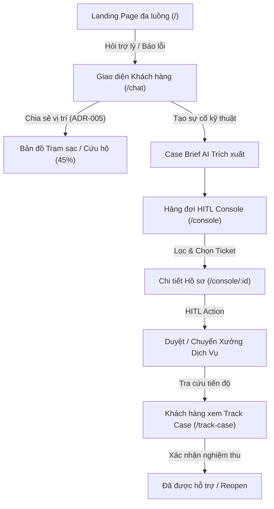

# Báo Cáo Hiện Trạng & Lộ Trình Phát Triển UI/UX Frontend
> **Dự án:** VinFast ServiceFlow AI (P-142)
> **Phiên bản Milestone:** Demo v1.0 — Phục vụ buổi báo cáo / demo
> **Cập nhật ngày:** 04/10/2026
> **Người phụ trách:** Frontend & UI/UX Team
> **Tài liệu tham chiếu:** [screen-spec.md](screen-spec.md) | [ui-flow.md](ui-flow.md) | [ADR-005](../decisions/ADR-005-roles-location-and-customer-confirmation.md)

---

## 1. Tổng Quan Những Gì Đã Làm (What Has Been Done)

Dựa trên tiêu chuẩn của bộ kỹ năng **Senior UI/UX Orchestrator**, đặc tả màn hình (`screen-spec.md`) và quyết định kiến trúc (`ADR-005`), toàn bộ giao diện người dùng (Frontend) đã được tái cấu trúc, chuẩn hóa và khóa trạng thái ổn định phục vụ buổi Demo.

---

### 1.1. Bàn Điều Phối Dịch Vụ (HITL Console — `/console`)

Đây là màn hình cốt lõi dành cho **Cố vấn Dịch vụ / Nhân viên Kỹ thuật xưởng**:

1. **Dải chỉ số vận hành (4-KPI Metric Strip):**
   - **Tổng hồ sơ:** Thống kê tổng số phiếu trong ca trực.
   - **Chờ duyệt (Staff Reviewing):** Điểm nhấn màu vàng hổ phách kèm chấm xung nhịp (`animate-ping`) cảnh báo các ca cần người duyệt gấp.
   - **Khẩn cấp (CRITICAL):** Điểm nhấn đỏ lửa cảnh báo các sự cố dừng xe trên cao tốc, kẹt sạc hoặc lỗi pin nghiêm trọng.
   - **Đang xử lý / Hoàn tất:** Tỷ lệ giải quyết hồ sơ trong ngày.
2. **Thanh điều khiển tìm kiếm & Lọc đa chiều (Command Filter Bar):**
   - **Tìm kiếm tức thì:** Tìm theo mã hồ sơ (`CASE-2026...`), mã định danh khách (`CUST_MOCK_01`), dòng xe (`VF8`, `VF5`...), hoặc phân loại lỗi.
   - **Tab trạng thái kèm số đếm:** `Tất cả`, `Chờ duyệt`, `Cần bổ sung`, `Đang xử lý`, `Đã giải quyết` tự động cập nhật số lượng badge.
   - **Bộ lọc mức ưu tiên:** `CRITICAL`, `HIGH`, `MEDIUM`, `LOW` với màu sắc nhận diện tiêu chuẩn.
   - **Sắp xếp linh hoạt:** Sắp xếp theo *Mới nhất*, *Mức ưu tiên cao nhất*, hoặc *Độ tin cậy AI*.
   - **Nút "Đặt lại bộ lọc":** Xuất hiện thông minh khi người dùng đang áp dụng bất kỳ bộ lọc nào.
3. **Bao phủ 100% Mô hình Trạng thái (Full State Coverage):**
   - **Loading State:** Hiệu ứng Skeleton Shimmer mô phỏng cấu trúc bảng/thẻ thật, loại bỏ giật khung hình.
   - **Empty State:** Minh họa hộp thư rỗng, thông điệp tiếng Việt thân thiện kèm nút bấm đặt lại bộ lọc.
   - **Error State:** Banner cảnh báo lỗi kết nối máy chủ kèm nút "Thử lại kết nối".
   - **Offline Demo Graceful Fallback:** Tự động kết nối API Backend (`/api/v1/staff/tickets`); nếu backend chưa bật hoặc mất mạng, tự động chuyển về bộ mock data mẫu mà không bao giờ crash giao diện.
4. **Thẻ hồ sơ (Ticket Card) phân cấp thị giác cao:**
   - Hồ sơ `CRITICAL` có viền đỏ cảnh báo và hiệu ứng phát quang nhẹ (`animate-pulse`).
   - Huy hiệu dòng xe, mã khách hàng No-PII Safe, độ tin cậy AI trích xuất có màu sắc phân định trực quan.

---

### 1.2. Màn Hình Xem Xét & Phê Duyệt Hồ Sơ Chi Tiết (`/console/[id]`)

1. **Header Vận Hành Thông Minh:**
   - Breadcrumb quay lại hàng đợi, mã hồ sơ font mono cỡ lớn.
   - Chip đo lường **Độ tin cậy AI trích xuất (AI Confidence)** hiển thị nổi bật dạng phần trăm.
2. **Thẻ Tóm Tắt Sự Cố (AI Case Brief Card):**
   - Chuyển đổi toàn bộ thuật ngữ kỹ thuật sang tiếng Việt thân thiện (`Dòng xe`, `Vị trí trạm sạc`, `Mã trụ sạc`, `Mã lỗi DTC`, `Dung lượng pin SoC`). Mã lỗi hiển thị font mono đỏ nổi bật.
   - **Chế độ chỉnh sửa Brief trực tiếp:** Cho phép nhân viên sửa lại nội dung tóm tắt do AI trích xuất, có bộ đếm ký tự và cặp nút "Lưu tóm tắt" / "Hủy".
   - Huy hiệu `Đã điều chỉnh bởi Staff` phục vụ kiểm toán dữ liệu (Audit Trail).
3. **Bảng Thao Tác Quyết Định Của Nhân Viên (HITL Action Bar):**
   - Khẳng định vai trò: *“AI Agent đề xuất — Nhân viên giữ quyền quyết định cuối cùng”*.
   - Ô nhập ghi chú điều phối nội bộ chuyển tiếp sang hệ thống xưởng (DMS).
   - **4 nút hành động phân tầng màu sắc rõ rệt:**
     - **Duyệt Phương Án & Điều Phối (Xanh lá Emerald):** Chuyển status sang `In Progress`.
     - **Yêu Cầu Bổ Sung Tin (Vàng Amber):** Chuyển status sang `Needs Information`.
     - **Chuyển Tuyến Xưởng (Xanh dương Indigo):** Điều phối lại ca sang đội cứu hộ hoặc xưởng khác.
     - **Đóng Hồ Sơ (Xám Slate):** Hoàn tất xử lý ca.
   - Hiệu ứng thông báo Toast thành công tự động biến mất sau 4 giây.
4. **Nhật Ký Hội Thoại (Conversation Timeline):**
   - Cuộn mượt mà thích ứng (`max-h-[75vh]`).
   - Phân biệt rõ rệt bong bóng chat của **Khách hàng** (Xanh dương), **AI Agent** (Xanh mòng két Teal), và **Cố vấn Dịch vụ** (Tím Indigo).

---

### 1.3. Khung Chat Khách Hàng Tinh Gọn (`/chat` — `SCR-01`, `SCR-02`)

* **Luật "Một tin nhắn chỉ một box":** Triệt tiêu hoàn toàn anti-pattern "box lồng box". Toàn bộ câu trả lời nằm trong 1 bong bóng xám nhạt (`bg-slate-100`) duy nhất, không viền; chỉ dẫn an toàn in đậm trực tiếp bên trong; trích dẫn nguồn thu gọn thành chip 1 dòng kèm nút `Xem chi tiết ▾` cho tin nhắn dài.
* **Banner khẩn cấp Sticky 46px:** Đặt full-width dính chặt ngay dưới Navbar (`sticky top-[56px] z-40`), chỉ kích hoạt cho ca khẩn cấp cao tốc/rùa vàng/mất phanh kèm nút gọi hotline cứu hộ `1900-232389`; hoàn toàn ẩn với ca thường (CC01, bảo dưỡng).
* **Phục hồi 70% không gian màn hình:** Header thu nhỏ gọn ~40px, gỡ bỏ 5 card tĩnh chiếm chỗ, ẩn thanh Quick Prompts ban đầu sau khi chat bắt đầu.
* **Gợi ý nhanh (Quick Replies):** Bỏ nhãn thừa `"GỢI Ý TRẢ LỜI NHANH:"`, tự động scroll mượt với `ResizeObserver` và đệm đáy `pb-8 sm:pb-10` chống bị cắt cụt. Bổ sung chip `"Xem bản đồ trạm sạc ›"`.
* **Mã Case ID động:** Tự động sinh `CASE-YYYYMMDD-XXX` theo ngày và số phiên thực tế, reset sạch khi làm mới phiên.

---

### 1.4. Tích Hợp Bản Đồ Dịch Vụ & Vị Trí Tuân Thủ ADR-005 (`SCR-05.4`)

* **Thanh Vị trí Docked:** Đưa card xin vị trí ra khỏi luồng tin nhắn, chuyển thành thanh mỏng dính sát trên ô nhập chat. Tuân thủ nghiêm ngặt 3 tùy chọn: GPS thật (timeout 8s), Nhập khu vực bằng tay, hoặc Bỏ qua.
* **Bản đồ 45% chiều cao panel:** Giảm chiều cao OpenStreetMap xuống 45% (`min-h-[240px]`), đảm bảo thẻ điểm dịch vụ đầu tiên hiển thị trọn vẹn cả 2 nút hành động `Chỉ đường Maps` và `Gọi Hotline` mà không bao giờ bị cắt đáy.
* **Tính khoảng cách Haversine chuẩn xác:** Tính toán từ vị trí GPS thật của xe đến 4 điểm seed chính hãng (Hà Nội, Hải Phòng, TP.HCM, Long Thành), có cảnh báo khi điểm gần nhất vượt bán kính hỗ trợ (> 50 km).
* **Làm mờ ghim ngoài nhóm lọc:** Khi lọc nhóm (ví dụ: `⚡ Trạm sạc`), các ghim thuộc nhóm khác (như xưởng 8 km) tự động chuyển sang trạng thái mờ (`opacity-25 grayscale scale-90 pointer-events-none z-10`), điểm gần nhất trong nhóm có viền radar sáng (`ring-2 ring-[#1E40AF] animate-pulse`), xóa bỏ nhầm lẫn thị giác.
* **Bỏ ký hiệu nội bộ:** Loại bỏ chuỗi `(ADR-005)` khỏi chân trang bản đồ.

---

### 1.5. Tái Cấu Trúc Hero Trang Chủ (`/` — `SCR-05.1`)

* **Tông giọng trung tính:** Đổi từ câu hỏi thiên lệch lỗi *"Xe của bạn đang gặp vấn đề gì?"* sang câu hỏi mở bao quát cả 3 nhóm khách: **"Bạn cần hỗ trợ gì về xe điện?"**.
* **Mô tả đa nhu cầu:** *"Hỏi về sạc, bảo dưỡng, ứng dụng, hoặc báo sự cố xe. Có thể gửi kèm ảnh táp-lô để AI nhận diện sơ bộ."*
* **Placeholder xoay vòng (3.8s):** Tự động luân phiên giữa 4 ngữ cảnh: Lỗi sạc CC01 $\rightarrow$ Lịch bảo dưỡng 12.000km $\rightarrow$ Đặt lịch sạc qua app $\rightarrow$ Biểu tượng rùa vàng.
* **Hàng chip cân bằng 4 nhóm ý định:** ⚡ Tìm trạm sạc gần tôi (Tra cứu), 🔧 Lịch bảo dưỡng 12.000km (Bảo dưỡng), ⚠ Sạc không vào điện CC01 (Sự cố), ⚠ Táp-lô hiện rùa vàng (Sự cố), 📱 Cách dùng app VinFast (Hướng dẫn).
* **Phân định 2 trạng thái rõ rệt:**
  - **Khách hàng đã đăng nhập (Customer):** Lời chào cá nhân hóa, tự điền dòng xe từ profile, hiển thị banner hồ sơ đang mở `CASE-YYYYMMDD-001`.
  - **Khách vãng lai (Guest):** Lời chào kèm link Đăng nhập, dropdown dòng xe có tùy chọn *"Chọn dòng xe (không bắt buộc)"*, quyền an toàn SOS trên cao tốc không bị chặn bởi bước đăng ký tài khoản.
* **Đổi nút hành động:** Từ *"Gửi yêu cầu"* $\rightarrow$ *"Hỏi trợ lý"*.
* **Section 3:** Đổi tên thành *"Chủ đề hỗ trợ thường gặp"*.

---

## 2. Kịch Bản Khuyên Dùng Cho Buổi Demo (Demo Walkthrough)

1. **Bước 1: Tiếp nhận tại Landing Page (`/`)**
   - Giới thiệu Hero đa luồng, chọn chip *"⚡ Tìm trạm sạc gần tôi"* hoặc *"⚠ Sạc không vào điện (CC01)"*.
   - Minh họa dropdown xe tự điền cho Customer và cho phép để trống với Guest.
2. **Bước 2: Trải nghiệm Khung Chat tinh gọn (`/chat`)**
   - Minh họa nguyên tắc "Một tin nhắn chỉ một box": bong bóng xám nhạt duy nhất, chip trích dẫn nguồn 1 dòng.
   - Thử nghiệm phân luồng an toàn: Gõ *"xe báo rùa vàng trên cao tốc"* $\rightarrow$ Sticky Banner đỏ 46px xuất hiện ngay lập tức kèm Hotline `1900-232389`.
   - Bấm chip gợi ý *"Xem bản đồ trạm sạc ›"*, đồng ý chia sẻ vị trí $\rightarrow$ Panel bản đồ trượt ra với tỷ lệ 55/45 mượt mà.
   - Trình bày tính năng làm mờ ghim ngoài nhóm lọc và thẻ điểm gần nhất hiển thị đủ nút `Chỉ đường` + `Gọi Hotline`.
3. **Bước 3: Mở Bàn điều phối `/console`**
   - Trình bày 4 thẻ KPI ca trực, thao tác tìm kiếm tức thì theo Case ID hoặc Model xe.
4. **Bước 4: Mở Chi tiết Hồ sơ `/console/[id]` & Thực thi Quyết định HITL**
   - Bấm chỉnh sửa Case Brief $\rightarrow$ Lưu tóm tắt.
   - Nhập ghi chú điều phối $\rightarrow$ Nhấn **"Duyệt Phương Án & Điều Phối"**.
5. **Bước 5: Khách hàng nghiệm thu tại `/track-case`**
   - Mở màn hình tra cứu, xem Customer Update từ Cố vấn dịch vụ và bấm nút **"Đã được hỗ trợ"** để đóng hồ sơ theo chuẩn ADR-005.

---

## 3. Lộ Trình Phát Triển & Hoàn Thiện UI/UX Tiếp Theo (Roadmap)

| Giai đoạn | Mục tiêu | Các hạng mục công việc cụ thể |
| :--- | :--- | :--- |
| **Giai đoạn 1** *(Ngay sau Demo — 1-2 tuần)* | **Tăng cường tương tác & Đồng bộ thời gian thực** | - Tích hợp **Server-Sent Events (SSE) / WebSocket** để hàng đợi tự động nhảy số khi khách tạo case mới mà không cần F5. - Bổ sung **Modal xác nhận điều phối** khi chuyển tuyến xưởng (chọn Showroom / Xưởng dịch vụ vệ tinh từ dropdown). - Âm thanh thông báo nhẹ (chime) khi có ca `CRITICAL` mới rơi vào hàng đợi. |
| **Giai đoạn 2** *(Tháng tiếp theo)* | **Tối ưu năng suất chuyên viên (Productivity & Pro Features)** | - **Phím tắt điều hướng nhanh (Keyboard Shortcuts):** Bấm `J`/`K` để chuyển giữa các ticket, `Enter` để mở, `Cmd+Enter` để duyệt nhanh. - **Dashboard Analytics:** Biểu đồ xu hướng sự cố (thống kê mã lỗi xuất hiện nhiều nhất, thời gian phản hồi trung bình MTTR của Cố vấn). - **Dark Mode:** Bổ sung giao diện tối chuẩn công nghệ cao cho ca trực đêm. |
| **Giai đoạn 3** *(Tương lai gần)* | **Mobile PWA & Tích hợp Đa kênh** | - **PWA Mobile App:** Giao diện tối ưu cho kỹ thuật viên ngoài bãi đỗ xe hoặc trạm sạc dùng điện thoại/máy tính bảng quét mã QR trên xe. - **Export & In Phiếu tiếp nhận:** Xuất file PDF Lệnh sửa chữa kèm chữ ký điện tử để giao tiếp với khách hàng. |

---

## 4. Danh Sách Các File Mã Nguồn Đã Được Khóa & Kiểm Tra (100% Pass Build)

- `frontend/src/features/landing/components/LandingPage.tsx` (Hero đa luồng, rotating placeholders, intent chips)
- `frontend/src/features/chat/components/CustomerChatContainer.tsx` (Khung chat chính, sticky banner, responsive layout)
- `frontend/src/features/chat/components/ChatMessageItem.tsx` (Nguyên tắc một tin nhắn một box, phân tầng 4 cấp)
- `frontend/src/features/chat/components/ChatFeed.tsx` (Auto-scroll thông minh, ResizeObserver, floating button)
- `frontend/src/features/chat/components/ClarificationChips.tsx` (Quick reply chips bo tròn, bỏ nhãn thừa)
- `frontend/src/features/chat/components/EmergencyAlertBanner.tsx` (Banner đỏ khẩn cấp 46px, hotline cố định)
- `frontend/src/features/chat/components/LocationConsentCard.tsx` (Thanh consent vị trí mỏng dính sát input bar)
- `frontend/src/features/chat/components/ServiceMapPanel.tsx` (Panel bản đồ OpenStreetMap 45%, Haversine, dimming ghim)
- `frontend/src/features/chat/utils/distance.ts` (Công thức khoảng cách Haversine & cảnh báo bán kính 50km)
- `frontend/src/features/chat/constants.ts` (4 trạm sạc / cứu hộ seed chính hãng)
- `frontend/src/features/chat/hooks/useChat.ts` (State hook, Case ID động, intent triggers)
- `frontend/src/app/track-case/page.tsx` (Customer Support Center & nghiệm thu ADR-005)
- `frontend/src/features/console/components/StaffConsoleShell.tsx` (Console layout & role gate)
- `frontend/src/features/console/components/TicketDetailPanel.tsx` (Case detail, HITL actions, editable brief)
- `src/api/customer.py` (FastAPI backend: sinh Case ID động, suggested replies, triage rules)
