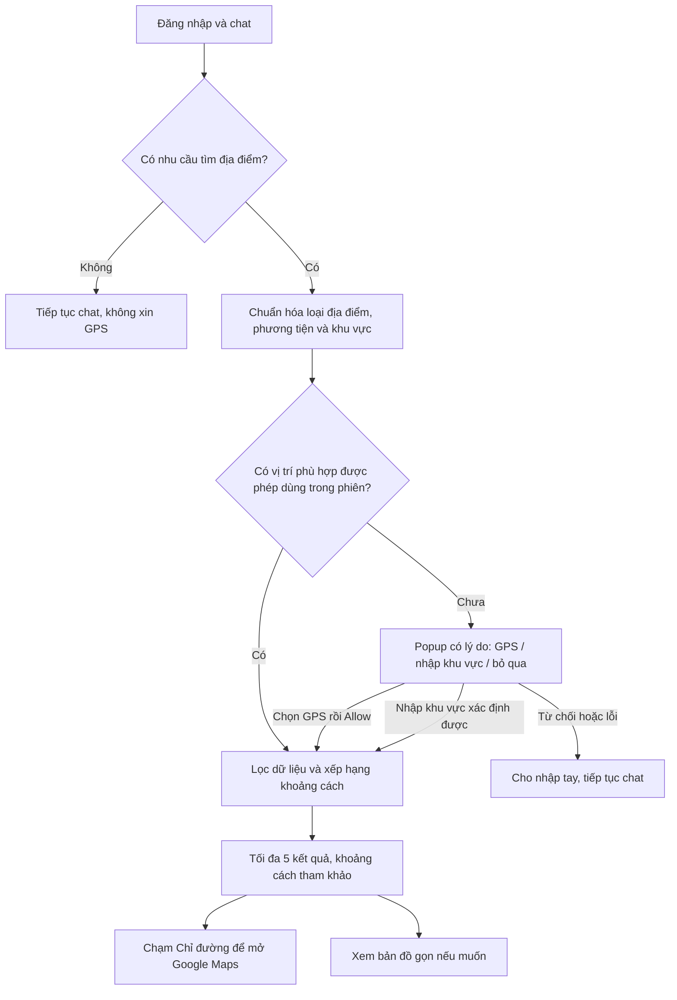

# Kế hoạch GPS theo ngữ cảnh hội thoại

Ngày: 15/10/2026. Phạm vi hiện tại: phân tích code, EDA và chuẩn bị dữ liệu; tài liệu này đề xuất thay đổi sản phẩm, chưa triển khai workflow hoặc thay nguồn runtime.

## Mục tiêu và luồng đề xuất

Khách đăng nhập và chat bình thường. Khi khách hỏi “tìm trạm sạc gần đây”, “showroom gần tôi”, “quanh đây có chỗ sửa xe không?” hoặc tiếp nối ngữ cảnh tương đương, agent nhận diện nhu cầu, xin vị trí đúng mục đích và trả tối đa 5 kết quả phù hợp với nút **Chỉ đường Google Maps** nổi bật.



Ví dụ popup: “Để tìm 5 trạm sạc ô tô gần bạn cho câu hỏi vừa rồi, bạn muốn dùng vị trí hiện tại hay nhập khu vực?” Ba lựa chọn: **Dùng vị trí hiện tại**, **Nhập khu vực**, **Bỏ qua**. Chỉ gọi browser Geolocation sau khi khách chọn GPS. Browser quản lý hộp xin quyền; ứng dụng không thể tự cấp quyền hoặc cam kết trình duyệt luôn hỏi lại. [MDN Geolocation](https://developer.mozilla.org/en-US/docs/Web/API/Geolocation/getCurrentPosition).

Luồng ngắn: gửi câu hỏi → chọn cách cung cấp vị trí nếu cần → tự hiện kết quả → chạm Chỉ đường. Bỏ bước chọn điểm đến để điền chat rồi tự gửi thêm câu hỏi. Nếu đã có consent còn hiệu lực trong phiên và vị trí phù hợp, trả kết quả luôn. Không tự mở tab Google Maps khi nhận kết quả; khách chọn điểm bằng nút chỉ đường.

## Hiện trạng được xác nhận từ code

| Thành phần | Hiện tại | Việc cần thay đổi |
| --- | --- | --- |
| `src/api/customer.py` | Có nhánh từ khóa tìm gần đây, trả `request_location=True`; chỉ chạy khi không bị phân loại sự cố kỹ thuật | Tách nhận diện nhu cầu địa điểm theo lượt/ngữ cảnh; giữ ưu tiên an toàn |
| `CustomerChatContainer.tsx` | Hiện location card theo `criticalBanner` hoặc `requestLocation`; mặc định category trạm sạc; GPS trong callback thao tác | Dùng action có mục đích/category/turn_id; chỉ popup khi cần; truyền đúng showroom/xưởng/trạm |
| `useChat.ts`, `ChatResponseData` | Boolean `request_location` thiếu loại tìm kiếm và lý do | Bổ sung structured action; tương thích phản hồi cũ trong giai đoạn chuyển |
| `service_point_catalog.py` | Fixture demo riêng; Haversine, filter category/radius, sort ổn định | Adapter snapshot, vehicle/status filter, top 5, cache |
| `/service-points/nearby` | Mặc định limit 10, radius 50 km; frontend hiện yêu cầu tới 100 điểm | Trả tối đa 5 theo yêu cầu tìm kiếm, metadata phạm vi và khoảng cách |
| `vinfast_station_search` / `location_service.py` | Hàm có sẵn, phụ thuộc case/session store; xếp theo bình phương chênh lat/lng, nguồn khác | Dùng chung engine Haversine/catalog; tránh kết quả lệch giữa agent/API |
| `ServiceMapPanel.tsx` | Panel lớn, chọn category/điểm và hành động phụ | Danh sách ngắn trong chat, CTA chỉ đường chính, bản đồ thu gọn mặc định |

Chưa thấy lời gọi GPS vô điều kiện khi login trong phần code đã đọc. Trước sửa cần tái hiện tài khoản/phiên mới và phiên có case cũ, xác định card ứng dụng hay browser prompt, truy vết nguồn `criticalBanner/request_location` và restoration. Không coi mô tả hiện tượng là nguyên nhân đã được xác nhận. Hàm station search tồn tại nhưng chưa thấy được nối vào graph như tool tìm địa điểm đang thực thi; cần tích hợp và kiểm chứng rõ.

## Nhận diện intent và quản lý context

Giữ bốn intent nghiệp vụ hiện có. Thêm action địa điểm độc lập, tránh tạo intent nghiệp vụ thứ năm hoặc chuyển mọi câu về sạc thành tìm map.

Structured action đề xuất:

```json
{
  "type": "FIND_NEARBY",
  "request_id": "opaque-id",
  "turn_id": "message-id",
  "category": "CHARGING_STATION",
  "vehicle_type": "CAR",
  "location_reference": "CURRENT_LOCATION",
  "area_text": null,
  "requires_location": true,
  "reason": "Tìm trạm sạc ô tô gần bạn",
  "limit": 5
}
```

- Nhận diện synonym và câu tiếp nối: “tìm chỗ sạc”, “gần đây có không?”, “còn showroom thì sao?”, “chỉ đường tới chỗ đầu tiên”. Liên kết lượt sau với kết quả/pending request hiện tại.
- FAQ “sạc bao lâu?”, “trạm sạc là gì?”, phủ định “không tìm trạm nữa” không xin GPS. “Tìm …” đơn thuần chưa đủ; phải là nhu cầu tìm địa điểm hỗ trợ.
- “Showroom ở Huế” dùng khu vực đã nêu; không ép khách chia sẻ vị trí hiện tại. Nếu tâm khu vực là ước lượng, ghi rõ khoảng cách từ tâm tham chiếu.
- Phân biệt trạm sạc ô tô, xe máy, tủ đổi pin và xưởng. Dùng loại xe đã biết nếu có; thiếu và mơ hồ thì hỏi một câu cần thiết. Không mặc định tủ đổi pin tương thích ô tô.
- Kết hợp rule rõ ràng + structured LLM classification cho diễn đạt/ngữ cảnh; validate allowlist. Confidence thấp/mâu thuẫn thì hỏi rõ; ngưỡng phải chốt bằng bộ eval, chưa coi một số tùy ý là chuẩn.
- Safety gate vẫn ưu tiên khi có nguy hiểm. Hiện hướng dẫn an toàn trước, tránh mở popup che cảnh báo. Không tự bật browser GPS chỉ vì priority CRITICAL.
- Consent tìm gần đây khác quyền chia sẻ vị trí với staff/case. Tra cứu khi chưa có case không được bắt tạo case. Tọa độ dùng bởi engine tìm kiếm, không cần đưa vào prompt LLM.
- Pending request gắn session/owner/turn_id; đổi yêu cầu hoặc bỏ qua thì hủy request cũ, response/GPS callback muộn không được ghi đè. Reload không tự mở lại popup; logout xóa vị trí/context nhạy cảm. Từ chối không bị hỏi lặp ở mỗi lượt; chỉ gợi ý lại khi khách chủ động yêu cầu mới.

## Tích hợp dữ liệu và xếp hạng

Dùng [EDA](gps-data-eda-2026-10-15.md) làm căn cứ. Đã chuẩn bị 68.637 bản ghi tại `data/gps`, gồm bộ ứng viên ô tô đề xuất 16.657 trạm sạc và 351 showroom. Nguồn vẫn `UNVERIFIED`; chưa rõ ngày export và trạng thái không phải thời gian thực.

1. Tạo schema dữ liệu nguồn có category + vehicle_type + source status + provenance. Parse boolean/string nghiêm ngặt; adapter chuyển sang response sản phẩm. Giữ fixture demo riêng để test/fallback có nhãn.
2. Cách ly sáu bản ghi tọa độ, xác minh mapping mã dịch vụ trước khi dùng showroom làm xưởng. Tủ đổi pin không ép vào CHARGING_STATION; mở rộng schema hoặc giữ nguồn riêng đến khi hỗ trợ đầy đủ.
3. Lọc đúng loại phương tiện/category, tính hợp lệ tọa độ, quyền truy cập và status theo chính sách từng nhóm. ACTIVE snapshot chỉ là ứng viên, không được diễn giải “còn cổng trống”. Không lén fallback demo lẫn điểm snapshot trong cùng ranking.
4. Tính Haversine trên server, sort theo khoảng cách đầy đủ rồi tie-break ID; sau đó lấy tối đa 5. LLM không tính hoặc bịa khoảng cách. Dữ liệu chuẩn trả `distance_km` cùng `distance_method=AIRLINE` và origin_kind GPS/AREA_CENTROID.
5. Giữ 50 km làm phạm vi ban đầu; nếu ít hơn 5 thì trả số thực có và lựa chọn mở rộng. Nếu tự mở rộng theo 100/200 km, phải ghi phạm vi cuối và không gọi là “top 5 toàn quốc”. Không tự gợi ý địa điểm rất xa hoặc bịa đủ 5.
6. Không gộp điểm chỉ vì cùng tọa độ. Điều tra entity/site ID và khả năng dịch vụ để tránh 5 kết quả thực chất là một địa điểm, nhưng không xóa những dịch vụ khác nhau.
7. Load/cache catalog một lần theo revision/hash, benchmark trên 68k dòng; chỉ thêm spatial index khi đo cho thấy cần. Lập cơ chế thay snapshot có validation và rollback, không đọc raw CSV mỗi lượt chat.

**Khoảng cách dự đoán:** MVP dùng khoảng cách địa lý chính xác theo tọa độ nhưng ghi “đường chim bay, tham khảo”, không gọi là quãng đường lái xe. CSV không có nhãn road distance/ETA nên chưa có căn cứ huấn luyện mô hình dự đoán. Quãng đường/ETA thực xem trên Google Maps; nếu sau này cần trong web, bổ sung routing adapter có nguồn, quota, lỗi và approval riêng cho dịch vụ/khóa cần thiết.

## Tối giản kết quả và map

Ngay dưới câu trả lời agent, tối đa 5 card: tên, loại điểm đúng xe, địa chỉ gọn, khoảng cách và nhãn snapshot. Card đầu đánh dấu “Gần nhất theo đường chim bay”; mỗi card có **Chỉ đường Google Maps** là CTA chính. Chọn điểm không tạo thêm lượt chat và không tạo booking.

Bản đồ mặc định thu gọn sau “Xem bản đồ”; khi mở chỉ hiển thị vị trí hiện tại/tâm khu vực và các điểm đang trả về, marker đánh số theo card. Bỏ danh sách dài, bộ lọc dư và panel lấn chat. Không cần vẽ tuyến đường trong web ở giai đoạn này. UX chi tiết được review riêng khi bắt đầu triển khai.

Tạo link bằng tọa độ đã validate, dạng `https://www.google.com/maps/dir/?api=1&destination=lat,lng&travelmode=driving`; thêm origin khi khách đồng ý dùng tọa độ. Việc nhấn nút chuyển tọa độ sang Google Maps cần được diễn đạt rõ trong UI. Khu vực chưa xác định được tâm thì không bịa origin/khoảng cách. Maps URLs không cần API key; Google Maps xử lý tuyến đường bên ngoài. [Tài liệu Google Maps URLs](https://developers.google.com/maps/documentation/urls/get-started).

## Tool và tài nguyên agent có thể sử dụng

| Tool/tài nguyên | Có sẵn hay đề xuất | Vai trò và giới hạn |
| --- | --- | --- |
| `rg`, terminal, đọc/sửa file | Có sẵn trong workspace | Truy vết request_location, graph, schema và flow frontend; không cần connector ngoài |
| `scripts/eda_gps_catalog.py`; Python csv/json/hashlib/Counter | Đã tạo và chạy trong đợt này | EDA tái lập, staging và kiểm tra chất lượng; không gọi API/cần cài package |
| Hai CSV nguồn, normalized CSV, summary và quality issues | Đã có | Dữ liệu địa điểm; không phải RAG kiến thức xe hay trạng thái live |
| `src/agents/nodes/triage_node.py`, state/graph và LLM adapter hiện có | Có sẵn | Tích hợp classifier/action có cấu trúc, không để LLM chọn tọa độ tùy ý |
| `vinfast_station_search` | Hàm đã có, cần nối graph và sửa nguồn/ranking | Không coi tên hàm là bằng chứng agent đã gọi thành công |
| `classify_location_request(message, context)` | Tool/hàm đề xuất | Trả category/vehicle/location reference/requires_location; validate schema |
| `search_nearby_service_points(origin, category, vehicle_type, limit=5)` | Tool nội bộ đề xuất, bọc engine catalog hiện có | Haversine, filter, metadata; origin từ consent/manual resolver, limit khóa ở 5 |
| `build_directions_url(destination, consented_origin)` | Helper đề xuất; tận dụng `utils/distance.ts` | Link Google Maps deterministic, validate và encode; không phải API định tuyến |
| `LocationConsentCard`, locationTracking, manualAreas | Có sẵn | Consent, GPS/manual fallback và hủy callback; ưu tiên one-shot cho tra cứu, tracking chỉ khi khách chọn rõ |
| `/service-points/nearby`, catalog adapter | Có sẵn | Có thể tái dùng cho chat và frontend cùng một nguồn/ranking |
| `vinfast_manual_search`, RAG service | Có sẵn | Chỉ phục vụ kiến thức/manual khi câu hỏi cần; không dùng vector search để quyết định điểm gần nhất |
| Browser Geolocation + Permissions API | API trình duyệt | Consent, secure context, denied/timeout; không thể ép quyền hay giả vị trí thật |
| Google Maps URLs + MDN | Tài liệu công khai đã đối chiếu | Chỉ đường ngoài web và quy tắc permission; không cần tạo key |
| pytest, frontend Node tests, Playwright Chromium/Firefox, `scripts/verify-gps.sh` | Có trong repository | Bộ kiểm chứng lúc triển khai; dùng tài khoản/GPS giả và cổng riêng, giữ test có ý nghĩa |

Các tên tool đề xuất là thiết kế, chưa phải MCP server/tool đã cài. Không cần bổ sung connector Google Maps/CRM hoặc mua dịch vụ để hoàn thành MVP này.

## Các bước triển khai, phụ thuộc và điều kiện hoàn thành

| Bước | Tệp/phạm vi dự kiến | Kết quả kiểm chứng |
| --- | --- | --- |
| 0. Tái hiện hành vi login và chốt hợp đồng | customer route, AuthContext/useChat, session history, schema | Login/refresh/restore không xin quyền GPS; xác định trigger popup hiện tại |
| 1. Dữ liệu và adapter | `data/gps/*`, importer, catalog service/schema, tests catalog/nearby | Count/hash khớp; 6 tọa độ bị loại; đúng vehicle/status; provenance rõ; fixture demo không bị ghi đè |
| 2. Intent/context/action | triage/state/graph hoặc location-intent service, customer route, response schema | Câu tìm gần đây và câu tiếp nối đúng; FAQ/phủ định không trigger; safety gate giữ nguyên |
| 3. Nearby engine và agent tool | service_point_catalog, location_service, vinfast_tools, API nearby | Cùng nguồn/ranking giữa agent/API; top 5 deterministic; không cần case giả; fallback thiếu dữ liệu rõ |
| 4. Popup và kết quả gọn | useChat/types/chatApi, CustomerChatContainer, LocationConsentCard, ServiceMapPanel hoặc card kết quả mới | Consent theo lượt; denial/manual hoạt động; tự tìm sau khi có vị trí; CTA chỉ đường một chạm |
| 5. Regression và bàn giao | Node/pytest/Playwright, verifier, user-guide và feature report | Toàn bộ tiêu chí dưới đạt; tài liệu ghi cách thử và giới hạn; commit/push theo chỉ định tiếp theo |

Bước 0 và EDA là đầu vào; bước 1 + hợp đồng action hoàn tất trước khi nối UI. Chưa thực hiện bước thay code runtime trong yêu cầu lập kế hoạch này.

Tiêu chí nghiệm thu:

- Login mới/refresh/restore history: không gọi geolocation và không mở popup nếu chưa có yêu cầu mới phù hợp.
- Câu tìm trạm/showroom/xưởng và câu tiếp nối giữ đúng loại điểm/xe; FAQ không mở map. Tình huống nguy hiểm vẫn nhận hướng dẫn an toàn.
- Allow/Block/timeout/GPS kém chính xác đều có luồng hợp lệ; không xin quyền khi chưa nhấn; nhập tay không thành GPS; bỏ qua không bị hỏi lặp.
- GPS thành công tự tìm, không cần bấm “xem map” hoặc gửi thêm câu. Lookup trước case hoạt động; consent tìm kiếm không tự chia sẻ với staff.
- Top 5 tối đa, sort khoảng cách đúng, loại trạm sai xe/hạn chế/lỗi tọa độ; tình huống 0–4 điểm được mô tả trung thực. Snapshot không được gọi là live.
- Request cũ, đổi category, đổi chat, logout và dừng chia sẻ không làm lộ/revive vị trí. Không lưu lịch sử tọa độ hoặc đưa vào prompt/log mặc định.
- Link Google Maps đúng destination, origin đúng consent; map lỗi vẫn dùng danh sách/CTA. Desktop và màn hẹp không che chat, không cuộn ngang.
- Eval intent bao phủ câu có dấu/không dấu, phủ định, mơ hồ, tiếp nối, đổi chủ đề; đo false popup và bỏ sót trước chốt confidence threshold.
- Đo latency/catalog load và thời gian từ cấp vị trí tới kết quả; mục tiêu là giảm thao tác so với baseline, chưa tuyên bố số liệu cải thiện trước khi đo.

## Đã làm và còn lại

Đã phân tích code liên quan, chạy EDA đủ hai nguồn, tạo script + ba artifact dữ liệu + README + báo cáo này và báo cáo EDA. Chưa thay UI/backend workflow, chưa tích hợp snapshot vào runtime, chưa chạy browser cho luồng đề xuất, chưa commit/push trong đợt lập kế hoạch.

## Triển khai ngày 15/10/2026

Đã triển khai các bước dữ liệu, action intent/context, engine chung, consent theo lượt và kết quả/map gọn. Trạng thái kiểm chứng, tệp thay đổi và giới hạn nguồn/online LLM ở [update_gps_Oct_15.md](update_gps_Oct_15.md). Các đoạn “chưa triển khai” phía trên ghi trạng thái lúc lập kế hoạch, không phải trạng thái bàn giao mới.
