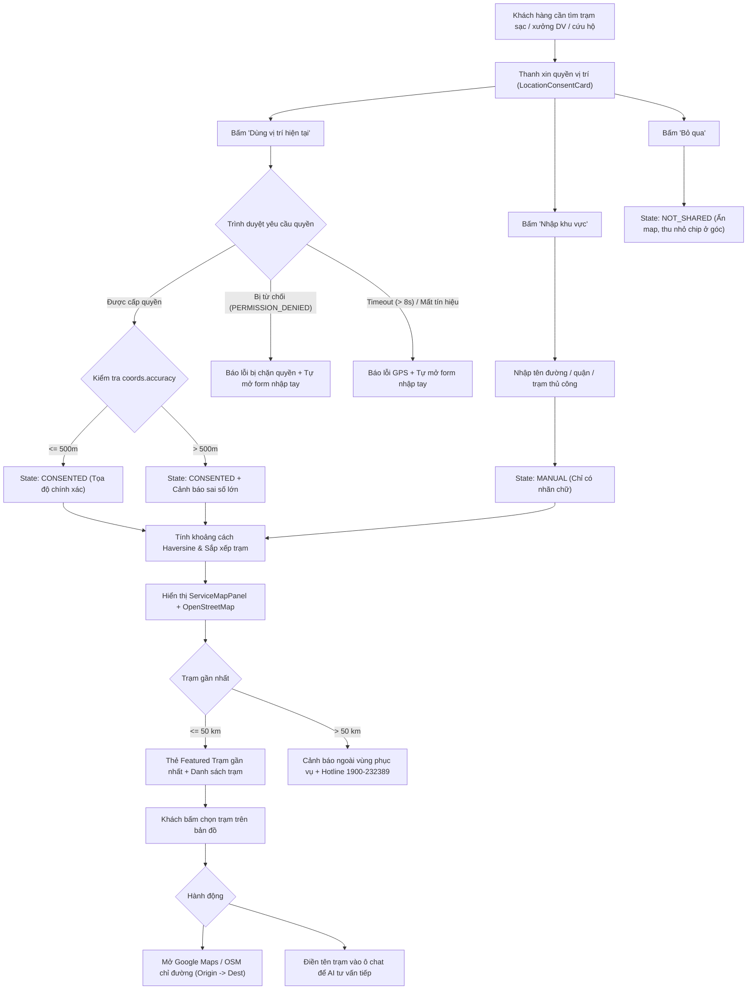

# Kế hoạch Triển khai: Tính năng Vị trí Hiện tại, Tìm Điểm Gần Nhất & Chỉ Đường Web

> **Tài liệu Kế hoạch Kỹ thuật (Technical Implementation Plan)**  
> **Áp dụng cho:** VinFast ServiceFlow AI — Web Support Hub  
> **Lưu trữ tại:** `docs/plans/location-feature.md`  
> **Tuân thủ:** ADR-001, ADR-005, screen-spec.md Mục 5.4, AGENTS.md  
> **Cập nhật ngày:** 11/10/2026 (Kế hoạch ngắn hạn cho Website Desktop Browser)

---

### 0. Bối cảnh & Phạm vi Đã Làm Rõ (Clarified Context & Scope)

* **Bối cảnh:** Người dùng đang lên kế hoạch cho tính năng tìm điểm dịch vụ gần nhất trên website.
* **Phạm vi đã được làm rõ:**
  1. **Chỉ thiết kế cho desktop:** Tập trung tối ưu hóa trải nghiệm trên màn hình và trình duyệt website desktop (Chromium và Firefox trên máy tính/laptop).
  2. **Theo dõi vị trí liên tục khi di chuyển:** Vị trí được theo dõi liên tục khi khách hàng di chuyển, trong lúc tính năng đang mở (thông qua `navigator.geolocation.watchPosition()` trên HTTPS sau khi khách hàng chủ động đồng ý; tự động gọi `clearWatch()` khi họ dừng chia sẻ hoặc rời tính năng).
  3. **Khách hàng chọn loại điểm dịch vụ:** Hỗ trợ lựa chọn linh hoạt giữa **trụ sạc**, **showroom**, **xưởng kỹ thuật (workshop)** hoặc **loại điểm dịch vụ khác**.
  4. **Giao diện chia đôi (Split View):**
     - **Bảng thông tin bên trái:** Hiển thị bộ lọc phân loại dịch vụ, danh sách các điểm gần nhất, khoảng cách, thông tin chi tiết và thao tác chọn điểm/chỉ đường.
     - **Bản đồ bên phải:** Hiển thị trực quan vị trí khách hàng thời gian thực, độ chính xác (sai số) và các ghim điểm dịch vụ gần nhất xung quanh.

---

## 1. Hướng Kỹ thuật Đã Đề xuất (Proposed Technical Direction)

### 1.1. Cơ chế Định vị Trình duyệt & Xử lý Sai số Desktop
* **Lấy vị trí thời gian thực bằng `watchPosition()`:**
  - Kích hoạt bằng `navigator.geolocation.watchPosition(successCallback, errorCallback, options)` trên môi trường bảo mật **HTTPS**, chỉ sau khi khách hàng chủ động chọn cho phép (explicit consent).
  - Tự động gọi `clearWatch(watchId)` để giải phóng tài nguyên ngay khi khách hàng nhấn dừng chia sẻ, chuyển sang nhập tay, đóng bản đồ hoặc điều hướng rời khỏi tính năng.
* **Xử lý đặc thù Desktop (Không đảm bảo có GPS):**
  - Trình duyệt desktop không đảm bảo có chip GPS vệ tinh chuyên dụng; vị trí định vị chủ yếu dựa vào mạng Wi-Fi (BSSID scan) hoặc địa chỉ IP mạng.
  - **Hiển thị sai số:** Luôn đọc trường `coords.accuracy` và hiển thị trực quan sai số (vòng tròn bán kính sai số trên bản đồ hoặc badge cảnh báo khi `accuracy > 500m`).
  - **Xử lý ngoại lệ:** Khi không lấy được vị trí (từ chối quyền, timeout > 8s, tín hiệu yếu hoặc thiết bị không hỗ trợ), hệ thống lập tức hiển thị thông báo rõ ràng và cung cấp form nhập/chọn địa điểm thủ công tiện lợi để khách hàng tiếp tục sử dụng mà không bị gián đoạn.

### 1.2. Giải pháp Nhà Cung cấp Bản đồ (Map Provider)
* **Google Maps JavaScript API với Advanced Markers (Đề xuất chính):** Nếu dự án chưa có nhà cung cấp bản đồ sẵn có, Google Maps JS API là phương án đề xuất hàng đầu nhờ tính hoàn thiện cao, dữ liệu địa lý phong phú tại Việt Nam, và hỗ trợ Advanced Markers tùy biến ghim nhận diện thương hiệu VinFast.
* **MapLibre GL JS (Phương án mã nguồn mở thay thế):** Lựa chọn mã nguồn mở không phụ thuộc khóa API thương mại; tuy nhiên để đưa vào production cần kết hợp với nhà cung cấp tile vector chất lượng và ổn định (như Protomaps, Stadia Maps hoặc tile server tự host).

### 1.3. Backend, Cơ sở Dữ liệu & Tối ưu Băng thông Mạng
* **Tái sử dụng hạ tầng hiện có:** Tận dụng backend FastAPI và cơ sở dữ liệu hiện có trong hệ thống để giảm thiểu chi phí triển khai.
* **Truy vấn không gian (Spatial Queries với PostgreSQL + PostGIS):** Khi cần thực hiện truy vấn không gian phức tạp (tìm trạm trong bán kính $R$, sắp xếp điểm gần nhất từ hàng nghìn trạm trên toàn quốc), đề xuất nâng cấp cơ sở dữ liệu sang **PostgreSQL với extension PostGIS** (`ST_DWithin`, `ST_Distance`). Backend sẽ chịu trách nhiệm xác thực request, thực hiện truy vấn không gian tối ưu và trả dữ liệu chuẩn hóa về cho web.
* **Cơ chế cập nhật mạng (Không cần WebSocket):**
  - Không cần thiết lập kết nối WebSocket phức tạp nếu chỉ phục vụ việc cập nhật bản đồ trên trình duyệt của chính khách hàng (client-side rendering).
  - Áp dụng cơ chế **Throttling theo ngưỡng di chuyển và thời gian (Thresholding)**: Client chỉ gọi lại API tìm điểm gần nhất lên backend khi khách hàng di chuyển vượt qua một khoảng cách tối thiểu (ví dụ: $\Delta d \ge 100\text{m} - 200\text{m}$) hoặc sau một khoảng thời gian nhất định (ví dụ: $\ge 30\text{s}$), tránh việc gửi từng lần cập nhật GPS li ti lên server gây quá tải hệ thống.

### 1.4. Quản trị Nguồn Dữ liệu Điểm Dịch vụ (Data Source Governance)
* **Thực trạng dữ liệu:** Website chính thức của VinFast có đầy đủ danh mục điểm dịch vụ thực tế, nhưng hiện tại hệ thống chưa xác nhận có API chính thức được phê duyệt để tích hợp.
* **Quy tắc sử dụng nguồn dữ liệu:**
  1. **Môi trường Thực tế (Production):** Tuyệt đối ưu tiên tích hợp nguồn dữ liệu/API nội bộ được phê duyệt chính thức từ các đơn vị vận hành của VinFast.
  2. **Môi trường Demo:** Sử dụng bộ dữ liệu giả lập chuẩn hóa (Mock / Demo fixtures) để phục vụ phát triển giao diện và kiểm thử tính năng.
  3. **Trạng thái trụ sạc trực tiếp (Live Charging Status):** Dữ liệu trạng thái khả dụng thời gian thực (đang sạc, trụ trống, công suất khả dụng, lỗi trụ) đòi hỏi nguồn cấp dữ liệu chuyên biệt từ đơn vị vận hành trạm sạc (V-GREEN / VinFast Charging Ops).

---

## 2. Rà soát & Sửa chữa Các Giả định Chưa đúng

| # | Giả định cũ chưa chính xác | Thực tế codebase & Hướng kỹ thuật đã thống nhất |
| :--- | :--- | :--- |
| **1** | Giả định tính năng vị trí phục vụ chung cho cả thiết bị di động/điện thoại thực tế. | **Thực tế:** Phạm vi đã được xác định dứt khoát: **Chỉ thiết kế cho desktop**. Màn hình desktop được bố trí dạng chia đôi (trái: danh mục/bảng thông tin; phải: bản đồ). |
| **2** | Giả định chỉ lấy vị trí 1 lần (snapshot), cấm cập nhật liên tục. | **Thực tế:** Vị trí được **theo dõi liên tục khi khách hàng di chuyển, trong lúc tính năng đang mở** bằng `navigator.geolocation.watchPosition()` trên HTTPS, và gọi `clearWatch()` khi dừng chia sẻ hoặc rời tính năng. |
| **3** | Giả định cần dựng kết nối WebSocket để cập nhật vị trí xe theo thời gian thực. | **Thực tế:** Không cần WebSocket vì chỉ hiển thị trên trình duyệt của chính khách hàng. Sử dụng cơ chế gọi lại API theo ngưỡng di chuyển/thời gian để tối ưu băng thông. |
| **4** | Giả định cần Google Maps API Key ngay lập tức hoặc không có phương án thay thế. | **Thực tế:** Nếu chưa có nhà cung cấp bản đồ, đề xuất Google Maps JavaScript API (Advanced Markers); phương án thay thế là MapLibre (kèm tile provider phù hợp cho production). |
| **5** | Giả định cần xây dựng engine dẫn đường nội tuyến (turn-by-turn polyline in-app) trên web. | **Thực tế:** Web chỉ đóng vai trò hiển thị trực quan và tìm điểm; việc chỉ đường chi tiết mở deep-link sang ứng dụng bản đồ chuyên dụng (Google Maps / Apple Maps / OSM). |
| **6** | Giả định backend SQLite đơn giản có thể tự động xử lý mọi truy vấn địa lý quy mô lớn. | **Thực tế:** Tái sử dụng backend hiện có; nếu cần truy vấn không gian phức tạp và tối ưu hiệu năng trên diện rộng, đề xuất chuyển sang **PostgreSQL + PostGIS**. |
| **7** | Giả định cào dữ liệu trực tiếp hoặc tự ý tích hợp API website công khai của VinFast. | **Thực tế:** Chưa xác nhận có API được phép tích hợp; ưu tiên nguồn dữ liệu/API nội bộ được phê duyệt. Dữ liệu giả lập chỉ dùng cho Demo. Trạng thái trụ sạc trực tiếp cần nguồn riêng từ đơn vị vận hành. |

---

## 3. Kiến trúc Luồng Xử lý Vị trí (State Flow)



---

## 4. Đặc tả Chi tiết Tính năng & Ca Biên (Edge Cases)

### 4.1. Luồng Xin quyền & Theo dõi Vị trí (`watchPosition` & `clearWatch`)
- **Kích hoạt:** Chỉ kích hoạt khi khách hàng chủ động bấm nút *"Dùng vị trí hiện tại"*. Bắt buộc chạy trên kết nối an toàn **HTTPS**.
- **Theo dõi liên tục khi di chuyển (trong lúc tính năng đang mở):**
  ```typescript
  // Bắt đầu theo dõi vị trí khi khách mở tính năng và đồng ý chia sẻ
  const watchId = navigator.geolocation.watchPosition(
    (position) => {
      handleLocationUpdate(position);
    },
    (error) => {
      handleLocationError(error);
    },
    {
      enableHighAccuracy: true,
      timeout: 8000,      // Timeout 8 giây cho mỗi chu kỳ định vị
      maximumAge: 5000,   // Chấp nhận cache vị trí tối đa 5 giây
    }
  );

  // Dọn dẹp: Gọi clearWatch() khi khách bấm "Dừng chia sẻ", chuyển sang nhập tay hoặc rời khỏi màn hình
  const stopTracking = () => {
    if (watchId !== null) {
      navigator.geolocation.clearWatch(watchId);
    }
  };
  ```
- **Trạng thái giao diện:** Nút bấm hiển thị trạng thái đang theo dõi (`isLocating = true`), kèm nút chuyển nhanh sang *"Dừng chia sẻ"* hoặc *"Nhập khu vực"*.

### 4.2. Luồng Từ chối quyền & Dừng chia sẻ (Permission Denied & Clear Watch)
- **Bấm "Bỏ qua" hoặc "Dừng chia sẻ":**
  - Gọi ngay `clearWatch(watchId)` để ngắt theo dõi.
  - Chuyển `locationState.status = "NOT_SHARED"`, `location_label = "Không chia sẻ"`, `coords = undefined`.
  - Thu nhỏ thành chip tinh gọn *"Chưa chia sẻ vị trí"* kèm nút *"Chia sẻ vị trí"* trên thanh nhập liệu để khách có thể đổi ý bất kỳ lúc nào.
  - Không chặn luồng tương tác, không chặn việc gửi tin nhắn hay tạo ticket hỗ trợ.
- **Từ chối quyền trên hộp thoại trình duyệt (`error.code === 1 - PERMISSION_DENIED`):**
  - Giao diện hiển thị cảnh báo: *"Trình duyệt đã chặn quyền truy cập vị trí. Anh/chị có thể nhập khu vực thủ công bên dưới hoặc cấp lại quyền trên thanh địa chỉ."*
  - Tự động chuyển giao diện sang chế độ form nhập tay (`isManualInputMode = true`).

### 4.3. Luồng Xử lý Sai số & Ngoại lệ Định vị trên Desktop
- **Hiển thị sai số ước lượng (Desktop Accuracy):**
  - Trình duyệt desktop không có GPS vệ tinh, độ chính xác phụ thuộc sóng Wi-Fi/IP.
  - Luôn kiểm tra `position.coords.accuracy`:
    - Nếu `accuracy <= 500m`: Hiển thị vị trí chuẩn xác kèm vòng tròn bán kính sai số nhẹ trên bản đồ.
    - Nếu `accuracy > 500m`: Đánh dấu `errorCode = "ACCURACY_LOW"`, hiển thị nhãn cảnh báo:  
      `⚠️ Vị trí ước lượng (sai số ±X m) - Bạn có thể bấm Nhập khu vực để có kết quả chính xác hơn.`
- **Lỗi tín hiệu (`error.code === 2 - POSITION_UNAVAILABLE`):**
  - Thông báo: *"Không xác định được vị trí (vùng sóng Wi-Fi yếu hoặc mạng không hỗ trợ). Vui lòng nhập khu vực thủ công."*
- **Lỗi quá thời gian chờ (`error.code === 3 - TIMEOUT` > 8s):**
  - Thông báo: *"Quá thời gian chờ định vị (> 8s). Vui lòng nhập khu vực thủ công."*

### 4.4. Bố cục Giao diện Chia đôi (Split View) & Bộ lọc Phân loại Điểm Dịch vụ
- **Thiết kế Chia đôi Desktop (Desktop Split View):**
  - **Cột trái (Information Panel):**
    - Bộ lọc danh mục (Pills/Tabs): **Trụ sạc** (`CHARGING_STATION`), **Showroom** (`SHOWROOM`), **Xưởng kỹ thuật** (`SERVICE_WORKSHOP`), hoặc **Loại khác** (`OTHER` / Cứu hộ cao tốc).
    - Thẻ điểm gần nhất (Featured Card) nổi bật với khoảng cách thực tế, địa chỉ, hotline và nút hành động.
    - Danh sách các điểm phụ lân cận kèm khoảng cách được tính toán lại khi vị trí xe thay đổi.
  - **Cột phải (Interactive Map Panel):**
    - Bản đồ hiển thị vị trí khách hàng (ghim xe radar phát sóng) và các ghim điểm dịch vụ theo bộ lọc đã chọn (Advanced Markers).
    - Tự động căn chỉnh Bounding Box vừa vặn khi tọa độ khách hàng cập nhật.
- **Tối ưu Băng thông (Throttling API Gọi Backend - Không cần WebSocket):**
  - Bản đồ cập nhật mượt mà trên client theo tọa độ từ `watchPosition()`.
  - Để tìm điểm dịch vụ mới từ backend, áp dụng cơ chế **Throttling theo ngưỡng**:
    - Chỉ gửi request tìm điểm gần nhất lên backend khi khách hàng di chuyển **vượt quá $\Delta d \ge 100\text{m} - 200\text{m}$** so với điểm truy vấn gần nhất, HOẶC sau thời gian $\ge 30\text{s}$.
    - Tránh spam API server liên tục theo từng nhịp `watchPosition()`.

### 4.5. Luồng Chọn điểm đến & Chỉ đường (Directions Deep-Link)
- **Chọn điểm đến:**
  - Khách click vào marker trên bản đồ hoặc click vào thẻ trong danh sách.
  - Điểm được chọn sẽ kích hoạt Popover chi tiết trạm và cập nhật `selectedPointId`.
  - Bổ sung nút **"Chọn làm điểm đến"**: Điền tự động câu hỏi gợi ý vào khung chat (ví dụ: *"Tôi muốn đến Xưởng Dịch vụ VinFast Thảo Điền để kiểm tra xe"*).
- **Chỉ đường (Navigation Link):**
  - Khi đã có tọa độ của người dùng (`origin = { lat, lng }`):
    ```
    https://www.google.com/maps/dir/?api=1&origin={origin.lat},{origin.lng}&destination={dest.lat},{dest.lng}&travelmode=driving
    ```
  - Khi là vị trí thủ công (chỉ có tên khu vực, không có GPS):
    ```
    https://www.google.com/maps/search/?api=1&query={encodeURIComponent(destination.address)}
    ```
  - Hỗ trợ thêm link OpenStreetMap Directions:
    ```
    https://www.openstreetmap.org/directions?engine=fossgis_osrm_car&route={origin.lat}%2C{origin.lng}%3B{dest.lat}%2C{dest.lng}
    ```

---

## 5. Danh mục Tệp Dự kiến Chỉnh sửa

### 5.1. Dữ liệu Hạt giống & Tiện ích
1. **[Tệp MỚI] `frontend/src/features/chat/constants/servicePoints.ts`**:
   - Chứa danh sách 5 trạm hạt giống demo chuẩn theo `fixtures/service_points.demo.json` và [customer.py](file:///home/palm/Desktop/vin_ai20k/P-142/src/api/customer.py).
   - Hàm `getSeedServicePoints()` để nạp vào giao diện.
2. **[SỬA] [`frontend/src/features/chat/types.ts`](file:///home/palm/Desktop/vin_ai20k/P-142/frontend/src/features/chat/types.ts)**:
   - Mở rộng `UserLocationState`: thêm `accuracy`, `errorCode` (`PERMISSION_DENIED`, `POSITION_UNAVAILABLE`, `TIMEOUT`, `ACCURACY_LOW`), `errorMessage`.
3. **[SỬA] [`frontend/src/features/chat/utils/distance.ts`](file:///home/palm/Desktop/vin_ai20k/P-142/frontend/src/features/chat/utils/distance.ts)**:
   - Thêm hàm `getDirectionsUrl(destination, origin)` tạo URL chỉ đường Google Maps có đầy đủ `origin` và `destination`.
   - Thêm hàm `getOsmDirectionsUrl(destination, origin)`.

### 5.2. Giao diện Người dùng
4. **[SỬA] [`frontend/src/features/chat/components/LocationConsentCard.tsx`](file:///home/palm/Desktop/vin_ai20k/P-142/frontend/src/features/chat/components/LocationConsentCard.tsx)**:
   - Xử lý trực quan các mã lỗi Geolocation (từ chối quyền, timeout, tín hiệu yếu).
   - Hiển thị chip cảnh báo sai số khi `accuracy > 500m`.
   - Tự động kích hoạt form nhập tay khi gặp lỗi GPS.
5. **[SỬA] [`frontend/src/features/chat/components/ServiceMapPanel.tsx`](file:///home/palm/Desktop/vin_ai20k/P-142/frontend/src/features/chat/components/ServiceMapPanel.tsx)**:
   - Cập nhật nút chỉ đường dùng `getDirectionsUrl` kèm tọa độ người dùng.
   - Thêm nút và callback "Chọn làm điểm đến" (`onSelectDestination`).
6. **[SỬA] [`frontend/src/features/chat/components/CustomerChatContainer.tsx`](file:///home/palm/Desktop/vin_ai20k/P-142/frontend/src/features/chat/components/CustomerChatContainer.tsx)**:
   - Khắc phục lỗi `servicePoints={[]}`: truyền dữ liệu trạm hạt giống `servicePoints={getSeedServicePoints()}`.
   - Nâng cấp `handleConsentGps` với kiểm tra lỗi chuẩn `GeolocationPositionError` và kiểm tra `coords.accuracy`.
   - Xử lý hành động chọn điểm đến (điền vào input chat).
   - Đồng bộ vị trí lên backend khi có case (`POST /api/v1/customer/location`).

### 5.3. Kết nối API & Kiểm thử
7. **[SỬA] [`frontend/src/features/chat/api/chatApi.ts`](file:///home/palm/Desktop/vin_ai20k/P-142/frontend/src/features/chat/api/chatApi.ts)**:
   - Bổ sung hàm `submitCustomerLocation(payload)` gọi `POST /api/v1/customer/location`.
8. **[Tệp MỚI] `frontend/tests/location-consent-flow.test.cjs`**:
   - Bộ test tự động kiểm thử toàn bộ các nhánh: xin quyền thành công, từ chối quyền, timeout, vị trí sai số lớn, sinh link chỉ đường có origin, và reset vị trí.

---

## 6. Hợp đồng API & Kiến trúc Dữ liệu (API Contracts & Architecture)

### 6.1. Hợp đồng Tìm kiếm Điểm Dịch vụ Gần nhất: `GET /api/v1/customer/service-points/nearby`
* **Mục đích:** Tìm và trả về danh sách các điểm dịch vụ gần nhất theo tọa độ và phân loại.
* **Tối ưu hóa Băng thông (Client Throttling - Không cần WebSocket):**
  - Trình duyệt theo dõi vị trí liên tục bằng `watchPosition()`, nhưng chỉ gọi API này khi khách hàng di chuyển **vượt ngưỡng $\Delta d \ge 100\text{m} - 200\text{m}$** hoặc sau **$\ge 30\text{s}$**.
* **Query Parameters:**
  - `lat`: Vĩ độ hiện tại của khách hàng (Float).
  - `lng`: Kinh độ hiện tại của khách hàng (Float).
  - `category`: Phân loại dịch vụ (`ALL` | `CHARGING_STATION` | `SHOWROOM` | `SERVICE_WORKSHOP` | `OTHER`). Mặc định: `ALL`.
  - `radius_km`: Bán kính tìm kiếm (mặc định 50 km).
  - `limit`: Số lượng kết quả tối đa (mặc định 10).
* **Kiến trúc Truy vấn Không gian (PostgreSQL + PostGIS):**
  - Tái sử dụng backend FastAPI và cơ sở dữ liệu hiện có.
  - Khi triển khai production trên diện rộng, đề xuất kích hoạt extension PostGIS với cột không gian `geography(Point, 4326)`:
    ```sql
    SELECT id, name, category, address, hotline,
           ST_Distance(geom, ST_SetSRID(ST_MakePoint(:lng, :lat), 4326)::geography) AS distance_meters
    FROM service_points
    WHERE ST_DWithin(geom, ST_SetSRID(ST_MakePoint(:lng, :lat), 4326)::geography, :radius_meters)
      AND (:category = 'ALL' OR category = :category)
    ORDER BY distance_meters ASC
    LIMIT :limit;
    ```

### 6.2. Hợp đồng Đồng bộ Vị trí Khách hàng: `POST /api/v1/customer/location`
* **Xác thực:** Bearer Token của Customer (khi đã tạo case).
* **Payload:**
```json
{
  "case_id": "CASE-20261011-001",
  "status": "CONSENTED", // "CONSENTED" | "MANUAL" | "NOT_SHARED"
  "source": "BROWSER_GPS", // "BROWSER_GPS" | "USER_TEXT" | "MAP_PICKER"
  "location_label": "Trạm sạc Vincom Metropolis, Ba Đình, Hà Nội",
  "latitude": 21.0315, // null nếu NOT_SHARED hoặc MANUAL không tọa độ
  "longitude": 105.8145, // null nếu NOT_SHARED hoặc MANUAL không tọa độ
  "precision": "EXACT", // "EXACT" | "APPROXIMATE"
  "share_with_staff": true
}
```
* **Chính sách lưu trữ:** Upsert 1 bản ghi duy nhất theo `case_id`. Không lưu lịch sử lộ trình di chuyển của người dùng nhằm bảo đảm quyền riêng tư.

### 6.3. Tích hợp Bản đồ & Deep-Link Chỉ đường
* **Map SDK:** Đề xuất **Google Maps JavaScript API với Advanced Markers**; phương án thay thế là **MapLibre GL JS** (cần nhà cung cấp tile phù hợp cho production).
* **Google Maps Directions Deep-Link:**
  `https://www.google.com/maps/dir/?api=1&origin={origin.lat},{origin.lng}&destination={dest.lat},{dest.lng}&travelmode=driving`
* **OpenStreetMap Directions Deep-Link:**
  `https://www.openstreetmap.org/directions?engine=fossgis_osrm_car&route={origin.lat}%2C{origin.lng}%3B{dest.lat}%2C{dest.lng}`

### 6.4. Quản trị Dữ liệu & Trạng thái Trực tiếp
* **Dữ liệu Điểm Dịch vụ:** Ưu tiên kết nối API nội bộ được phê duyệt; dữ liệu giả lập (`fixtures/service_points.demo.json`) chỉ phục vụ môi trường Demo.
* **Trạng thái Trụ sạc Trực tiếp (Live Status):** Thông tin trụ sạc trống/bận/hỏng hóc thời gian thực đòi hỏi tích hợp nguồn dữ liệu riêng từ đơn vị vận hành trạm sạc.

---

## 7. Kế hoạch Kiểm thử & Xác minh

### 7.1. Kiểm thử Tự động (Automated Tests)
1. **Kiểm thử Luồng Vị trí Frontend:**
   ```bash
   node --test frontend/tests/location-consent-flow.test.cjs
   ```
   - Xác nhận xin quyền thành công & tính khoảng cách Haversine.
   - Xác nhận bắt lỗi `PERMISSION_DENIED` và fallback form nhập tay.
   - Xác nhận bắt lỗi `TIMEOUT` (> 8s).
   - Xác nhận cảnh báo khi `accuracy > 500m`.
   - Xác nhận bấm "Bỏ qua" chuyển sang `NOT_SHARED` và xóa tọa độ.
   - Xác nhận URL chỉ đường chứa đủ `origin` và `destination`.
2. **Kiểm thử Hồi quy Frontend hiện có:**
   ```bash
   node --test frontend/tests/chat-safety-contract.test.cjs
   node --test frontend/tests/useChat-hydration.test.cjs
   node --test frontend/tests/useChat-errors.test.cjs
   ```
3. **Kiểm thử Hồi quy Backend:**
   ```bash
   python3 -m pytest tests/test_agents/test_location_and_memory.py tests/test_agents/test_location_extraction.py
   ```

### 7.2. Kiểm thử Thủ công trên Desktop Browser (`http://localhost:3000/chat`)
1. **Truy cập web trên máy tính:** Mở trình duyệt Desktop (Chrome, Edge, Firefox, Brave) tại địa chỉ `http://localhost:3000/chat`.
2. **Thử nghiệm cấp quyền Wi-Fi/IP:** Bấm *"Dùng vị trí hiện tại"* -> Hộp thoại Permission của trình duyệt xuất hiện ở góc thanh địa chỉ (Address Bar) -> Chọn *Allow/Cho phép* -> Kiểm tra ghim "Xe của bạn" xuất hiện trên bản đồ OSM, danh mục trạm sắp xếp trạm gần nhất kèm khoảng cách.
3. **Thử nghiệm cảnh báo sai số:** Nếu máy tính sử dụng Wi-Fi yếu hoặc mạng dây văn phòng (`accuracy > 500m`), kiểm tra badge màu vàng `Ước lượng ±...m` hiển thị cảnh báo kèm gợi ý nhập tay.
4. **Thử nghiệm từ chối quyền (Chặn quyền trên Desktop):** Vào biểu tượng ổ khóa/cài đặt trang web trên thanh URL -> Chuyển quyền Vị trí sang *Block/Chặn* -> Tải lại và bấm lại nút định vị -> Xác nhận thông báo *"Trình duyệt đã chặn quyền vị trí"* hiển thị và form nhập tay khu vực tự động mở ra.
5. **Thử nghiệm chỉ đường sang tab mới:** Bấm *"Chỉ đường Maps"* trên thẻ trạm -> Xác nhận trình duyệt mở tab mới tới Google Maps với lộ trình xuất phát từ tọa độ máy tính đến trạm đích.
6. **Thử nghiệm bảo mật quyền riêng tư:** Nhấn F5 tải lại trang -> Xác nhận vị trí không bị lưu ngầm vào bộ nhớ máy tính, trạng thái reset an toàn về `PENDING`.
