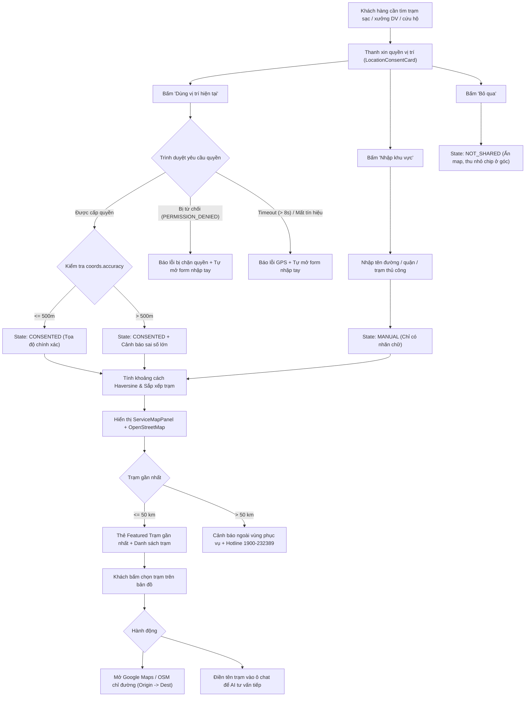

# Kế hoạch Triển khai: Tính năng Vị trí Hiện tại, Tìm Điểm Gần Nhất & Chỉ Đường Web

> **Tài liệu Kế hoạch Kỹ thuật (Technical Implementation Plan)**  
> **Áp dụng cho:** VinFast ServiceFlow AI — Web Support Hub  
> **Lưu trữ tại:** `docs/plans/location-feature.md`  
> **Tuân thủ:** ADR-001, ADR-005, screen-spec.md Mục 5.4, AGENTS.md

---

## 1. Định vị & Trả lời Dứt khoát Ba Vấn đề Cốt lõi

### 1.1. Người dùng cần chỉ đường ngay trong web hay chỉ cần mở ứng dụng bản đồ?
* **Xác định dứt khoát:** **CHỈ CẦN MỞ ỨNG DỤNG BẢN ĐỒ NGOÀI (EXTERNAL MAPS APP / DEEP-LINK).**
* **Căn cứ kỹ thuật & Sản phẩm:**
  1. Hệ thống là **Web Support Hub** tiếp nhận và điều phối sự cố, **không phải ứng dụng dẫn đường cho xe** (theo ADR-001 và ADR-005).
  2. Trình duyệt web không thể thay thế ứng dụng bản đồ chuyên dụng: không có giọng nói rẽ từng chặng (turn-by-turn voice), không cập nhật tắc đường thời gian thực và gây nguy hiểm mất an toàn nếu tài xế cố nhìn web khi đang lái xe.
  3. Bản đồ trên Web (OpenStreetMap tile) chỉ phục vụ mục đích:
     - Hiển thị trực quan vị trí hiện tại (hoặc khu vực nhập tay) cùng các trạm dịch vụ xung quanh.
     - Tính toán khoảng cách chim bay (Haversine) để tìm trạm gần nhất.
     - Cho phép bấm nút **"Chỉ đường Maps"** để mở ngay ứng dụng bản đồ ngoài (Google Maps / Apple Maps / OpenStreetMap) với đầy đủ tọa độ xuất phát (`origin`) và đích đến (`destination`).
  4. Tuyệt đối **không xây dựng engine dẫn đường rẽ từng ngã rẽ (turn-by-turn polyline in-app) trên Web**.

### 1.2. Nguồn dữ liệu địa điểm là gì?
* **Xác định dứt khoát:** **BỘ DỮ LIỆU HẠT GIỐNG DEMO CHUẨN HÓA (SEED DIRECTORY / DEMO FIXTURES).**
* **Căn cứ kỹ thuật & Sản phẩm:**
  1. Hệ thống MVP không kết nối trực tiếp cơ sở dữ liệu thật của VinFast (theo ADR-001, ADR-005).
  2. Nguồn dữ liệu sử dụng là bộ danh mục 5 trạm seed mẫu đã có trong dự án:
     - File cấu hình backend: `fixtures/service_points.demo.json`.
     - Danh sách chuẩn hóa: `DEMO_SERVICE_POINTS` (trong `src/api/customer.py`):
       - *Trạm sạc VinFast Vincom Metropolis (Ba Đình, Hà Nội - 21.0315, 105.8145)* - Loại: `CHARGING_STATION`.
       - *Trạm sạc & Dịch vụ VinFast Landmark 81 (Bình Thạnh, TP.HCM - 10.7950, 106.7218)* - Loại: `CHARGING_STATION`.
       - *Trạm Cứu hộ Cao tốc Long Thành - Dầu Giây (Km 28 - 10.7712, 106.9450)* - Loại: `EXPRESSWAY_RESCUE`.
       - *Xưởng Dịch vụ VinFast Thảo Điền (Thủ Đức, TP.HCM - 10.8030, 106.7350)* - Loại: `SERVICE_WORKSHOP`.
       - *VinFast Showroom & Service Smart City (Nam Từ Liêm, Hà Nội - 20.9982, 105.7420)* - Loại: `SERVICE_WORKSHOP`.
     - Toàn bộ các điểm đều có cờ `demo: true`, nhãn rõ ràng là điểm mẫu định hướng, kèm số Hotline chính thức của VinFast (`1900-232389`).
  3. Bộ dữ liệu hạt giống này được cấp phát cho giao diện web để tính toán cự ly ngay lập tức cho cả khách vãng lai (Guest) và khách đã đăng nhập (Customer), chấm dứt tình trạng truyền mảng rỗng `servicePoints={[]}` hiện tại.
  4. Giữ nguyên hành vi an toàn của backend endpoint `GET /api/v1/customer/cases/{case_id}/service-points` để không làm vỡ các test hồi quy (`test_aligned_spec.py`, `test_chat_remediation.py`).

### 1.3. Có cần cập nhật vị trí liên tục khi đang điều hướng không?
* **Xác định dứt khoát:** **HOÀN TOÀN KHÔNG CẦN VÀ KHÔNG ĐƯỢC PHÉP CẬP NHẬT LIÊN TỤC.**
* **Căn cứ kỹ thuật & Sản phẩm:**
  1. **Quy định dự án (User Rule):** *"Không lưu lịch sử tọa độ mặc định"* và *"Chỉ lấy vị trí sau khi người dùng chọn cho phép"*.
  2. **Quy định ADR-005 & Scope:** *"Tự chia sẻ vị trí nền thuộc Out-of-Scope; Không tự lấy vị trí nền, không lấy GPS từ EXIF ảnh"*.
  3. **Nguyên lý hoạt động:** Chỉ lấy vị trí **1 lần duy nhất (One-time snapshot)** bằng hàm `navigator.geolocation.getCurrentPosition` khi người dùng nhấn nút *"Dùng vị trí hiện tại"*.
  4. **Tuyệt đối KHÔNG sử dụng `watchPosition`** và không chạy tiến trình tracking ngầm. Việc điều hướng thực tế trên đường do ứng dụng bản đồ bên ngoài đảm nhiệm.
  5. Nếu người dùng di chuyển sang địa điểm mới và muốn tìm lại trạm, họ có thể nhấn nút *"Đổi lại vị trí"* (Reset) để kích hoạt snapshot mới.

---

## 2. Rà soát & Sửa chữa Các Giả định Chưa đúng

| # | Giả định cũ chưa chính xác | Thực tế codebase & Sửa đổi chuẩn xác |
| :--- | :--- | :--- |
| **1** | Giả định frontend phải gọi `GET /api/v1/customer/cases/{id}/service-points` để lấy danh sách trạm hiển thị lên bản đồ. | **Thực tế:** Endpoint này yêu cầu phải có `case_id` và token Customer. Guest không gọi được. Hơn nữa, commit `7774b96a` đang chủ động trả về `points = []` để vượt qua test hồi quy an toàn (`test_unverified_location_data_is_not_presented_as_nearby`).<br>**Sửa đổi:** Frontend sử dụng bộ dữ liệu hạt giống chuẩn hóa `servicePoints.ts` để hiển thị và tính cự ly trực tiếp, độc lập với vòng đời của Case. |
| **2** | Giả định cần vẽ lộ trình đường đi (polyline) turn-by-turn ngay trong panel web. | **Thực tế:** OpenStreetMap nhúng qua iframe tĩnh chỉ dùng để hiển thị trực quan ghim xe và ghim các trạm lân cận. Không cần vẽ polyline phức tạp trên web; khi bấm chỉ đường sẽ mở Google Maps / Apple Maps / OSM chuyên dụng. |
| **3** | Giả định cần có Google Maps API Key để tính khoảng cách và chỉ đường. | **Thực tế:** Tính khoảng cách bằng công thức **Haversine thuần client** (zero API key) trong `distance.ts`. Chỉ đường bằng **URL Scheme / Deep-link chuẩn W3C** (zero API key), tuân thủ triệt để quy định không tạo khóa API. |
| **4** | Giả định lưu vị trí người dùng vào `localStorage` để tái sử dụng. | **Thực tế:** Vi phạm quy định *"Không lưu lịch sử tọa độ mặc định"*. Vị trí chỉ tồn tại trong bộ nhớ `useState` của phiên làm việc. Tải lại trang (F5) sẽ xóa trạng thái vị trí về `PENDING`. |

---

## 3. Kiến trúc Luồng Xử lý Vị trí (State Flow)



---

## 4. Đặc tả Chi tiết Tính năng & Ca Biên (Edge Cases)

### 4.1. Luồng Xin quyền (Permission Request)
- **Kích hoạt:** Chỉ kích hoạt khi khách hàng chủ động bấm nút *"Dùng vị trí hiện tại"*. Tuyệt đối không tự động kích hoạt GPS khi mở trang hoặc chạy nền.
- **Tùy chọn gọi API trình duyệt:**
  ```typescript
  navigator.geolocation.getCurrentPosition(successCallback, errorCallback, {
    enableHighAccuracy: true,
    timeout: 8000, // Đúng 8 giây theo ADR-005
    maximumAge: 0, // Không lấy cache tọa độ cũ
  });
  ```
- **Trạng thái giao diện:** Nút bấm chuyển sang `isLocating = true`, hiển thị text *"Đang định vị..."* kèm spinner.

### 4.2. Luồng Từ chối quyền (Permission Denied)
- **Bấm "Bỏ qua" trên UI:**
  - Chuyển `locationState.status = "NOT_SHARED"`, `location_label = "Không chia sẻ"`, `coords = undefined`.
  - Thu nhỏ thành chip tinh gọn *"Chưa chia sẻ vị trí"* kèm nút *"Chia sẻ vị trí"* trên thanh nhập liệu để khách có thể đổi ý bất kỳ lúc nào.
  - Không chặn luồng chat, không chặn việc gửi tin nhắn hay tạo ticket.
- **Từ chối quyền trên hộp thoại trình duyệt (`error.code === 1 - PERMISSION_DENIED`):**
  - Giao diện hiển thị cảnh báo: *"Trình duyệt đã chặn quyền truy cập vị trí. Anh/chị có thể nhập khu vực thủ công bên dưới hoặc cấp lại quyền trên thanh địa chỉ."*
  - Tự động chuyển `LocationConsentCard` sang chế độ form nhập tay (`isManualInputMode = true`).

### 4.3. Luồng Vị trí không chính xác & Lỗi kỹ thuật GPS
- **Lỗi tín hiệu (`error.code === 2 - POSITION_UNAVAILABLE`):**
  - Thông báo: *"Không xác định được vị trí GPS (vùng sóng yếu hoặc trong hầm). Vui lòng nhập khu vực thủ công."*
- **Lỗi quá thời gian chờ (`error.code === 3 - TIMEOUT` > 8s):**
  - Thông báo: *"Quá thời gian chờ định vị (> 8s). Vui lòng nhập khu vực thủ công."*
- **Sai số tọa độ lớn (`coords.accuracy > 500m`):**
  - Vẫn ghi nhận tọa độ để tính khoảng cách ước lượng, nhưng hiển thị thêm nhãn cảnh báo:
    `⚠️ Vị trí ước lượng (sai số ±X m) - Bạn có thể bấm Nhập khu vực để có kết quả chính xác hơn.`
  - Cung cấp nút chuyển nhanh sang form nhập tay.

### 4.4. Luồng Tìm nơi gần đó (Nearby Points Sorting)
- **Tính toán:** Sử dụng công thức Haversine thuần trong `distance.ts`:
  ```typescript
  distKm = calculateHaversineDistanceKm(userCoord, sp.coords);
  ```
- **Sắp xếp:** Các điểm dịch vụ được sắp xếp tăng dần theo khoảng cách `distKm`. Điểm gần nhất nằm trên cùng với huy hiệu *"Gần bạn nhất"*.
- **Cảnh báo bán kính tối đa (> 50 km):**
  - Nếu điểm gần nhất cách xa `> 50 km` (`MAX_SUPPORT_RADIUS_KM`):
  - Hiển thị banner cảnh báo: *"Chưa có điểm hỗ trợ trong khu vực của bạn (điểm gần nhất cách > 50 km). Vui lòng liên hệ Tổng đài Toàn quốc."*
  - Nút gọi khẩn cấp `tel:1900232389` (Hotline VinFast 24/7).

### 4.5. Luồng Chọn điểm đến & Chỉ đường (Directions Deep-Link)
- **Chọn điểm đến:**
  - Khách click vào marker trên bản đồ OSM hoặc click vào thẻ trong danh sách.
  - Điểm được chọn sẽ kích hoạt Popover chi tiết trạm và cập nhật `selectedPointId`.
  - Bổ sung nút **"Chọn làm điểm đến"**: Khi bấm, điền tự động câu hỏi gợi ý vào khung chat (ví dụ: *"Tôi muốn đến Trạm sạc VinFast Vincom Metropolis để kiểm tra sạc"*).
- **Chỉ đường (Navigation Link):**
  - Khi đã có tọa độ GPS của người dùng (`origin = { lat, lng }`):
    ```
    https://www.google.com/maps/dir/?api=1&origin={origin.lat},{origin.lng}&destination={dest.lat},{dest.lng}&travelmode=driving
    ```
  - Khi là vị trí thủ công (chỉ có tên khu vực, không có GPS):
    ```
    https://www.google.com/maps/search/?api=1&query={encodeURIComponent(destination.address)}
    ```
  - Hỗ trợ thêm link OpenStreetMap Directions cho người dùng chuộng mã nguồn mở:
    ```
    https://www.openstreetmap.org/directions?engine=fossgis_osrm_car&route={origin.lat}%2C{origin.lng}%3B{dest.lat}%2C{dest.lng}
    ```

---

## 5. Danh mục Tệp Dự kiến Chỉnh sửa

### 5.1. Dữ liệu Hạt giống & Tiện ích
1. **[Tệp MỚI] `frontend/src/features/chat/constants/servicePoints.ts`**:
   - Chứa danh sách 5 trạm hạt giống demo chuẩn theo `fixtures/service_points.demo.json` và [customer.py](file:///home/palm/Desktop/vin_ai20k/P-142/src/api/customer.py).
   - Hàm `getSeedServicePoints()` để nạp vào giao diện.
2. **[SỬA] [`frontend/src/features/chat/types.ts`](file:///home/palm/Desktop/vin_ai20k/P-142/frontend/src/features/chat/types.ts)**:
   - Mở rộng `UserLocationState`: thêm `accuracy`, `errorCode` (`PERMISSION_DENIED`, `POSITION_UNAVAILABLE`, `TIMEOUT`, `ACCURACY_LOW`), `errorMessage`.
3. **[SỬA] [`frontend/src/features/chat/utils/distance.ts`](file:///home/palm/Desktop/vin_ai20k/P-142/frontend/src/features/chat/utils/distance.ts)**:
   - Thêm hàm `getDirectionsUrl(destination, origin)` tạo URL chỉ đường Google Maps có đầy đủ `origin` và `destination`.
   - Thêm hàm `getOsmDirectionsUrl(destination, origin)`.

### 5.2. Giao diện Người dùng
4. **[SỬA] [`frontend/src/features/chat/components/LocationConsentCard.tsx`](file:///home/palm/Desktop/vin_ai20k/P-142/frontend/src/features/chat/components/LocationConsentCard.tsx)**:
   - Xử lý trực quan các mã lỗi Geolocation (từ chối quyền, timeout, tín hiệu yếu).
   - Hiển thị chip cảnh báo sai số khi `accuracy > 500m`.
   - Tự động kích hoạt form nhập tay khi gặp lỗi GPS.
5. **[SỬA] [`frontend/src/features/chat/components/ServiceMapPanel.tsx`](file:///home/palm/Desktop/vin_ai20k/P-142/frontend/src/features/chat/components/ServiceMapPanel.tsx)**:
   - Cập nhật nút chỉ đường dùng `getDirectionsUrl` kèm tọa độ người dùng.
   - Thêm nút và callback "Chọn làm điểm đến" (`onSelectDestination`).
6. **[SỬA] [`frontend/src/features/chat/components/CustomerChatContainer.tsx`](file:///home/palm/Desktop/vin_ai20k/P-142/frontend/src/features/chat/components/CustomerChatContainer.tsx)**:
   - Khắc phục lỗi `servicePoints={[]}`: truyền dữ liệu trạm hạt giống `servicePoints={getSeedServicePoints()}`.
   - Nâng cấp `handleConsentGps` với kiểm tra lỗi chuẩn `GeolocationPositionError` và kiểm tra `coords.accuracy`.
   - Xử lý hành động chọn điểm đến (điền vào input chat).
   - Đồng bộ vị trí lên backend khi có case (`POST /api/v1/customer/location`).

### 5.3. Kết nối API & Kiểm thử
7. **[SỬA] [`frontend/src/features/chat/api/chatApi.ts`](file:///home/palm/Desktop/vin_ai20k/P-142/frontend/src/features/chat/api/chatApi.ts)**:
   - Bổ sung hàm `submitCustomerLocation(payload)` gọi `POST /api/v1/customer/location`.
8. **[Tệp MỚI] `frontend/tests/location-consent-flow.test.cjs`**:
   - Bộ test tự động kiểm thử toàn bộ các nhánh: xin quyền thành công, từ chối quyền, timeout, vị trí sai số lớn, sinh link chỉ đường có origin, và reset vị trí.

---

## 6. Hợp đồng API (API Contracts)

### 6.1. Hợp đồng Đồng bộ Vị trí: `POST /api/v1/customer/location`
* **Xác thực:** Bearer Token của Customer (khi đã tạo case).
* **Payload:**
```json
{
  "case_id": "CASE-20261011-001",
  "status": "CONSENTED", // "CONSENTED" | "MANUAL" | "NOT_SHARED"
  "source": "BROWSER_GPS", // "BROWSER_GPS" | "USER_TEXT" | "MAP_PICKER"
  "location_label": "Trạm sạc Vincom Metropolis, Ba Đình, Hà Nội",
  "latitude": 21.0315, // null nếu NOT_SHARED hoặc MANUAL không tọa độ
  "longitude": 105.8145, // null nếu NOT_SHARED hoặc MANUAL không tọa độ
  "precision": "EXACT", // "EXACT" | "APPROXIMATE"
  "share_with_staff": true
}
```
* **Chính sách lưu trữ:** Upsert 1 bản ghi duy nhất theo `case_id`. Không tạo bảng lịch sử tracking. Nếu `status === "NOT_SHARED"`, `latitude` và `longitude` được đặt về `null`.

### 6.2. Hợp đồng Deep-Link Chỉ đường (Zero API-Key)
* **Google Maps Directions:**
  `https://www.google.com/maps/dir/?api=1&origin={origin.lat},{origin.lng}&destination={dest.lat},{dest.lng}&travelmode=driving`
* **OpenStreetMap Directions:**
  `https://www.openstreetmap.org/directions?engine=fossgis_osrm_car&route={origin.lat}%2C{origin.lng}%3B{dest.lat}%2C{dest.lng}`

---

## 7. Kế hoạch Kiểm thử & Xác minh

### 7.1. Kiểm thử Tự động (Automated Tests)
1. **Kiểm thử Luồng Vị trí Frontend:**
   ```bash
   node --test frontend/tests/location-consent-flow.test.cjs
   ```
   - Xác nhận xin quyền thành công & tính khoảng cách Haversine.
   - Xác nhận bắt lỗi `PERMISSION_DENIED` và fallback form nhập tay.
   - Xác nhận bắt lỗi `TIMEOUT` (> 8s).
   - Xác nhận cảnh báo khi `accuracy > 500m`.
   - Xác nhận bấm "Bỏ qua" chuyển sang `NOT_SHARED` và xóa tọa độ.
   - Xác nhận URL chỉ đường chứa đủ `origin` và `destination`.
2. **Kiểm thử Hồi quy Frontend hiện có:**
   ```bash
   node --test frontend/tests/chat-safety-contract.test.cjs
   node --test frontend/tests/useChat-hydration.test.cjs
   node --test frontend/tests/useChat-errors.test.cjs
   ```
3. **Kiểm thử Hồi quy Backend:**
   ```bash
   python3 -m pytest tests/test_agents/test_location_and_memory.py tests/test_agents/test_location_extraction.py
   ```

### 7.2. Kiểm thử Thủ công (Manual Verification)
1. Mở web chat, kích hoạt sự cố sạc hoặc mở bản đồ.
2. Bấm *"Dùng vị trí hiện tại"* -> Trình duyệt bật prompt xin quyền -> Chọn Cho phép -> Kiểm tra ghim "Xe của bạn" xuất hiện trên bản đồ, thẻ trạm gần nhất hiển thị cự ly chính xác.
3. Chặn quyền vị trí trong trình duyệt -> Bấm lại nút định vị -> Kiểm tra cảnh báo bị chặn quyền xuất hiện và form nhập khu vực tự động mở ra.
4. Bấm nút *"Chỉ đường Maps"* trên thẻ trạm -> Kiểm tra tab mới mở Google Maps với lộ trình xuất phát từ tọa độ xe đến trạm đích.
5. F5 tải lại trang -> Xác nhận vị trí không bị lưu ngầm, quay về trạng thái `PENDING`.
