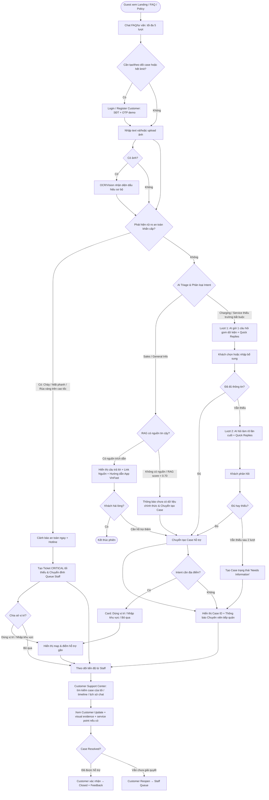
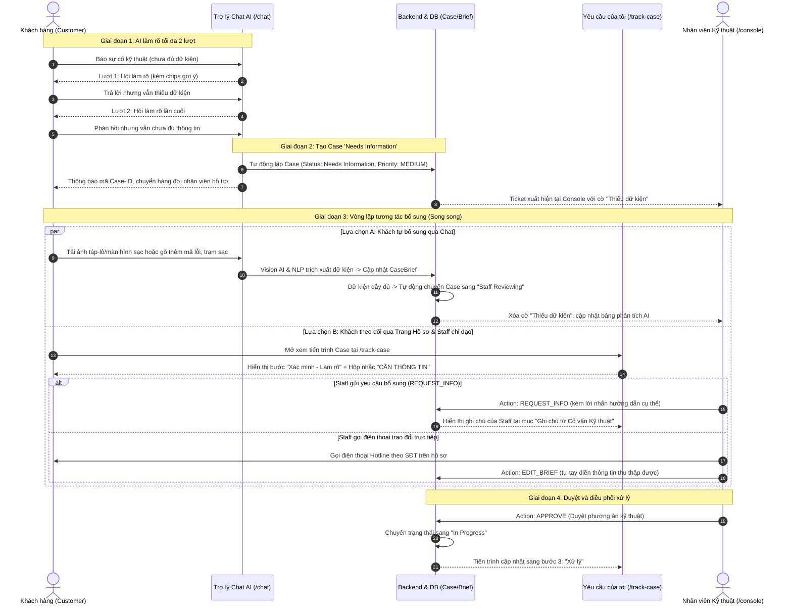
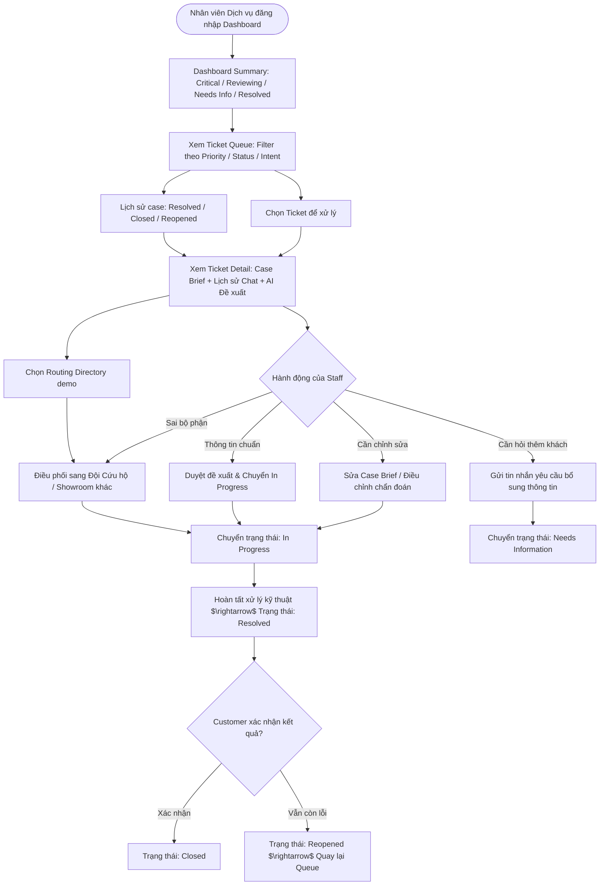
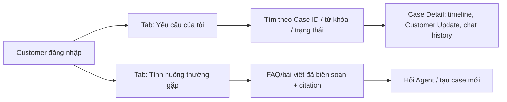

# User Flows Specification (Customer & Staff)

> **Người phụ trách chính:** Việt (Product Lead)  
> **Cập nhật lần cuối:** 2026-09-24  
> **Trạng thái:** In Review (Đã cập nhật Clarification Bounds và App Handoff)

---

## 1. Customer User Flow

**Access flow:** Guest xem Landing/FAQ/Policy và được chat tối đa 5 lượt/phiên. Khi cần tạo/theo dõi case hoặc hết limit, hệ thống yêu cầu Login/Register Customer bằng SĐT + OTP demo. Customer chỉ xem case của mình; Staff dùng tài khoản seed/invite.



---

### 1.1 Chi tiết Luồng Hồ Sơ Thiếu Dữ Kiện & Vòng lặp Bổ sung (Needs Information Loop)

Khi khách hàng báo sự cố kỹ thuật thông thường (không đe dọa an toàn) nhưng thiếu dữ kiện bắt buộc (dòng xe, mã lỗi, vị trí trạm/trụ sạc), hệ thống áp dụng cơ chế giới hạn 2 lượt hỏi và vòng lặp bổ sung 2 chiều giữa Khách hàng và Nhân viên:



#### Quy tắc nghiệp vụ chi tiết:
1. **Dừng hỏi tự động sau 2 lượt (`max_clarification_turns = 2`):** Tránh trải nghiệm "hỏi cung" khó chịu cho khách hàng khi khách không nhớ hoặc không biết thông tin kỹ thuật chuyên sâu.
2. **Phân loại mức độ ưu tiên:** Case `Needs Information` luôn có mức ưu tiên `Priority = MEDIUM` (không kích hoạt cảnh báo nguy hiểm khẩn cấp, không hiển thị banner tấp xe vào lề nguy hiểm).
3. **Cơ chế tự động nâng cấp trạng thái (Auto-Promotion):** Nếu khách hàng quay lại gửi ảnh táp-lô hoặc nhắn tin bổ sung đủ dữ kiện vào phiên chat, hệ thống tự động bóc tách và chuyển trạng thái từ `Needs Information` sang `Staff Reviewing` mà không bắt khách phải tạo lại ca mới.
4. **Kênh trao đổi hai chiều:**
   - Khách xem chỉ đạo và ghi chú của nhân viên tại trang `/track-case` (thông qua `CaseUpdate` từ `REQUEST_INFO`).
   - Nhân viên tại `/console/{id}` có thể dùng `REQUEST_INFO` để gửi lời nhắn, hoặc dùng `EDIT_BRIEF` để trực tiếp điền dữ kiện sau khi gọi hotline cho khách.

---

## 2. Staff Console User Flow



---

## 3. Customer Support Center & Privacy Flow



* Customer chỉ truy cập case mà `customer_id` sở hữu.
* Tab `Tình huống thường gặp` không hiển thị raw case, ảnh, vị trí, Case ID, chat history hoặc kết quả xử lý của Customer khác.

## 4. Staff Console Navigation

```text
Tổng quan → Hàng đợi xử lý → Ticket Detail → Customer Update
                ↓
          Lịch sử case

Knowledge Hub / Customer Preview
```

* `Knowledge Hub`: Staff xem nguồn/citation và thư viện tình huống thường gặp.
* `Customer Preview`: Staff thử giao diện public/chat bằng session demo, không truy cập Customer Chat của khách thật.

---

## 5. Exception Flows & Guardrails

| Tình huống ngoại lệ | Xử lý của Hệ thống | Trạng thái Ticket |
| :--- | :--- | :--- |
| **Phát hiện từ khóa Nguy hiểm (Cháy, Mất phanh, Tai nạn, Rùa vàng cao tốc)** | Cắt đứt luồng chat thông thường, hiển thị cảnh báo an toàn lập tức (Hotline 1900-232389), tạo Case Brief mức `CRITICAL` và đẩy lên đỉnh hàng đợi Staff. | `Staff Reviewing` (Priority: CRITICAL) |
| **Khách gửi thông tin không liên quan / Spam** | AI nhắc nhở lịch sự phạm vi hỗ trợ của trợ lý ảo VinFast. Cho phép thử lại tối đa 3 lần trước khi khóa phiên. | `N/A` |
| **RAG không tìm thấy tài liệu phù hợp** | Tuyệt đối không phỏng đoán. Phản hồi: *"Hiện tại hệ thống chưa có dữ liệu chính xác về vấn đề này. Em đã tạo yêu cầu để chuyên viên VinFast kiểm tra lại cho mình."* | `Staff Reviewing` |
| **Khách chưa cung cấp đủ thông tin sau 2 lượt hỏi** | Dừng hỏi tự động, tạo Case để nhân viên hỗ trợ trực tiếp. | `Needs Information` |
