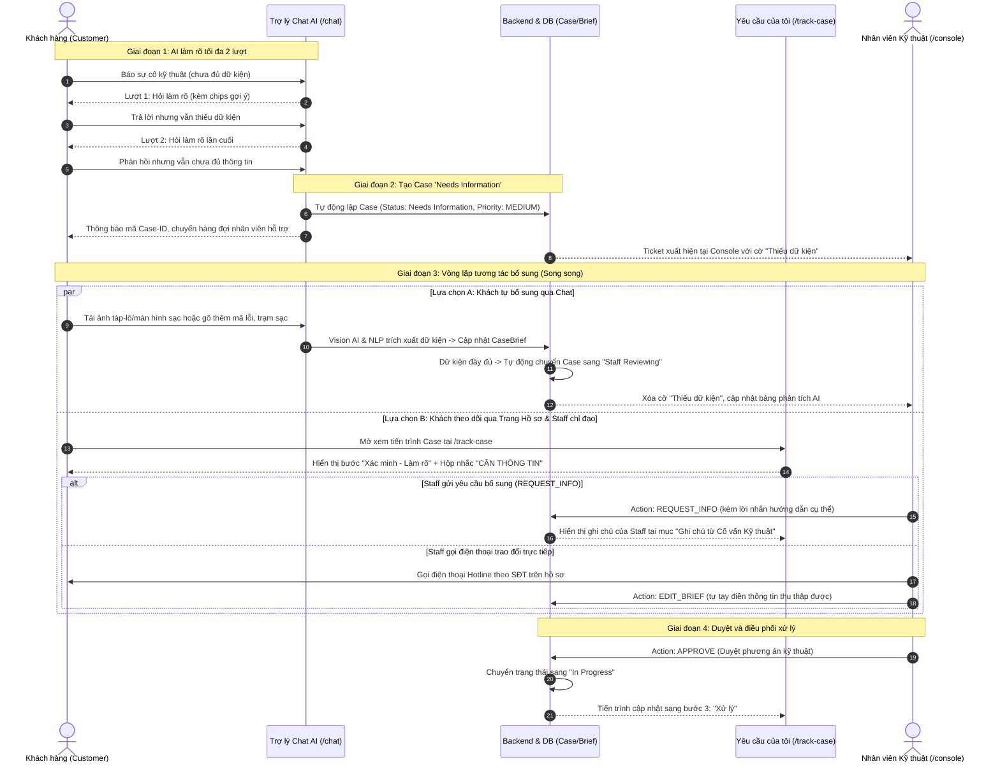
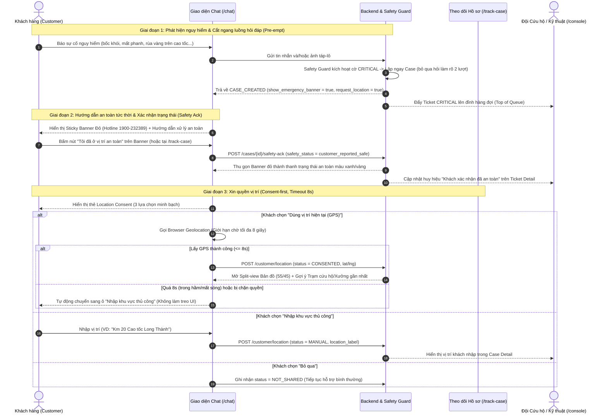
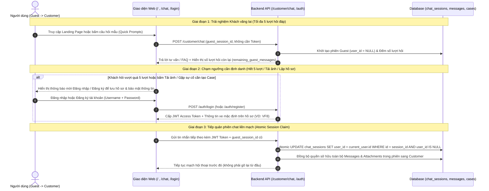
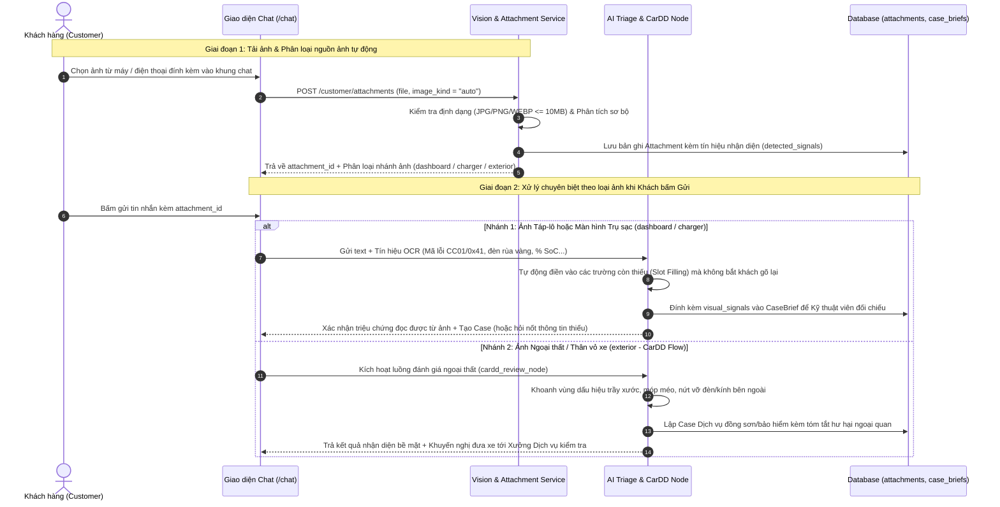
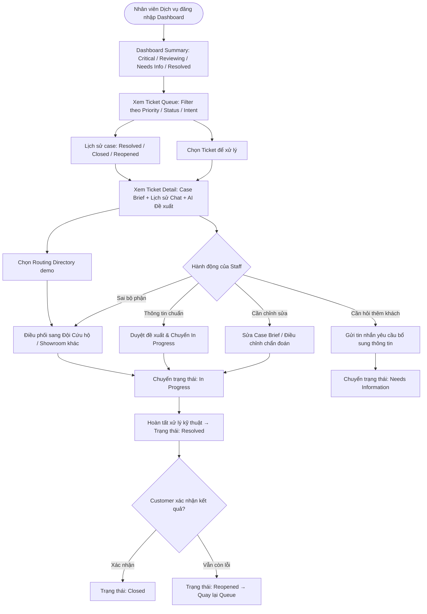
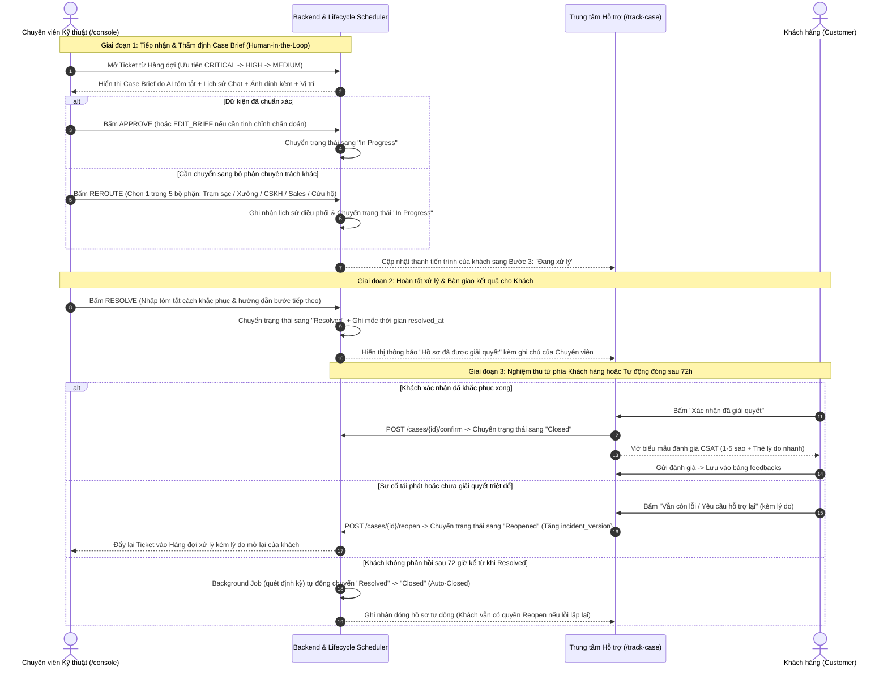
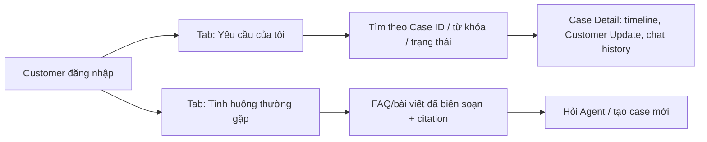
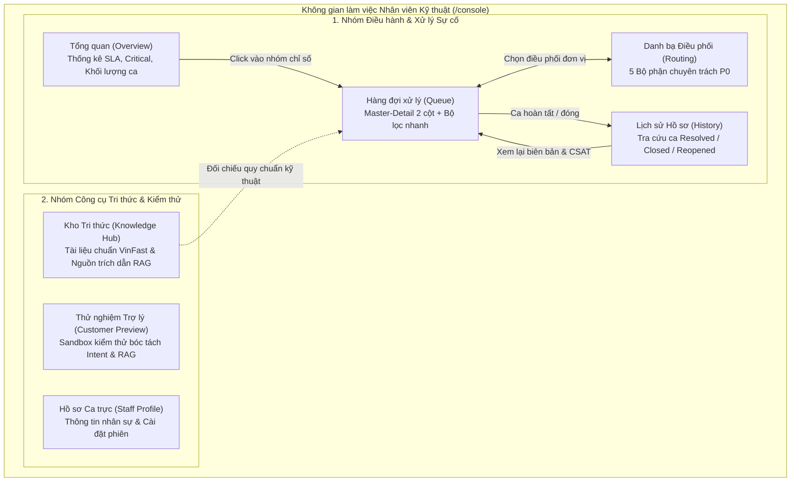

# User Flows Specification (Customer & Staff)

> **Người phụ trách chính:** Việt (Product Lead)  
> **Cập nhật lần cuối:** 2026-10-17  
> **Trạng thái:** Approved (Đã bổ sung Sequence Diagrams chi tiết cho toàn bộ luồng nghiệp vụ cốt lõi)

---

## 1. Customer User Flow

**Access flow:** Guest xem Landing/FAQ/Policy và được chat tư vấn tối đa 5 lượt/phiên. Khi cần tải ảnh, tạo/theo dõi hồ sơ sự cố hoặc chạm ngưỡng 5 lượt, hệ thống yêu cầu Đăng nhập / Đăng ký tài khoản Customer (Username + Password). Customer chỉ xem được hồ sơ của chính mình; Staff sử dụng tài khoản nội bộ được cấp sẵn.

---

### 1.1 Chi tiết Luồng Hồ Sơ Thiếu Dữ Kiện & Vòng lặp Bổ sung (Needs Information Loop)

Khi khách hàng báo sự cố kỹ thuật thông thường (không đe dọa an toàn) nhưng thiếu dữ kiện bắt buộc (dòng xe, mã lỗi, vị trí trạm/trụ sạc), hệ thống áp dụng cơ chế giới hạn 2 lượt hỏi và vòng lặp bổ sung 2 chiều giữa Khách hàng và Nhân viên:

#### Quy tắc nghiệp vụ chi tiết:
1. **Dừng hỏi tự động sau 2 lượt (`max_clarification_turns = 2`):** Tránh trải nghiệm "hỏi cung" khó chịu cho khách hàng khi khách không nhớ hoặc không biết thông tin kỹ thuật chuyên sâu.
2. **Phân loại mức độ ưu tiên:** Case `Needs Information` luôn có mức ưu tiên `Priority = MEDIUM` (không kích hoạt cảnh báo nguy hiểm khẩn cấp, không hiển thị banner tấp xe vào lề nguy hiểm).
3. **Cơ chế tự động nâng cấp trạng thái (Auto-Promotion):** Nếu khách hàng quay lại gửi ảnh táp-lô hoặc nhắn tin bổ sung đủ dữ kiện vào phiên chat, hệ thống tự động bóc tách và chuyển trạng thái từ `Needs Information` sang `Staff Reviewing` mà không bắt khách phải tạo lại ca mới.
4. **Kênh trao đổi hai chiều:**
   - Khách xem chỉ đạo và ghi chú của nhân viên tại trang `/track-case` (thông qua `CaseUpdate` từ `REQUEST_INFO`).
   - Nhân viên tại `/console` có thể dùng `REQUEST_INFO` để gửi lời nhắn, hoặc dùng `EDIT_BRIEF` để trực tiếp điền dữ kiện sau khi gọi hotline cho khách.

---

### 1.2 Chi tiết Luồng Cứu hộ Khẩn cấp, Xác nhận An toàn & Chia sẻ Vị trí (Critical Safety & Location Consent)

Khi khách hàng báo các dấu hiệu đe dọa trực tiếp tới an toàn vận hành (bốc khói, mùi khét, mất phanh, tai nạn hoặc hiện đèn rùa vàng khi đang chạy trên cao tốc/quốc lộ), hệ thống lập tức ngắt quy trình hỏi đáp thông thường để ưu tiên bảo vệ an toàn cho người ngồi trên xe:

#### Quy tắc nghiệp vụ & Lưu ý thiết kế:
1. **Ưu tiên tính mạng hơn dữ kiện (`Safety Pre-emption`):** Ngay khi nhận diện từ khóa hoặc tín hiệu nguy hiểm, AI không hỏi vặn lại dòng xe hay mã lỗi mà lập tức tạo hồ sơ mức `CRITICAL`, ghim cảnh báo đỏ kèm nút gọi nhanh Hotline Cứu hộ 24/7 (`1900-232389`).
2. **Xác nhận an toàn hai chiều (`Safety Acknowledgement`):** Nút *"Tôi đã ở vị trí an toàn"* giúp giảm áp lực thị giác cho khách hàng (thu gọn banner đỏ sau khi đã đỗ xe an toàn), đồng thời báo ngay cho điều phối viên trên Console biết tình trạng hiện tại của chủ xe.
3. **Quyền riêng tư vị trí & Chống treo giao diện (`8s GPS Timeout` - ADR-005):** Hệ thống tuyệt đối không tự động bóc tách tọa độ GPS ngầm từ EXIF ảnh chụp. Nếu khách bấm chia sẻ GPS khi đang ở tầng hầm hoặc khu vực sóng yếu, sau đúng **8 giây** giao diện tự động mở ô nhập tay để khách gõ tên đường/cột mốc mà không bị kẹt màn hình.

---

### 1.3 Chi tiết Luồng Chuyển tiếp Khách vãng lai sang Tài khoản Khách hàng (Guest-to-Customer Atomic Handoff)

Để khách hàng có thể trải nghiệm trợ lý AI ngay từ trang chủ mà không gặp rào cản đăng nhập sớm, đồng thời vẫn bảo toàn trọn vẹn mạch hội thoại khi phát sinh sự cố cần lập hồ sơ, hệ thống vận hành cơ chế chuyển giao phiên nguyên tử (`ADR-006`):

#### Quy tắc nghiệp vụ & Lưu ý bảo mật:
1. **Giới hạn 5 lượt cho Khách vãng lai (`Guest Quota`):** Khách chưa đăng nhập được hỏi tối đa 5 lượt cho các nhu cầu tra cứu thông số xe, giá bán, chính sách pin và trạm sạc. Các tính năng tạo dữ liệu nhạy cảm (tải ảnh sự cố, lập hồ sơ kỹ thuật, xem lịch sử `/track-case`) yêu cầu tài khoản định danh.
2. **Tiếp quản phiên không đứt quãng (`Seamless Context Carry-over`):** Khi khách đăng nhập ở giữa cuộc trò chuyện, toàn bộ lịch sử tin nhắn vừa trao đổi ở chế độ Guest được gắn tự động vào tài khoản vừa đăng nhập, giúp AI nhớ ngay dòng xe và triệu chứng khách vừa kể.
3. **Chống chiếm đoạt phiên (`Anti-Hijacking`):** Thao tác gán chủ sở hữu phiên tại Database chỉ thực thi thành công khi `user_id IS NULL`. Nếu một tài khoản khác cố tình truyền `session_id` đã thuộc về người dùng khác, hệ thống lập tức từ chối và trả mã lỗi `404` để chống dò quét dữ liệu.

---

### 1.4 Chi tiết Luồng Nhận diện Ảnh Đa phương thức (Vision OCR Táp-lô/Trụ sạc & Ngoại thất CarDD)

Thay vì bắt khách hàng phải tự đọc và gõ lại các mã lỗi kỹ thuật phức tạp trên màn hình xe hoặc trụ sạc, hệ thống tích hợp luồng xử lý ảnh đa phương thức tự động phân nhánh theo ngữ cảnh bức ảnh:

#### Quy tắc nghiệp vụ & Ranh giới an toàn:
1. **Tự động bóc tách thông số (`Visual Slot-Filling`):** Với ảnh chụp bảng đồng hồ táp-lô hoặc màn hình trụ sạc, Vision AI trích xuất mã lỗi (`error_code`), đèn cảnh báo (`warning_symbol`) và mức pin (`SoC`) để điền thẳng vào `CaseBrief`, giúp rút ngắn số lượt hỏi làm rõ.
2. **Ranh giới chẩn đoán ảnh ngoại thất (`CarDD Guardrail`):** Với ảnh chụp thân vỏ xe (`exterior`), AI chỉ mô tả các dấu hiệu hư hại nhìn thấy được trên bề mặt (trầy xước, móp cản, nứt kính) để hỗ trợ cố vấn dịch vụ chuẩn bị tiếp nhận; **tuyệt đối không phán đoán tình trạng khung gầm, hệ thống treo hay pin cao áp bên trong** khi chỉ dựa vào ảnh chụp.

---

## 2. Staff Console User Flow

---

### 2.1 Chi tiết Luồng Thẩm định của Chuyên viên & Khép kín Vòng đời Hồ sơ (Staff HITL, Handover & 72h Lifecycle)

Sau khi AI tạo hồ sơ tóm tắt (`CaseBrief`), quy trình xử lý tuân thủ nguyên tắc **Con người giữ quyền quyết định cuối cùng (Human-in-the-Loop)** và chỉ đóng hồ sơ khi có sự nghiệm thu từ phía khách hàng (hoặc hết thời hạn chờ 72 giờ):

#### Quy tắc nghiệp vụ & Lưu ý vận hành:
1. **AI chỉ gợi ý, Chuyên viên quyết định (`HITL Governance`):** Mọi bản tóm tắt `CaseBrief` do AI sinh ra đều gắn cờ `is_edited_by_staff = false` ban đầu. Chuyên viên có thể sửa lại nội dung chẩn đoán (`EDIT_BRIEF`) hoặc điều phối lại (`REROUTE`) về đúng một trong 5 đơn vị nghiệp vụ trước khi xử lý.
2. **Duyệt hàng đợi tốc độ cao kèm nút Hoàn tác (`Auto-Advance & Undo`):** Trên giao diện `/console`, ngay khi chuyên viên bấm Duyệt (`Approve`) hoặc Hoàn tất (`Resolve`), hệ thống tự động chuyển sang ca tiếp theo trong hàng đợi để tiết kiệm thao tác, đồng thời hiển thị thanh thông báo **Hoàn tác (Undo)** phòng trường hợp thao tác nhầm.
3. **Quy tắc đóng hồ sơ 2 lớp & Tự động đóng sau 72 giờ (`ADR-005`):** Nhân viên chỉ được chuyển hồ sơ tới trạng thái `Resolved`. Quyền chuyển sang `Closed` thuộc về khách hàng sau khi nghiệm thu kết quả. Nếu sau **72 giờ** kể từ thời điểm `resolved_at` mà khách không phản hồi, tiến trình nền (`case_lifecycle.py`) sẽ tự động đóng hồ sơ nhưng vẫn giữ nguyên quyền `Reopen` nếu sự cố tái diễn.

---

## 3. Customer Support Center & Privacy Flow

#### Nguyên tắc hiển thị & Bảo mật quyền riêng tư:
* **Cô lập dữ liệu cá nhân (`Strict Ownership`):** Tại tab **Yêu cầu của tôi**, khách hàng chỉ truy cập được các hồ sơ thuộc quyền sở hữu của `user_id` đang đăng nhập.
* **Tiết lộ thông tin theo lớp (`Progressive Disclosure`):** Để tránh gây rối mắt cho chủ xe, giao diện chi tiết hồ sơ ưu tiên hiển thị thanh tiến trình 4 bước và lời nhắn mới nhất từ Cố vấn Kỹ thuật; phần lịch sử đoạn chat gốc và bảng thông số kỹ thuật chi tiết được thu gọn mặc định trong các khối mở rộng (Accordion).
* **Tách biệt kho tri thức công khai:** Tab **Tình huống thường gặp** chỉ hiển thị các bài hướng dẫn chuẩn hóa kèm trích dẫn nguồn chính thức của VinFast; tuyệt đối không hiển thị hồ sơ thô, hình ảnh, vị trí hay đoạn chat của các khách hàng khác.

---

## 4. Staff Console Navigation & Workspace Architecture

Không gian làm việc của Chuyên viên Kỹ thuật tại `/console` được tổ chức thành 7 phân khu chức năng (chia làm 2 nhóm chính), cho phép xử lý hàng đợi, tra cứu quy chuẩn kỹ thuật và kiểm thử AI trên cùng một màn hình duy nhất:

#### Giải thích & Lưu ý vận hành:
* **Môi trường thử nghiệm cô lập (`Sandbox Isolation` tại Customer Preview):** Tab **Customer Preview** cho phép nhân viên đóng vai khách hàng nhắn tin thử để kiểm tra cách AI bóc tách Intent và trích dẫn nguồn từ **Knowledge Hub**. Mọi tin nhắn tại đây sử dụng mã phiên độc lập (`staff_preview_*`), hoàn toàn tách biệt với dữ liệu và hàng đợi của khách hàng thật.
* **Đồng bộ trạng thái qua URL (`Deep-linking`):** Khi nhân viên chọn một hồ sơ trong hàng đợi, đường dẫn trình duyệt tự động đồng bộ theo dạng `/console?case=CASE-...`, hỗ trợ chia sẻ nhanh đường dẫn hồ sơ giữa các ca trực hoặc bấm nút Back/Forward trên trình duyệt mà không mất trạng thái đang làm việc.

---

## 5. Exception Flows & Guardrails

| Tình huống ngoại lệ | Xử lý của Hệ thống | Trạng thái Ticket |
| :--- | :--- | :--- |
| **Phát hiện từ khóa Nguy hiểm (Cháy, Mất phanh, Tai nạn, Rùa vàng cao tốc)** | Cắt đứt luồng chat thông thường, hiển thị cảnh báo an toàn lập tức (Hotline 1900-232389), tạo Case Brief mức `CRITICAL` và đẩy lên đỉnh hàng đợi Staff. | `Staff Reviewing` (Priority: CRITICAL) |
| **Khách hỏi thao tác can thiệp điện cao áp / tự tháo lắp nguy hiểm** | Từ chối hướng dẫn tự tháo sửa các bộ phận điện cao áp/pin/cầu chì để bảo đảm an toàn và quyền lợi bảo hành; khuyên khách đưa xe tới Xưởng Dịch vụ hoặc kết nối Cố vấn Kỹ thuật. | `N/A` (hoặc giữ nguyên Case hiện tại) |
| **Khách gửi thông tin ngoài phạm vi (Out-of-Scope) / Hãng xe khác** | AI từ chối lịch sự, nhắc lại phạm vi chuyên trách về xe điện và dịch vụ VinFast, kèm gợi ý các chủ đề hỗ trợ hợp lệ. | `N/A` |
| **RAG không tìm thấy tài liệu phù hợp** | Tuyệt đối không phỏng đoán. Phản hồi: *"Hiện tại hệ thống chưa có dữ liệu chính xác về vấn đề này. Em đã tạo yêu cầu để chuyên viên VinFast kiểm tra lại cho mình."* | `Staff Reviewing` |
| **Khách chưa cung cấp đủ thông tin sau 2 lượt hỏi** | Dừng hỏi tự động, tạo Case để nhân viên hỗ trợ trực tiếp và mở vòng lặp bổ sung dữ kiện 2 chiều (xem Mục 1.1). | `Needs Information` |

