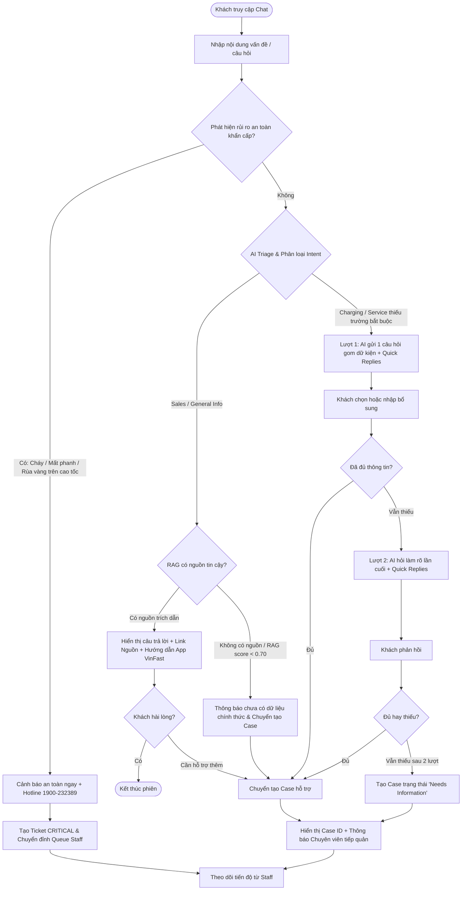
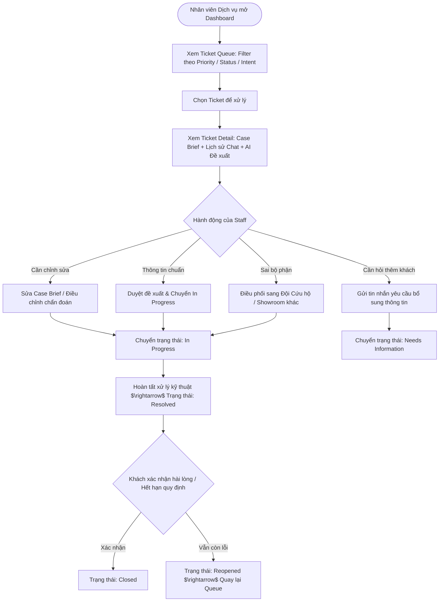

# User Flows Specification (Customer & Staff)

> **Người phụ trách chính:** Việt (Product Lead)  
> **Cập nhật lần cuối:** 2026-09-24  
> **Trạng thái:** In Review (Đã cập nhật Clarification Bounds và App Handoff)

---

## 1. Customer User Flow

---

## 2. Staff Console User Flow

---

## 3. Exception Flows & Guardrails

| Tình huống ngoại lệ | Xử lý của Hệ thống | Trạng thái Ticket |
| :--- | :--- | :--- |
| **Phát hiện từ khóa Nguy hiểm (Cháy, Mất phanh, Tai nạn, Rùa vàng cao tốc)** | Cắt đứt luồng chat thông thường, hiển thị cảnh báo an toàn lập tức (Hotline 1900-232389), tạo Case Brief mức `CRITICAL` và đẩy lên đỉnh hàng đợi Staff. | `Staff Reviewing` (Priority: CRITICAL) |
| **Khách gửi thông tin không liên quan / Spam** | AI nhắc nhở lịch sự phạm vi hỗ trợ của trợ lý ảo VinFast. Cho phép thử lại tối đa 3 lần trước khi khóa phiên. | `N/A` |
| **RAG không tìm thấy tài liệu phù hợp** | Tuyệt đối không phỏng đoán. Phản hồi: *"Hiện tại hệ thống chưa có dữ liệu chính xác về vấn đề này. Em đã tạo yêu cầu để chuyên viên VinFast kiểm tra lại cho mình."* | `Staff Reviewing` |
| **Khách chưa cung cấp đủ thông tin sau 2 lượt hỏi** | Dừng hỏi tự động, tạo Case để nhân viên hỗ trợ trực tiếp. | `Needs Information` |
