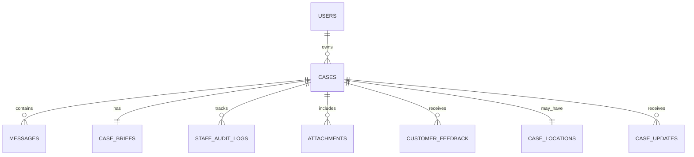

# 📘 VinFast ServiceFlow AI - Backend Changelog & Architecture Guide (`src/`)

Tài liệu này ghi nhận toàn bộ quá trình chuẩn hóa Backend, cơ sở dữ liệu SQLite, hệ thống Migration Alembic, danh mục API và **Từ điển Dữ liệu Chi tiết (Data Dictionary)** kèm dữ liệu mẫu của từng thuộc tính theo đúng **Nguồn Chân Lý (Single Source of Truth - Cập nhật 2026-10-02 / ADR-005)** tại thư mục `docs/`.

---

## 📍 Vị trí tài liệu
File được đặt trực tiếp tại: **`src/BACKEND_CHANGELOG.md`**

---

## 1. Lịch sử cập nhật chuẩn hóa

### 1.1. Cập nhật ngày 2026-10-02 (ADR-005: Roles, Location Consent, Customer Confirmation & Staff Operations)
Bổ sung và chuẩn hóa toàn diện theo `docs/architecture/api-contract.md`, `docs/architecture/data-model.md`, `docs/decisions/ADR-005-roles-location-and-customer-confirmation.md`:

1. **Guest Trial & Giới hạn 5 lượt chat:**
   - Hỗ trợ định danh `guest_session_id` khi chưa đăng nhập.
   - Giới hạn tối đa 5 lượt chat/phiên; phản hồi tự động trả `remaining_guest_messages` giảm dần từ 4 về 0. Lượt thứ 6 bị chặn với mã lỗi `403 Forbidden`.
   - Guest nhận tư vấn FAQ/Citation bình thường nhưng phải đăng nhập tài khoản Customer để tạo và theo dõi case.

2. **Chia sẻ Vị trí theo Consent (Location Consent & Privacy):**
   - API `POST /api/v1/customer/location`: Khách hàng chọn chia sẻ vị trí qua trình duyệt (`CONSENTED` + `BROWSER_GPS`/`MAP_PICKER`) hoặc nhập tay khu vực gặp sự cố (`MANUAL` + `USER_TEXT`).
   - Tuyệt đối tuân thủ bảo mật: Không tự động đọc dữ liệu GPS/EXIF từ ảnh đính kèm.
   - Bảng mới `case_locations` (quan hệ 1-1 với `cases`).

3. **Gợi ý Điểm dịch vụ / Trạm sạc (Service Points):**
   - API `GET /api/v1/customer/cases/{case_id}/service-points`: Gợi ý 3-5 điểm seed demo phù hợp theo Intent (Trạm sạc siêu nhanh DC cho sự cố pin/sạc; Xưởng dịch vụ/Trạm cứu hộ cho sự cố vận hành/cao tốc).

4. **Quy trình Khách hàng xác nhận hoàn tất (Customer Confirmation Flow):**
   - Khi Staff đánh dấu sự cố là `RESOLVE`, hệ thống tạo bản ghi `CaseUpdate` với cờ `awaiting_customer_confirmation = True`.
   - API `POST /api/v1/customer/cases/{case_id}/confirmation`:
     - Khách chọn `RESOLVED_CONFIRMED` ("Đã được hỗ trợ") $\rightarrow$ Chuyển trạng thái sang `Closed`.
     - Khách chọn `STILL_UNRESOLVED` ("Vẫn chưa giải quyết") $\rightarrow$ Chuyển trạng thái sang `Reopened` và quay trở lại hàng đợi Staff Queue.
   - Bảng mới `case_updates` (quan hệ 1-N với `cases`).

5. **Customer Case Search & Case Detail:**
   - API `GET /api/v1/customer/cases?query={query}&status={status}`: Tìm kiếm hồ sơ của chính mình theo mã case/từ khóa và lọc theo trạng thái.
   - API `GET /api/v1/customer/cases/{case_id}`: Trả chi tiết case, brief an toàn, vị trí đã chia sẻ, timeline cập nhật, ảnh táp-lô và lịch sử chat (kiểm tra ownership).

6. **Thư viện Tình huống Thường gặp Công khai (Public Support Insights):**
   - API `GET /api/v1/public/support-insights`: Cung cấp thư viện hướng dẫn xử lý các tình huống thường gặp (lỗi kết nối CC01, đèn rùa vàng cao tốc, lỗi sạc chậm tại nhà, không đồng bộ app, tối ưu sạc mùa nóng).
   - Nội dung đã được biên soạn/ẩn danh, tuyệt đối không dùng raw ticket/chat của khách hàng.

7. **Staff Console: Dashboard & Routing Directory:**
   - API `GET /api/v1/staff/dashboard`: Cung cấp bộ đếm vận hành: Critical, Staff Reviewing, Needs Information, Resolved hôm nay, Tổng số case.
   - API `GET /api/v1/staff/routing-directory`: Danh bạ 5 bộ phận tiếp nhận P0 để điều phối: `Charging Operations`, `Service Center`, `Customer Care`, `Sales Advisor`, `Emergency Support Demo`.

8. **Alembic Migration mới:**
   - Tạo revision `777b44e9e4d6_case_locations_and_updates.py` nâng cấp cấu trúc bảng `case_locations` và `case_updates`.

---

### 1.2. Cập nhật ngày 2026-09-30 (ADR-004: Web-first Auth & Image Triage)
- Quản trị vai trò người dùng (RBAC): `Guest`, `Customer`, `Staff`.
- API `POST /api/v1/customer/attachments`: Nhận ảnh táp-lô/đèn báo, lưu private, trích xuất OCR/Vision sơ bộ (`ocr_text`, `detected_signals`, `vision_confidence`).
- Bảng mới: `users`, `attachments`, `customer_feedback`. Bổ sung `user_id` vào `cases`.
- Revision migration: `9f03985a11a8_web_auth_and_attachments.py`.

---

### 1.3. Cập nhật ngày 2026-09-24 (Đặc tả cốt lõi MVP)
- Chuẩn hóa 4 bảng gốc: `cases`, `messages`, `case_briefs`, `staff_audit_logs`.
- Mã Case định dạng chuỗi: `CASE-YYYYMMDD-XXX`.
- 7 trạng thái chuẩn: `New` $\rightarrow$ `Needs Information` $\rightarrow$ `Staff Reviewing` $\rightarrow$ `In Progress` $\rightarrow$ `Resolved` $\rightarrow$ `Closed` (và `Reopened`).
- Quy tắc No-PII: Dùng `mock_customer_id`, `vehicle_code_mock`, `session_id`.

---

## 2. Bản đồ cấu trúc thư mục Backend

```text
E:\P-142\
├── alembic.ini                   # Cấu hình Migration Alembic trỏ vào migrations/ và data/app.db
├── migrations/                   # Hệ thống Alembic Database Migrations
│   ├── env.py                   # Cấu hình SQLAlchemy metadata & render_as_batch=True cho SQLite
│   ├── script.py.mako           # Template sinh mã migration
│   └── versions/
│       ├── c9952f7d6ac7_init_schema.py               # Migration khởi tạo cũ (base)
│       ├── 84802fff010b_align_spec_schema.py         # Revision: chuyển đổi sang 4 bảng chuẩn hóa
│       ├── 9f03985a11a8_web_auth_and_attachments.py   # Revision: bổ sung users, attachments, feedback
│       └── 777b44e9e4d6_case_locations_and_updates.py # [MỚI] Revision: bổ sung case_locations, case_updates
├── data/
│   ├── app.db                   # Database SQLite chính thức của hệ thống
│   └── attachments/             # Private Attachment Storage (lưu trữ ảnh táp-lô riêng tư)
├── src/
│   ├── main.py                  # FastAPI app, nạp Router, CORS, Lifespan tạo thư mục
│   ├── config.py                # Pydantic Settings
│   ├── db.py                    # SQLite engine, foreign keys PRAGMA, SessionLocal
│   ├── seed.py                  # Script nạp 4 kịch bản demo chuẩn hóa, locations & updates
│   ├── BACKEND_CHANGELOG.md     # Tài liệu kiến trúc và hướng dẫn này
│   ├── services/
│   │   ├── auth.py              # Xử lý băm mật khẩu, tạo token session, dependency RBAC
│   │   └── llm.py               # Tích hợp Google Gemini LLM
│   ├── models/
│   │   ├── db_models.py         # SQLAlchemy ORM (9 bảng dữ liệu)
│   │   └── schemas.py           # Pydantic schemas với ApiResponse envelope chuẩn
│   ├── api/
│   │   ├── auth.py              # Auth APIs: /login, /register, /me
│   │   ├── public.py            # Public Knowledge Hub: /articles, /support-insights
│   │   ├── customer.py          # Customer APIs: /chat, /attachments, /location, /service-points, /confirmation, /cases, /status, /reopen, /feedback
│   │   ├── staff.py             # Staff Console APIs: /dashboard, /routing-directory, /tickets, /tickets/{id}, /actions
│   │   ├── cases.py             # Cases APIs tương thích ngược
│   │   └── routes.py            # API cơ bản của template (/chat, /status)
│   └── agents/                  # AI LangGraph Agent
└── tests/
    ├── conftest.py              # Test fixtures (async client, mock LLM)
    ├── test_agents/             # Kiểm tra LangGraph flow
    └── test_api/
        ├── test_routes.py       # Kiểm tra các routes cơ bản
        └── test_aligned_spec.py # [39 TESTS] Bộ kiểm thử tự động toàn diện pass 100%
```

---

## 3. Danh mục API Endpoints chi tiết

Chuẩn Envelope bắt buộc cho toàn bộ response API:
```json
{
  "success": true,
  "data": { ... },
  "error": null,
  "meta": {
    "timestamp": "2026-10-02T10:00:00.000000Z"
  }
}
```

### 3.1. Public & Auth APIs
| Method | Endpoint | Mô tả | RBAC |
| :--- | :--- | :--- | :--- |
| `GET` | `/api/v1/public/articles` | Danh sách bài viết Knowledge Hub công khai (FAQ, hướng dẫn app, biểu phí sạc) | Guest / Public |
| `GET` | `/api/v1/public/support-insights` | Thư viện tình huống thường gặp đã biên soạn/ẩn danh (lỗi CC01, rùa vàng, sạc chậm...) | Guest / Public |
| `POST` | `/api/v1/auth/register` | Đăng ký tài khoản Customer mới bằng SĐT + OTP demo | Guest / Public |
| `POST` | `/api/v1/auth/login` | Đăng nhập lấy Bearer token và profile vai trò (`CUSTOMER` hoặc `STAFF`) | Guest / Public |
| `GET` | `/api/v1/auth/me` | Lấy thông tin tài khoản hiện tại từ token | Authenticated |

### 3.2. Customer APIs
| Method | Endpoint | Mô tả | RBAC |
| :--- | :--- | :--- | :--- |
| `POST` | `/api/v1/customer/chat` | Chat tiếp nhận sự cố, hỏi làm rõ, trả FAQ hoặc tạo case. Hỗ trợ Guest trial (max 5 lượt) | Guest / Customer |
| `POST` | `/api/v1/customer/attachments` | Tải ảnh táp-lô, đèn báo hoặc trụ sạc; OCR trích xuất tín hiệu sơ bộ | Customer |
| `POST` | `/api/v1/customer/location` | Chia sẻ vị trí sự cố theo Consent hoặc tự nhập khu vực | Customer |
| `GET` | `/api/v1/customer/cases/{case_id}/service-points` | Gợi ý 3-5 điểm trạm sạc/xưởng dịch vụ/cứu hộ phù hợp theo sự cố | Customer |
| `POST` | `/api/v1/customer/cases/{case_id}/confirmation` | Khách xác nhận `RESOLVED_CONFIRMED` (Closed) hoặc `STILL_UNRESOLVED` (Reopened) | Customer |
| `GET` | `/api/v1/customer/cases` | Danh sách case của chính mình (hỗ trợ filter `query` và `status`) | Customer |
| `GET` | `/api/v1/customer/cases/{case_id}` | Xem chi tiết Case: brief, vị trí, timeline cập nhật, ảnh táp-lô, lịch sử chat | Customer |
| `GET` | `/api/v1/customer/cases/{case_id}/status` | Tra cứu tiến độ xử lý hồ sơ kèm mô tả thân thiện | Customer |
| `POST` | `/api/v1/customer/cases/{case_id}/reopen` | Yêu cầu mở lại hồ sơ đã xử lý | Customer |
| `POST` | `/api/v1/customer/cases/{case_id}/feedback` | Gửi đánh giá dịch vụ (1 đến 5 sao) và nhận xét | Customer |

### 3.3. Staff Console APIs
| Method | Endpoint | Mô tả | RBAC |
| :--- | :--- | :--- | :--- |
| `GET` | `/api/v1/staff/dashboard` | Thống kê counter vận hành: Critical, Staff Reviewing, Needs Info, Resolved hôm nay | Staff |
| `GET` | `/api/v1/staff/routing-directory` | Danh bạ 5 bộ phận tiếp nhận P0 để điều phối (Reroute) | Staff |
| `GET` | `/api/v1/staff/tickets` | Hàng đợi danh sách ticket cần xử lý (lọc theo `status`, `priority`) | Staff |
| `GET` | `/api/v1/staff/tickets/{case_id}` | Xem toàn bộ chi tiết case, brief, vị trí, updates, ảnh đính kèm và chat history | Staff |
| `POST` | `/api/v1/staff/tickets/{case_id}/actions` | Thao tác HITL (`APPROVE`, `EDIT_BRIEF`, `REROUTE`, `REQUEST_INFO`, `RESOLVE`, `CLOSE`, `REOPEN`) | Staff |

---

## 4. BẢNG DỮ LIỆU & THUỘC TÍNH CHI TIẾT KÈM DỮ LIỆU MẪU (DATA DICTIONARY)

Hệ thống cơ sở dữ liệu SQLite (`data/app.db`) bao gồm **9 bảng chuẩn hóa** tuân thủ tuyệt đối quy định **No-PII (ADR-003)** và các yêu cầu nghiệp vụ trong `data-model.md` và `ADR-005`.



---

### 4.1. Bảng `users` (Quản lý tài khoản & Phân quyền RBAC)
Lưu trữ thông tin người dùng của hệ thống Web Support Hub. Đăng ký công khai chỉ tạo role `CUSTOMER`; tài khoản `STAFF` được seed/invite sẵn.

| Tên Cột (Attribute) | Kiểu Dữ Liệu | Nullable | Ràng Buộc / Mặc Định | Ý Nghĩa Nghiệp Vụ | Dữ Liệu Mẫu Thực Tế (Sample Value) |
| :--- | :--- | :---: | :--- | :--- | :--- |
| `id` | `VARCHAR(36)` | No | `PRIMARY KEY` | Định danh UUID của tài khoản | `"USER_CUST_01"` hoặc `"d4a8c9b2-3e1f-4a5c-8b7a-9f0e1d2c3b4a"` |
| `username` | `VARCHAR(100)` | No | `UNIQUE, INDEX` | Email hoặc SĐT đăng nhập | `"customer@vinfast.vn"` |
| `password_hash` | `VARCHAR(256)` | No | | Chuỗi mật khẩu băm SHA-256 kèm salt | `"a665a45920422f9d417e4867efdc4fb8a04a1f3fff1fa07e998e86f7f7a27ae3"` |
| `role` | `VARCHAR(20)` | No | Default: `'CUSTOMER'` | Vai trò: `CUSTOMER`, `STAFF`, `GUEST` | `"CUSTOMER"` |
| `mock_customer_id` | `VARCHAR(50)` | Yes | | Mã định danh khách hàng mô phỏng | `"CUST_MOCK_01"` |
| `created_at` | `TIMESTAMP` | No | Default: `utcnow` | Thời điểm tạo tài khoản | `"2026-09-20T08:00:00Z"` |

*Bản ghi mẫu JSON:*
```json
{
  "id": "USER_CUST_01",
  "username": "customer@vinfast.vn",
  "password_hash": "a665a45920422f9d...",
  "role": "CUSTOMER",
  "mock_customer_id": "CUST_MOCK_01",
  "created_at": "2026-09-20T08:00:00Z"
}
```

---

### 4.2. Bảng `cases` (Hồ sơ sự cố / Ticket dịch vụ)
Bảng trung tâm quản lý toàn bộ vòng đời của yêu cầu hỗ trợ. Khóa chính là dạng chuỗi `CASE-YYYYMMDD-XXX`.

| Tên Cột (Attribute) | Kiểu Dữ Liệu | Nullable | Ràng Buộc / Mặc Định | Ý Nghĩa Nghiệp Vụ | Dữ Liệu Mẫu Thực Tế (Sample Value) |
| :--- | :--- | :---: | :--- | :--- | :--- |
| `id` | `VARCHAR(32)` | No | `PRIMARY KEY` | Mã định danh hồ sơ sự cố chuẩn | `"CASE-20260924-001"` |
| `user_id` | `VARCHAR(36)` | Yes | `FK(users.id), INDEX` | Khóa ngoại tài khoản khách hàng tạo case | `"USER_CUST_01"` |
| `session_id` | `VARCHAR(64)` | No | `INDEX` | Định danh phiên chat web ban đầu | `"sess_vf_98234"` |
| `mock_customer_id` | `VARCHAR(50)` | Yes | | Mã định danh khách hàng mô phỏng | `"CUST_MOCK_01"` |
| `mock_customer_name` | `VARCHAR(100)` | Yes | | Tên khách mô phỏng (chỉ seed demo) | `"Khách hàng Demo 01"` |
| `mock_customer_phone` | `VARCHAR(20)` | Yes | | SĐT mô phỏng (chỉ seed demo) | `"0900-000-231"` |
| `vehicle_code_mock` | `VARCHAR(50)` | Yes | | Mã xe mô phỏng không chứa VIN thật | `"VF-SF-00231"` |
| `vehicle_model` | `VARCHAR(50)` | Yes | | Dòng xe điện: VF3, VF5, VF6, VF7, VF8, VF9, e34 | `"VF8"` |
| `intent` | `VARCHAR(50)` | No | | Nhóm phân loại yêu cầu | `"Charging/Battery"` |
| `priority` | `VARCHAR(20)` | No | Default: `'MEDIUM'` | Mức ưu tiên: `LOW`, `MEDIUM`, `HIGH`, `CRITICAL` | `"HIGH"` |
| `status` | `VARCHAR(30)` | No | Default: `'New'` | Trạng thái vòng đời ticket chuẩn (7 trạng thái) | `"Staff Reviewing"` |
| `assigned_staff_id` | `VARCHAR(50)` | Yes | | Mã nhân viên điều phối phụ trách | `"STAFF_001"` |
| `created_at` | `TIMESTAMP` | No | Default: `utcnow` | Thời điểm tạo hồ sơ | `"2026-09-24T08:30:00Z"` |
| `updated_at` | `TIMESTAMP` | No | Default: `utcnow` | Thời điểm cập nhật cuối | `"2026-09-24T08:35:00Z"` |

*Bản ghi mẫu JSON:*
```json
{
  "id": "CASE-20260924-001",
  "user_id": "USER_CUST_01",
  "session_id": "sess_vf_98234",
  "mock_customer_id": "CUST_MOCK_01",
  "mock_customer_name": "Khách hàng Demo 01",
  "mock_customer_phone": "0900-000-231",
  "vehicle_code_mock": "VF-SF-00231",
  "vehicle_model": "VF8",
  "intent": "Charging/Battery",
  "priority": "HIGH",
  "status": "Staff Reviewing",
  "assigned_staff_id": "STAFF_001",
  "created_at": "2026-09-24T08:30:00Z",
  "updated_at": "2026-09-24T08:35:00Z"
}
```

---

### 4.3. Bảng `messages` (Lịch sử hội thoại Chat)
Lưu trữ toàn bộ tin nhắn tương tác giữa khách hàng, AI agent và nhân viên kỹ thuật.

| Tên Cột (Attribute) | Kiểu Dữ Liệu | Nullable | Ràng Buộc / Mặc Định | Ý Nghĩa Nghiệp Vụ | Dữ Liệu Mẫu Thực Tế (Sample Value) |
| :--- | :--- | :---: | :--- | :--- | :--- |
| `id` | `VARCHAR(36)` | No | `PRIMARY KEY` | Mã định danh UUID tin nhắn | `"b5c3d2e1-4f5a-6b7c-8d9e-0f1a2b3c4d5e"` |
| `case_id` | `VARCHAR(32)` | Yes | `FK(cases.id), INDEX` | Khóa ngoại tới hồ sơ sự cố (null nếu chat FAQ) | `"CASE-20260924-001"` |
| `session_id` | `VARCHAR(64)` | No | `INDEX` | Định danh phiên chat liên quan | `"sess_vf_98234"` |
| `sender_type` | `VARCHAR(20)` | No | | Bên gửi: `CUSTOMER`, `AGENT`, `STAFF`, `SYSTEM` | `"CUSTOMER"` |
| `content` | `TEXT` | No | | Nội dung văn bản của tin nhắn | `"Xe VF8 của tôi không nhận sạc ở trạm Metropolis, trụ báo đèn đỏ."` |
| `metadata` | `JSON` | Yes | | Dữ liệu ngữ cảnh phụ (trích dẫn citation, suggested replies, cờ an toàn) | `{"turn": 1, "suggested_replies": ["Mã lỗi CC01, trụ P02", "Đèn đỏ, không hiện mã"]}` |
| `created_at` | `TIMESTAMP` | No | Default: `utcnow` | Thời điểm gửi tin nhắn | `"2026-09-24T08:30:00Z"` |

*Bản ghi mẫu JSON:*
```json
{
  "id": "b5c3d2e1-4f5a-6b7c-8d9e-0f1a2b3c4d5e",
  "case_id": "CASE-20260924-001",
  "session_id": "sess_vf_98234",
  "sender_type": "CUSTOMER",
  "content": "Xe VF8 của tôi không nhận sạc ở trạm Metropolis, trụ báo đèn đỏ.",
  "metadata": {
    "client_context": {"vehicle_model": "VF8", "mock_customer_id": "CUST_MOCK_01"},
    "attachment_ids": ["ATT-20260930-001"]
  },
  "created_at": "2026-09-24T08:30:00Z"
}
```

---

### 4.4. Bảng `case_briefs` (Tóm tắt sự cố kỹ thuật AI sinh)
Chứa thông tin tổng hợp sự cố do AI Agent trích xuất (quan hệ 1-1 với `cases`).

| Tên Cột (Attribute) | Kiểu Dữ Liệu | Nullable | Ràng Buộc / Mặc Định | Ý Nghĩa Nghiệp Vụ | Dữ Liệu Mẫu Thực Tế (Sample Value) |
| :--- | :--- | :---: | :--- | :--- | :--- |
| `id` | `VARCHAR(36)` | No | `PRIMARY KEY` | Mã định danh UUID của bản tóm tắt | `"c1a2b3c4-d5e6-7f8a-9b0c-1d2e3f4a5b6c"` |
| `case_id` | `VARCHAR(32)` | No | `UNIQUE, FK(cases.id)` | Khóa ngoại duy nhất liên kết tới `cases` | `"CASE-20260924-001"` |
| `summary` | `TEXT` | No | | Tóm tắt sự cố kỹ thuật ngắn gọn | `"Xe VF8 không nhận sạc DC tại trạm Metropolis, màn hình xe báo mã lỗi CC01 và đèn trụ báo đỏ."` |
| `captured_fields` | `JSON` | No | Default: `{}` | Các trường kỹ thuật đã trích xuất | `{"vehicle_model": "VF8", "station_location": "Vincom Metropolis", "charger_id": "VN-CS-HN042-P02", "error_code": "CC01", "current_soc": "18%"}` |
| `suggested_action` | `TEXT` | Yes | | Phương án xử lý AI khuyến nghị cho nhân viên | `"Kiểm tra tín hiệu giao tiếp trụ sạc P02 từ xa hoặc cử nhân viên trạm hỗ trợ cắm lại cáp sạc."` |
| `confidence_score` | `FLOAT` | No | Default: `0.90` | Điểm tự tin của AI (0.0 đến 1.0) | `0.92` |
| `is_edited_by_staff` | `BOOLEAN` | No | Default: `FALSE` | Cờ đánh dấu nhân viên đã chỉnh sửa brief | `false` |
| `generated_at` | `TIMESTAMP` | No | Default: `utcnow` | Thời điểm AI tạo bản tóm tắt | `"2026-09-24T08:34:00Z"` |

*Bản ghi mẫu JSON:*
```json
{
  "id": "c1a2b3c4-d5e6-7f8a-9b0c-1d2e3f4a5b6c",
  "case_id": "CASE-20260924-001",
  "summary": "Xe VF8 không nhận sạc DC tại trạm Metropolis, màn hình xe báo mã lỗi CC01 và đèn trụ báo đỏ.",
  "captured_fields": {
    "vehicle_model": "VF8",
    "station_location": "Vincom Metropolis Liễu Giai",
    "charger_id": "VN-CS-HN042-P02",
    "error_code": "CC01",
    "current_soc": "18%"
  },
  "suggested_action": "Kiểm tra tín hiệu handshake giao tiếp trụ sạc P02 từ xa hoặc cử kỹ thuật viên cắm lại cáp.",
  "confidence_score": 0.92,
  "is_edited_by_staff": false,
  "generated_at": "2026-09-24T08:34:00Z"
}
```

---

### 4.5. Bảng `staff_audit_logs` (Nhật ký kiểm toán thao tác Staff HITL)
Lưu vết toàn bộ hành động can thiệp của nhân viên (HITL) trên Service Agent Console để phục vụ kiểm toán và đánh giá mô hình.

| Tên Cột (Attribute) | Kiểu Dữ Liệu | Nullable | Ràng Buộc / Mặc Định | Ý Nghĩa Nghiệp Vụ | Dữ Liệu Mẫu Thực Tế (Sample Value) |
| :--- | :--- | :---: | :--- | :--- | :--- |
| `id` | `VARCHAR(36)` | No | `PRIMARY KEY` | Mã định danh UUID bản ghi nhật ký | `"f8e7d6c5-b4a3-2109-8765-43210fedcba9"` |
| `case_id` | `VARCHAR(32)` | No | `FK(cases.id), INDEX` | Khóa ngoại liên kết tới case | `"CASE-20260924-001"` |
| `staff_id` | `VARCHAR(50)` | No | | Định danh nhân viên hoặc người thao tác | `"STAFF_001"` |
| `action` | `VARCHAR(30)` | No | | Hành động HITL (`APPROVE`, `EDIT_BRIEF`, `REROUTE`, `REQUEST_INFO`, `RESOLVE`, `CLOSE`, `REOPEN`) | `"APPROVE"` |
| `previous_state` | `JSON` | Yes | | Snapshot trạng thái trước khi thay đổi | `{"status": "Staff Reviewing", "priority": "HIGH"}` |
| `new_state` | `JSON` | Yes | | Snapshot trạng thái sau khi thay đổi | `{"status": "In Progress", "priority": "HIGH"}` |
| `notes` | `TEXT` | Yes | | Ghi chú lý do thao tác của nhân viên | `"Đã tiếp nhận yêu cầu và điều phối kỹ thuật viên kiểm tra trụ sạc."` |
| `created_at` | `TIMESTAMP` | No | Default: `utcnow` | Thời điểm ghi nhận thao tác | `"2026-09-24T08:40:00Z"` |

*Bản ghi mẫu JSON:*
```json
{
  "id": "f8e7d6c5-b4a3-2109-8765-43210fedcba9",
  "case_id": "CASE-20260924-001",
  "staff_id": "STAFF_001",
  "action": "APPROVE",
  "previous_state": {"status": "Staff Reviewing"},
  "new_state": {"status": "In Progress"},
  "notes": "Đã duyệt phương án xử lý và chuyển kỹ thuật viên trạm.",
  "created_at": "2026-09-24T08:40:00Z"
}
```

---

### 4.6. Bảng `attachments` (File đính kèm & Tín hiệu OCR/Vision)
Lưu trữ thông tin ảnh táp-lô, đèn báo hoặc trụ sạc được khách hàng tải lên đường dẫn riêng tư (private storage).

| Tên Cột (Attribute) | Kiểu Dữ Liệu | Nullable | Ràng Buộc / Mặc Định | Ý Nghĩa Nghiệp Vụ | Dữ Liệu Mẫu Thực Tế (Sample Value) |
| :--- | :--- | :---: | :--- | :--- | :--- |
| `id` | `VARCHAR(36)` | No | `PRIMARY KEY` | Mã định danh ảnh chuẩn `ATT-YYYYMMDD-XXX` | `"ATT-20260930-001"` |
| `case_id` | `VARCHAR(32)` | Yes | `FK(cases.id), INDEX` | Khóa ngoại case (null trước khi tạo case) | `"CASE-20260924-001"` |
| `message_id` | `VARCHAR(36)` | Yes | `FK(messages.id), INDEX` | Khóa ngoại tin nhắn chứa ảnh | `"b5c3d2e1-4f5a-6b7c-8d9e-0f1a2b3c4d5e"` |
| `storage_key` | `VARCHAR(255)` | No | | Đường dẫn lưu trữ file an toàn nội bộ | `"data/attachments/ATT-20260930-001_demo_screen_cc01.jpg"` |
| `mime_type` | `VARCHAR(50)` | No | Default: `'image/jpeg'` | Định dạng file tải lên | `"image/jpeg"` |
| `analysis_status` | `VARCHAR(20)` | No | Default: `'UPLOADED'` | Trạng thái: `UPLOADED`, `ANALYZED`, `FAILED` | `"ANALYZED"` |
| `ocr_text` | `TEXT` | Yes | | Đoạn text nhận dạng sơ bộ qua OCR | `"Mã lỗi CC01 - Trụ sạc VN-CS-HN042-P02 đèn báo nhấp nháy đỏ"` |
| `detected_signals` | `JSON` | Yes | | Cặp key-value tín hiệu kỹ thuật phát hiện | `{"error_code_candidate": "CC01", "charger_lamp": "RED", "warning_type": "CHARGING_COMMUNICATION_ERROR"}` |
| `vision_confidence` | `FLOAT` | Yes | | Độ tự tin nhận diện hình ảnh | `0.92` |
| `created_at` | `TIMESTAMP` | No | Default: `utcnow` | Thời điểm upload ảnh | `"2026-09-30T09:15:00Z"` |

*Bản ghi mẫu JSON:*
```json
{
  "id": "ATT-20260930-001",
  "case_id": "CASE-20260924-001",
  "message_id": "b5c3d2e1-4f5a-6b7c-8d9e-0f1a2b3c4d5e",
  "storage_key": "data/attachments/ATT-20260930-001_demo_screen_cc01.jpg",
  "mime_type": "image/jpeg",
  "analysis_status": "ANALYZED",
  "ocr_text": "Mã lỗi CC01 - Trụ sạc VN-CS-HN042-P02 đèn báo nhấp nháy đỏ",
  "detected_signals": {
    "error_code_candidate": "CC01",
    "charger_lamp": "RED"
  },
  "vision_confidence": 0.92,
  "created_at": "2026-09-30T09:15:00Z"
}
```

---

### 4.7. Bảng `customer_feedback` (Đánh giá dịch vụ của Khách hàng)
Lưu nhận xét và đánh giá mức độ hài lòng của khách hàng sau khi sự cố đã được xử lý (`Resolved`/`Closed`).

| Tên Cột (Attribute) | Kiểu Dữ Liệu | Nullable | Ràng Buộc / Mặc Định | Ý Nghĩa Nghiệp Vụ | Dữ Liệu Mẫu Thực Tế (Sample Value) |
| :--- | :--- | :---: | :--- | :--- | :--- |
| `id` | `VARCHAR(36)` | No | `PRIMARY KEY` | Mã định danh UUID của feedback | `"a1b2c3d4-e5f6-7a8b-9c0d-1e2f3a4b5c6d"` |
| `case_id` | `VARCHAR(32)` | No | `FK(cases.id), INDEX` | Khóa ngoại hồ sơ sự cố được đánh giá | `"CASE-20260924-004"` |
| `rating` | `INTEGER` | No | Ràng buộc: `1 <= rating <= 5` | Điểm đánh giá số sao hài lòng | `5` |
| `comment` | `TEXT` | Yes | | Nhận xét chi tiết của khách hàng | `"Nhân viên hỗ trợ tư vấn rất nhanh và nhiệt tình, cảm ơn VinFast!"` |
| `created_at` | `TIMESTAMP` | No | Default: `utcnow` | Thời điểm gửi đánh giá | `"2026-09-25T14:30:00Z"` |

*Bản ghi mẫu JSON:*
```json
{
  "id": "a1b2c3d4-e5f6-7a8b-9c0d-1e2f3a4b5c6d",
  "case_id": "CASE-20260924-004",
  "rating": 5,
  "comment": "Nhân viên hỗ trợ tư vấn rất nhanh và nhiệt tình, cảm ơn VinFast!",
  "created_at": "2026-09-25T14:30:00Z"
}
```

---

### 4.8. Bảng `case_locations` (Vị trí sự cố khách hàng chia sẻ theo Consent - ADR-005)
Lưu vị trí sự cố khi khách hàng đồng ý (consent) hoặc tự nhập khu vực. Tuyệt đối không đọc GPS từ EXIF ảnh.

| Tên Cột (Attribute) | Kiểu Dữ Liệu | Nullable | Ràng Buộc / Mặc Định | Ý Nghĩa Nghiệp Vụ | Dữ Liệu Mẫu Thực Tế (Sample Value) |
| :--- | :--- | :---: | :--- | :--- | :--- |
| `id` | `VARCHAR(36)` | No | `PRIMARY KEY` | Mã định danh UUID vị trí | `"e2f3a4b5-c6d7-8e9f-0a1b-2c3d4e5f6a7b"` |
| `case_id` | `VARCHAR(32)` | No | `UNIQUE, FK(cases.id), INDEX` | Khóa ngoại duy nhất tới `cases` (quan hệ 1-1) | `"CASE-20260924-001"` |
| `status` | `VARCHAR(20)` | No | Default: `'NOT_SHARED'` | Trạng thái chia sẻ: `CONSENTED`, `MANUAL`, `NOT_SHARED`, `UNKNOWN` | `"CONSENTED"` |
| `source` | `VARCHAR(20)` | No | Default: `'USER_TEXT'` | Nguồn: `BROWSER_GPS`, `USER_TEXT`, `MAP_PICKER` | `"MAP_PICKER"` |
| `location_label` | `VARCHAR(255)` | No | | Tên địa điểm hoặc nhãn khu vực mô tả | `"Trạm sạc Vincom Metropolis Liễu Giai, Ba Đình, Hà Nội"` |
| `latitude` | `FLOAT` | Yes | | Tọa độ Vĩ độ (Latitude) | `21.0315` |
| `longitude` | `FLOAT` | Yes | | Tọa độ Kinh độ (Longitude) | `105.8145` |
| `precision` | `VARCHAR(20)` | No | Default: `'APPROXIMATE'` | Độ chính xác: `APPROXIMATE`, `EXACT` | `"EXACT"` |
| `share_with_staff` | `BOOLEAN` | No | Default: `TRUE` | Cho phép hiển thị tọa độ cho nhân viên cứu hộ/kỹ thuật | `true` |
| `created_at` | `TIMESTAMP` | No | Default: `utcnow` | Thời điểm chia sẻ vị trí | `"2026-09-24T08:35:00Z"` |

*Bản ghi mẫu JSON:*
```json
{
  "id": "e2f3a4b5-c6d7-8e9f-0a1b-2c3d4e5f6a7b",
  "case_id": "CASE-20260924-001",
  "status": "CONSENTED",
  "source": "MAP_PICKER",
  "location_label": "Trạm sạc Vincom Metropolis Liễu Giai, Ba Đình, Hà Nội",
  "latitude": 21.0315,
  "longitude": 105.8145,
  "precision": "EXACT",
  "share_with_staff": true,
  "created_at": "2026-09-24T08:35:00Z"
}
```

---

### 4.9. Bảng `case_updates` (Tiến độ cập nhật gửi Khách hàng & Chờ xác nhận - ADR-005)
Lưu trữ các mốc thông báo cập nhật tiến độ an toàn gửi cho khách hàng, bao gồm cờ chờ xác nhận `awaiting_customer_confirmation`.

| Tên Cột (Attribute) | Kiểu Dữ Liệu | Nullable | Ràng Buộc / Mặc Định | Ý Nghĩa Nghiệp Vụ | Dữ Liệu Mẫu Thực Tế (Sample Value) |
| :--- | :--- | :---: | :--- | :--- | :--- |
| `id` | `VARCHAR(36)` | No | `PRIMARY KEY` | Mã định danh UUID cập nhật | `"d3c2b1a0-9f8e-7d6c-5b4a-3210fedcba98"` |
| `case_id` | `VARCHAR(32)` | No | `FK(cases.id), INDEX` | Khóa ngoại hồ sơ sự cố (quan hệ 1-N) | `"CASE-20260924-004"` |
| `author_type` | `VARCHAR(20)` | No | Default: `'STAFF'` | Người tạo cập nhật: `STAFF`, `SYSTEM` | `"STAFF"` |
| `status_after_update` | `VARCHAR(30)` | No | | Trạng thái ticket tương ứng sau mốc này | `"Resolved"` |
| `customer_message` | `TEXT` | No | | Nội dung văn bản thân thiện hiển thị cho khách | `"Đã gửi tài liệu chi tiết chương trình miễn phí sạc V-GREEN và bảng tính thuê pin VF5 đến email khách hàng."` |
| `next_step` | `TEXT` | Yes | | Bước tiếp theo trong quy trình xử lý | `"Khách hàng xác nhận kết quả hỗ trợ trên ứng dụng."` |
| `awaiting_customer_confirmation` | `BOOLEAN` | No | Default: `FALSE` | Cờ đánh dấu đang chờ khách hàng bấm xác nhận hài lòng hoặc mở lại | `true` |
| `created_at` | `TIMESTAMP` | No | Default: `utcnow` | Thời điểm ghi nhận cập nhật | `"2026-09-25T14:00:00Z"` |

*Bản ghi mẫu JSON:*
```json
{
  "id": "d3c2b1a0-9f8e-7d6c-5b4a-3210fedcba98",
  "case_id": "CASE-20260924-004",
  "author_type": "STAFF",
  "status_after_update": "Resolved",
  "customer_message": "Đã gửi tài liệu chi tiết chương trình miễn phí sạc V-GREEN đến email khách hàng.",
  "next_step": "Khách hàng xác nhận kết quả hỗ trợ trên ứng dụng.",
  "awaiting_customer_confirmation": true,
  "created_at": "2026-09-25T14:00:00Z"
}
```

---

## 5. Tài khoản Demo có sẵn (Seed Data)

Khi chạy lệnh nạp dữ liệu mẫu, hệ thống sẽ tự động tạo các tài khoản demo:

| Tên đăng nhập | Mật khẩu | Vai trò | Mục đích sử dụng |
| :--- | :--- | :--- | :--- |
| `staff@vinfast.vn` | `staff123` | **STAFF** | Truy cập Console điều phối, xem ticket queue, dashboard, routing directory, duyệt HITL actions |
| `customer@vinfast.vn` | `customer123` | **CUSTOMER** | Đóng vai khách hàng Demo 01 (`CUST_MOCK_01`), sở hữu Case 001 (Metropolis), 002 (Cao tốc), 003 (Sạc chậm) |
| `customer2@vinfast.vn` | `customer123` | **CUSTOMER** | Đóng vai khách hàng Demo 02 (`CUST_MOCK_02`), sở hữu Case 004 đã giải quyết |

---

## 6. Hướng dẫn chạy và kiểm thử

### 6.1. Nâng cấp Database Migration Alembic
```powershell
& ".\.venv\Scripts\alembic.exe" upgrade head
```

### 6.2. Reset và Nạp dữ liệu mẫu (Seed Data)
```powershell
& ".\.venv\Scripts\python.exe" -m src.seed --reset
```

### 6.3. Chạy kiểm thử tự động (Pytest)
```powershell
& ".\.venv\Scripts\pytest.exe" -v
```
*(Hiện tại 39/39 bài kiểm thử tự động đạt kết quả PASSED 100%).*

### 6.4. Khởi động Backend Server
```powershell
& ".\.venv\Scripts\uvicorn.exe" src.main:app --reload --port 8000
```
- Swagger UI tài liệu tương tác: [http://localhost:8000/docs](http://localhost:8000/docs)
- Health check endpoint: [http://localhost:8000/health](http://localhost:8000/health)
