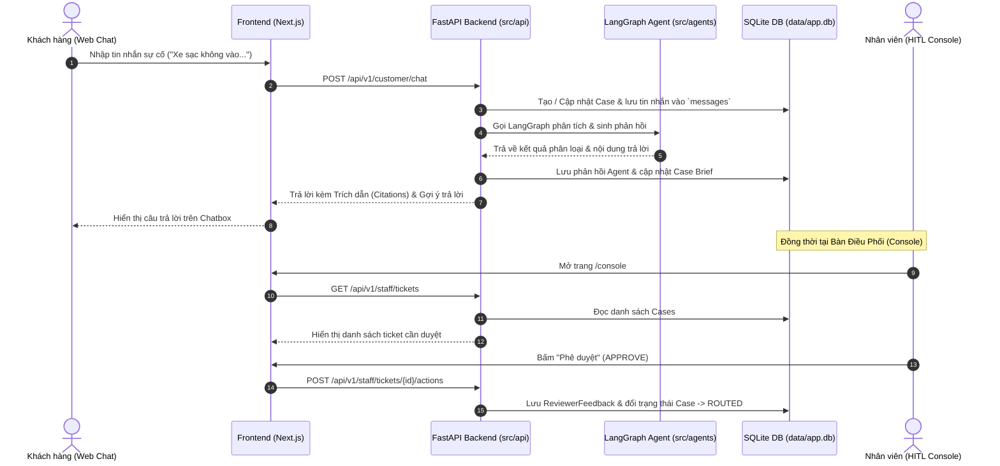

# 📘 Hướng Dẫn & Ghi Chú Kiến Trúc Backend (`src/`)

Tài liệu này được tạo nhằm giúp các thành viên trong nhóm nắm bắt nhanh cấu trúc Backend, luồng dữ liệu giữa Frontend - Backend - Database - AI Agent, cũng như các thành phần vừa được bổ sung/tối ưu.

---

## 📍 Vị trí tài liệu này
File này được đặt trực tiếp tại: **`src/BACKEND_CHANGELOG.md`**  
*(Bất kỳ thành viên nào mở thư mục `src/` đều có thể đọc tài liệu này để xem toàn bộ cập nhật & kiến trúc Backend).*

---

## 1. Tổng quan kiến trúc & Lý do sắp xếp lại
Ban đầu dự án bị phân tán giữa 2 thư mục (`src/` của mẫu AI20K và `backend/` tự tạo), gây nhầm lẫn khi chạy ứng dụng.  
Toàn bộ logic Backend, Database và API đã được **hợp nhất hoàn toàn vào `src/`** để:
- Đúng chuẩn với `Dockerfile` gốc: `uvicorn src.main:app --port 8000`.
- Giữ nguyên 100% các thành phần cốt lõi của ban tổ chức (`src/agents/`, `src/services/`, bộ test `tests/`).
- Kết nối thông suốt với Frontend Next.js (`frontend/`).

---

## 2. Bản đồ cấu trúc thư mục `src/`

```text
src/
├── main.py              # Cổng vào FastAPI: Cấu hình CORS, Lifespan, nạp các Router
├── config.py            # Cấu hình Pydantic Settings (ENV, DB URL, Gemini API Key...)
├── db.py                # [MỚI] Kết nối SQLAlchemy SQLite (SessionLocal, Base, get_db)
├── seed.py              # [MỚI] Script tạo dữ liệu mẫu cho Database SQLite
│
├── models/              # Quản lý cấu trúc dữ liệu
│   ├── schemas.py       # Pydantic schemas (Request/Response cho API)
│   └── db_models.py     # [MỚI] SQLAlchemy ORM Models (Case, Ticket, Message, ReviewerFeedback)
│
├── api/                 # Các API Endpoints
│   ├── routes.py        # [GỐC] API chat agent cơ bản (/api/v1/chat, /status)
│   ├── customer.py      # [MỚI] API Chat khách hàng (/api/v1/customer/chat & /cases/{id}/status)
│   ├── staff.py         # [MỚI] API Quản lý Console cho nhân viên (/api/v1/staff/tickets & /actions)
│   └── cases.py         # [MỚI] API CRUD quản lý Case cơ sở
│
├── agents/              # [GIỮ NGUYÊN GỐC] AI LangGraph Workflow
│   ├── graph.py         # StateGraph và instance `agent = build_graph()`
│   ├── state.py         # Schema trạng thái của Agent
│   ├── nodes/           # Các Node xử lý trong đồ thị (analyze_node, respond_node...)
│   └── tools/           # Các công cụ mở rộng của Agent
│
└── services/            # [GIỮ NGUYÊN GỐC] Các dịch vụ phụ trợ
    └── llm.py           # Tích hợp Google Gemini LLM
```

---

## 3. Các thành phần mới được bổ sung

### 🗄️ Database SQLite (`src/db.py` & `src/models/db_models.py`)
- **File lưu trữ:** `./data/app.db` (nằm ở thư mục gốc dự án).
- **Các bảng chính:**
  1. `cases`: Lưu các hồ sơ sự cố/yêu cầu từ khách hàng (`status`, `intent`, `priority`, `brief_data`...).
  2. `messages`: Lưu lại toàn bộ lịch sử tin nhắn của Khách hàng và Agent.
  3. `tickets`: Lưu vé điều phối đến các bộ phận xử lý (`Sales`, `Service`, `Charging`...).
  4. `reviewer_feedback`: Lưu lịch sử duyệt/chỉnh sửa của nhân viên điều phối (HITL).

### 🌐 Router Khách hàng (`src/api/customer.py`)
- **`POST /api/v1/customer/chat`**:
  - Nhận tin nhắn, session ID, thông tin dòng xe (`VF8`, `VF5`...).
  - Tự động tạo hồ sơ `Case` hoặc tìm `Case` cũ trong SQLite.
  - Phân loại sự cố (Khẩn cấp cao tốc / Trụ sạc pin / Sales / Dịch vụ chung).
  - Tự động lưu tin nhắn khách hàng & câu trả lời của AI vào bảng `messages`.
  - Trả về đúng chuẩn Frontend mong muốn: `response_type`, `citations`, `safe_guidance`, `suggested_replies`, `priority`...
- **`GET /api/v1/customer/cases/{case_id}/status`**: Tra cứu trạng thái hồ sơ trực tiếp từ SQLite.

### 🛡️ Router Nhân viên điều phối (`src/api/staff.py`)
- **`GET /api/v1/staff/tickets`**: Lấy danh sách ticket từ SQLite, hỗ trợ lọc theo trạng thái (`status`) và độ ưu tiên (`priority`).
- **`GET /api/v1/staff/tickets/{case_id}`**: Lấy chi tiết hồ sơ, bản tóm tắt trích xuất `case_brief`, và toàn bộ lịch sử trao đổi.
- **`POST /api/v1/staff/tickets/{case_id}/actions`**: Nhân viên duyệt (`APPROVE`), chỉnh sửa brief (`EDIT_BRIEF`), chuyển tuyến (`REROUTE`), hoặc đóng hồ sơ (`CLOSE`).

---

## 4. Luồng hoạt động (Data Flow)



---

## 5. Hướng dẫn dành cho thành viên trong nhóm

### Bước 1: Kích hoạt môi trường ảo Python
```powershell
# Tại thư mục gốc E:\P-142:
.\.venv\Scripts\Activate.ps1
```

### Bước 2: Tạo dữ liệu mẫu cho Database (Seed Data)
Nếu file database chưa có dữ liệu hoặc muốn reset lại dữ liệu mẫu:
```powershell
python -m src.seed          # Chỉ seed nếu DB đang trống
python -m src.seed --reset  # Xóa sạch dữ liệu cũ và seed lại từ đầu
```

### Bước 3: Khởi chạy Backend
```powershell
uvicorn src.main:app --reload --port 8000
```
- Swagger Docs: [http://localhost:8000/docs](http://localhost:8000/docs)
- Health check: [http://localhost:8000/health](http://localhost:8000/health)

### Bước 4: Chạy Unit Test kiểm tra
```powershell
pytest
```
*(Tất cả bài test trong `tests/` phải đạt trạng thái **Passed**).*
